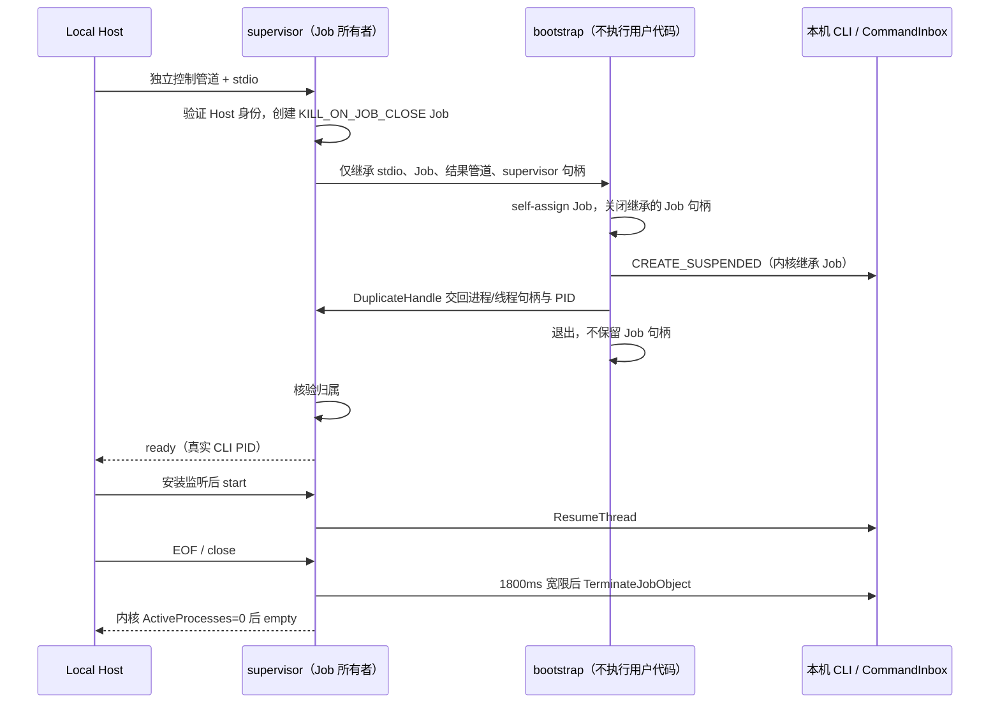

# Windows 7 SP1 x64 本地试验版

源码基线：`b95ebaffeab641907b38652f45c1502bd762972d`，ZCode `3.18.0`。规格日期：2026-11-11。

## 已确认的选择

用户选择社区移植运行时路线，接受兼容性与维护不确定性；必须在 Win7 本机读写项目、运行终端与 Agent。GitHub Actions 在现代 Windows 上构建，用户在自己的 Win7 SP1 x64 电脑安装验收。现代 Windows CI 通过不代表 Win7 验收通过。

保留 React、Tailwind、Node SQLite、现有 Host/Agent 和业务依赖。官方 Electron 23 起不支持 Win7；降级 Electron 22 会同时退回 Node 16 / Chromium 108，无法直接运行当前 ESM、`node:sqlite` 与 Tailwind 4。Tauri/WebView2 109 也不解决本机 Node 后端问题。[Electron 公告](https://www.electronjs.org/blog/windows-7-to-8-1-deprecation-notice)、[Node SQLite](https://nodejs.org/api/sqlite.html)、[Tailwind 浏览器要求](https://tailwindcss.com/docs/upgrade-guide)。

固定试验运行时，不修改现代版 Electron 44.7.0 与锁文件：

| 项       | 固定值                                                                                                                   |
| -------- | ------------------------------------------------------------------------------------------------------------------------ |
| 来源     | [e3kskoy7wqk/Electron-for-windows-7 v44.2.0](https://github.com/e3kskoy7wqk/Electron-for-windows-7/releases/tag/v44.2.0) |
| 上游提交 | `1086a0a7c6b7105f300a4af8724e6d996ce3c347`                                                                               |
| 运行时   | Electron 44.2.0 / Chromium 152.0.7977.76 / Node 24.20.0                                                                  |
| 发布资产 | `dist.zip`，win32-x64，158905110 字节                                                                                    |
| SHA-256  | `c50ba2c10c87331ab961f60569e4d906c8514921ac17e138fd0da21ee4ddb2b1`                                                       |

下载必须校验固定 SHA-256，禁止失败时回退到官方新运行时。社区声明是候选依据，实际依赖和机器兼容性仍须验证。[其他项目采用同一运行时的移植记录](https://github.com/factfinding/dsh-win7/blob/main/docs/porting.md)仅作参考，不算 ZCode 的测试证据。

## 产品规则与范围

1. 独立名称 `ZCode Win7 Experimental`、appId、安装目录与 Electron userData。默认业务目录为 `%USERPROFILE%/.zcode-win7-home/.zcode`，不导入正式版数据库。
2. 复用既有 `ZCODE_DESKTOP_HOME_DIR` / `ZCODE_DATA_BASE_DIR` 隔离机制；早期设置读取、默认工作区与设置服务必须使用同一隔离 home。保留操作系统 HOME/USERPROFILE，Git、SSH 等用户工具仍使用真实用户目录。
3. 编译期关闭自动更新；不发布到现代版更新源。产物是未签名试验 NSIS 安装器与 zip；每次手动测试升级，卸载不删除项目或业务数据。
4. 核心目标：打开工作区、文件编辑/搜索、模型对话/流式输出、工具审批/取消、本地终端、基本 Git、历史重启恢复。Windows 7 的 Git/外部 MCP/外部 shell 需由用户安装其兼容版本，包内 Agent 不依赖系统 Node。
5. 当前 `packages/zcode-cua` 明确为占位包，不恢复已删除的 Computer Use 实现。复杂浏览器预览和其他扩展只按实测声明支持。
6. 不关闭 TLS 校验、Chromium sandbox、权限检查或凭据保护来换取启动成功。

## 状态与平台边界

Main 仍负责窗口/转发，window-scoped Local Host 负责 owner/lease 与路由，CLI `CommandInbox` 负责串行 admission。`workspaceIdentity?.trim() || workspacePath`、remoteSessionId、stale run 防护不变。Desktop 连续流与手机 replayable 恢复语义不变；本次不修改协议、数据库 schema 或会话所有者。

### 终端

复用 node-pty 1.1.0 自带 WinPTY 预构建。Windows build < 18309 选择 `useConpty:false,useConptyDll:false` 并向 xterm 返回 `winpty`；现代 Windows 保持现有 ConPTY 与 DLL 加载失败回退。未知 build 按 node-pty 的 WinPTY 下限策略处理。分界来自锁定版本 node-pty 的实现；系统 [ConPTY 从 Windows 10 1809 引入](https://learn.microsoft.com/en-us/windows/console/createpseudoconsole)。WinPTY 文件必须随包解压部署。

### Agent 进程归属

Windows 10+ 保持 `PROC_THREAD_ATTRIBUTE_JOB_LIST` 创建时归组。Win7 不支持此属性，采用同一 helper 的短命 bootstrap 子进程，不能把普通 CLI spawn 后再 attach 当成安全实现。

bootstrap 在归组前崩溃不会创建 CLI；supervisor 在此时崩溃，bootstrap 归组并关闭最后一个 Job 句柄时被内核终止。归组之后所有后代从创建起就在 Job 中。supervisor 始终是唯一长期持有者，bootstrap 只是有限交接；不依赖 PID/PPID 枚举补杀。继承句柄用显式 HANDLE_LIST 限定，用户 CLI 只继承 stdio。

若 supervisor 已在其他 Job 中，Win7 bootstrap 必须通过 `CREATE_BREAKAWAY_FROM_JOB` 脱离；系统拒绝则明确失败，不以失去归属为代价回退。ready/start/close/root/empty 协议、幂等关闭、deadline 不释放归属等现有 TS 契约不变。现代 CI 使用单独的强制旧路径验收 binary，避免只验证 Win10 快路径。

## 修改覆盖面与验证

- 平台：`terminalService.ts` 的统一选择；native `main.cpp` / CMake、现有 native 与 Host acceptance。
- 隔离：打包入口与配置，早期数据设置和默认工作区读取；复用现有身份/路径 override。
- 分发：独立构建脚本、固定运行时清单、GitHub Actions；复用已有 runtime staging 与 builder 校验。
- 验证：工程脚本回归、native acceptance（现代及 legacy）、实际社区 Electron 下 SQLite/PTY/原生模块 smoke、打包构建、typecheck、lint、架构检查。不得新增已退役的 App 业务单测。
- 范围外：旧 Node/SQLite 驱动移植、UI 重写、新会话状态、已删除的内部服务、正式更新通道发布。

## Win7 真机验收清单（由用户执行）

安装前记录 `winver`、CPU、显卡、系统补丁、VC 运行库、Git 与 shell 版本。使用虚构文件与测试模型；日志不能包含凭据。

| 场景      | 合格标准                                                   |
| --------- | ---------------------------------------------------------- |
| 安装/启动 | 无系统 Node 时能打开窗口；错误保留完整诊断                 |
| 隔离      | 正式版数据不变，试验版重启读取自己的历史                   |
| 本地项目  | 中文/空格路径可打开、读写保存、搜索                        |
| Agent     | 流式对话；批准一次工具调用；拒绝一次；取消运行有效         |
| 输入时序  | running 时追加输入不重复执行、重启可恢复历史               |
| 终端      | 中文输出、输入、调整尺寸、Ctrl+C、关闭均正常               |
| Git       | 兼容 Git 的 status/diff 正确                               |
| 故障      | 强制结束 Host/helper 后所属 Agent/后代退出，不误杀其他程序 |
| 界面      | 编辑器、菜单、终端、差异页、明暗主题可用                   |
| 卸载      | 项目与业务数据保留                                         |

## 验证记录

基线 freshness 通过。已按 mise.toml 安装 Node 24.14.0 / pnpm 10.33.2 的冻结依赖；架构基线 0 违规。社区 zip 已在 macOS 下载并校验 SHA-256。实现、CI 结果与未通过项在交付时补录；这些准备步骤不构成 Win7 运行验证。
