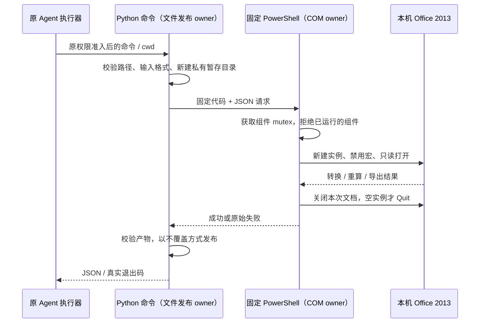

# Win7 / Office 2013 原生文档增强

日期：2026-11-12。用户确认目标 Win7 已安装 Microsoft Office 2013，Word、Excel、PowerPoint 都需要常用处理、旧格式转换和 PDF 导出。

## 范围与接口

复用随包 Python、四个既有 Office skill 和本机 Office COM。不增加 LibreOffice、pywin32、在线 MCP、服务进程或编辑器 UI，不把 Office 安装程序放入安装包。Office 需要已激活并完成首次启动。

随包入口：`python -B -X utf8 <offline-tools>/office_native.py <action> [input] [output]`。

| action  | 输入 → 输出                        | 契约                                                                                             |
| ------- | ---------------------------------- | ------------------------------------------------------------------------------------------------ |
| probe   | 无文件 → JSON                      | 只查三个 COM 类是否注册，不启动 Office；不等于转换验收                                           |
| convert | DOC/XLS/PPT → DOCX/XLSX/PPTX       | 使用对应原生组件；旧文件带 VBA 时拒绝转换为无宏格式                                              |
| pdf     | DOC/DOCX、XLS/XLSX、PPT/PPTX → PDF | Word/Excel/PowerPoint 原生导出；保留文档的打印范围/页面设置                                      |
| recalc  | XLSX → 新 XLSX                     | Excel CalculateFullRebuild，保存计算缓存；返回错误单元格计数和有限样本，不把重算成功当作公式正确 |

普通内容编辑、模板套用、批量生成仍用现有 Python 库，Office 原生操作完成转换、计算与最终导出。第三方 skill 不能替代实际计算/排版引擎；当前任务不再引入重复技能。

## 文件、进程与执行边界

- 输入必须是本机普通文件，默认只读打开；输出必须是不同的新路径，已存在时拒绝。工具先生成同一输出目录下的私有暂存文件，检查格式后才以不覆盖方式发布。失败不留下冒充成功的目标文件。
- 只处理所列格式，不接收任意 COM 方法、脚本、URL、密码或宏开关。不能以改后缀代替转换。加密、损坏、受保护文件保留 Office 原错误，不关闭 Protected View/组织策略来绕过。
- PowerShell 使用 Windows 自带 2.0 可用语法与 .NET 3.5 API；请求通过 UTF-8 JSON/Base64 传值，代码不拼接文件名。不改执行策略、注册表、系统 PATH 或文件关联。32 位 Office 的本机 COM 注册也应可被 64 位调用端发现，最终以实际启动验收为准。
- 同一用户会话、同一 Office 组件通过命名 mutex 拒绝并发；发现该组件已经运行则拒绝，并请用户保存关闭后再执行。只关闭本次打开的文档；只有集合为空才退出本次实例，禁止按进程名杀掉 Office。
- 打开前设置 AutomationSecurity=ForceDisable；Excel Open 显式 UpdateLinks=0，Word 禁用打开时的链接更新；不刷新外部数据，不执行文档 VBA。Excel 4.0 宏、加载项、外部数据源和企业插件不在承诺范围，复杂文件必须单独验收。
- 沿用 Agent 的命令审批与取消，不新增后台任务 owner。COM 调用可能被 Office 首次启动/加载项/密码弹窗阻塞；强制取消或进程崩溃后 Office 可能残留，不能保证 finally 执行，也不以盲杀进程解决。此时人工检查并关闭工具实例后重试。

工作区文件是唯一文档事实来源；不改变 Host、CommandInbox、workspaceIdentity、协议及桌面/手机流语义。构建仍由 prepare-offline-tools 复制整个离线目录，四个 skill 动态读取同一 office.md，因此无需更改插件版本或缓存 owner。

## 验收场景

| 场景                | 验证与边界                                                                                        |
| ------------------- | ------------------------------------------------------------------------------------------------- |
| 中文/空格/引号路径  | JSON 往返，固定脚本无代码注入，输出另存                                                           |
| 源文件/已有输出保护 | 相同路径、已有目标、错误扩展名拒绝；处理失败后无目标文件，原件摘要不变                            |
| 真实格式            | OOXML 必需项/PDF 签名验证，不接受空产物或改名的假文件                                             |
| 公式重算            | 新公式缓存可读；错误单元格如 #DIV/0! 明确报告；不依赖 openpyxl 计算                               |
| Office 缺失/已运行  | 明确失败，不自动安装、不接管已打开文件                                                            |
| Win7 / Office 2013  | 三类旧格式转换、三类 PDF、公式重算与进程退出，由目标机器运行验收；macOS 和无 Office CI 不能算通过 |

工程回归先于实现维护：Python unittest 覆盖文件提交/失败边界，Windows 无 Office 的探针检查注册信息和 PS 解析。固定虚构文档的 Office 真机检查单随 office.md 提供。不新增 App 业务单测。

## API 依据

- [Word ExportAsFixedFormat](https://learn.microsoft.com/en-us/office/vba/api/word.document.exportasfixedformat)
- [Excel CalculateFullRebuild](https://learn.microsoft.com/en-us/office/vba/api/excel.application.calculatefullrebuild)
- [Excel Workbooks.Open / UpdateLinks](https://learn.microsoft.com/en-us/office/vba/api/excel.workbooks.open)
- [PowerPoint SaveAs](https://learn.microsoft.com/en-us/office/vba/api/powerpoint.presentation.saveas)

## 直接试用工具包

工具 ZIP 是待真机验收的增量文件，不是新安装器，不包含 Microsoft Office 或 Python 运行时。

1. 保存并关闭 Office，退出 aibuddy7se。在原安装/便携目录找到 `resources/offline-tools`，先把其中的 `office.md` 备份到其他位置。
2. 将 ZIP 中的 `office_native.py`、`office_native.ps1`、`office.md` 复制到该目录；已有业务数据、模型配置、Python 和应用文件都不替换。
3. 重启 aibuddy7se 并开一个新对话。也可在应用终端执行 `python -B -X utf8 -c "import os; print(os.environ['ZCODE_OFFLINE_TOOLS'])"` 得到工具绝对路径，再运行 `python -B -X utf8 "<工具目录>\office_native.py" probe`。
4. 按 `office.md` 的三类文档验收清单操作。可在聊天中要求：“读取离线 Office 指南，用本机 Office 2013 把这份测试 DOC 转成 DOCX 并导出 PDF，保留原件。”注册检查成功不能代替真实转换。

撤销时删除本次增加的两个脚本，恢复备份的 office.md；不删除原有工具、项目或设置。

## 验证记录

- 已实现 Python 文件校验/不覆盖发布、固定 PS2 COM worker，更新现有离线 Office 指引；原 staging 会复制新增文件。Windows CI 增加脚本回归及成包 probe，完整离线包随附本指南；以对应 Actions 运行结果为成包验收记录。
- 本机工程回归 18 项通过：Office 文件保护/请求编码 7 项、Win7 和 Windows runtime host 工程 11 项；Windows PowerShell 注册探针 1 项因 macOS 跳过。该 probe 即使通过，也不能代表 Office 转换通过。
- 使用校验过官方 SHA-256 的 Node 24.14.0 和 pnpm 10.33.2 重跑：typecheck 通过；lint 为 0 错误、538 条原有警告。初次检查的本机默认工具链有偏差，因此以这次固定版本结果为准。架构检查 0 违规；修改文档/YAML 格式与 diff whitespace 检查通过。
- 尚未执行真实 Win7 / PS2 / Office 2013 转换、PDF、重算与 COM 生命周期验收；尚未生成新安装器。本次仅提供工具与集成源码，不将 API 依据或模拟文件回归当作 Office 真机结果。
