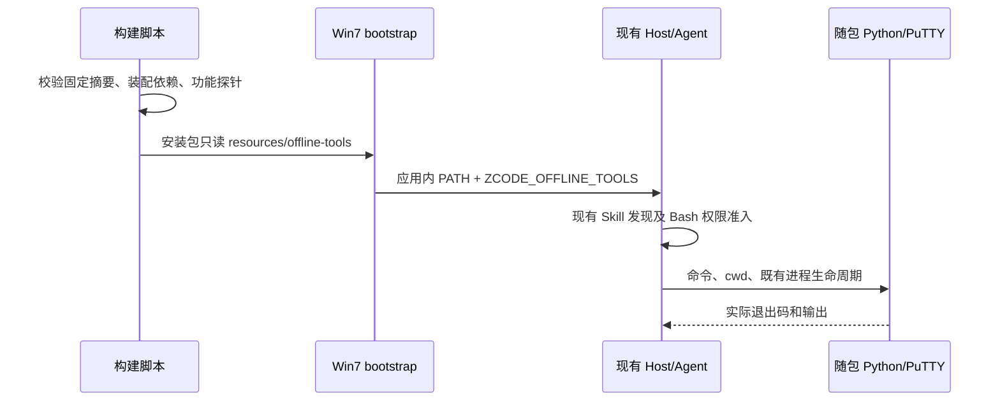

# Win7 内网离线工具包规格

## 产品范围

用户已选择 Win7 SP1 x64、本机 Agent、社区运行时和 GitHub Actions 打包，并要求内网离线部署、Office 编辑、SSH/SFTP、内置 Python 与常用技能。

2026-11-12 用户确认：模型连接内网已有 API，程序和依赖离线部署，安装包不包含模型权重。Office 优先 DOCX/XLSX/PPTX 内容编辑、表格处理和批量生成，不要求所见即所得编辑器；继续由 Agent 调用随包 Python 库处理，复用现有只读预览，无需本机 Office。旧二进制 DOC/XLS/PPT、宏执行、复杂版式保真、公式计算、Office→PDF 转换仍不作为已支持能力。

“离线部署”指安装、首次启动、内置技能和工具依赖不要求公网；模型和 SSH/SFTP 可以访问用户指定的内网地址。并非保证应用所有可选联网功能均无网络请求。公开市场、网页搜索、云登录等需要相应网络服务；自动升级及遥测编译端点在此版本关闭。

## 安装与首次使用

1. 在可联网的电脑下载 Actions artifact，解开外层压缩包后将全部文件拷入内网。包内 `.exe` 是安装器，内层 `.zip` 是可直接解压运行的程序，`SHA256SUMS.txt` 可核对文件完整性。
2. 先解开程序 ZIP，在 `resources/offline-tools/prerequisites` 找到系统前置包，按系统已有补丁情况安装。已检查随包 VS2019 安装器的 Burn 清单：46 个 payload 均为 embedded，其中包含 `Windows6.1-KB2999226-x64.msu`（UCRT），无需安装时在线下载；补丁适用性仍以目标 Win7 安装器结果为准。
3. 安装或直接运行 `ZCode Win7 Experimental.exe`。首次页面选「使用 API Key」→「跳过」，再关闭职业引导（右上角关闭或 Escape），即可进入工作区。
4. 在设置的模型供应商中新增内网服务，填写实际 Base URL、认证配置与模型名称，协议须与服务器匹配。安装包不含模型权重，接通模型前可使用终端及下述独立工具诊断。
5. 在应用终端执行 `python -B -X utf8 -c "import os,runpy; runpy.run_path(os.path.join(os.environ['ZCODE_OFFLINE_TOOLS'],'smoke.py'),run_name='__main__')"`（兼容 CMD/PowerShell/Git Bash）。应显示 PASS，覆盖 Word/Excel/PPTX 内容编辑及原件不变、PDF、图片与常用数据格式。再执行 `plink.exe -V`、`psftp.exe -V` 确认工具可运行。
6. 用测试文档和测试 Linux 账号验收聊天中的 `docx` / `xlsx` / `pptx` / `pdf`、`ssh-sftp`、`offline-toolkit`。SSH 首连先向服务器管理员核实主机指纹；私钥和密码留在本机，不粘贴到模型消息中。

Office 编辑由 Agent 调用本机库完成，预览面板仍为只读，不提供类似 Word 的所见即所得编辑界面。Git 未随包提供，需要时另行准备 Win7 兼容版本。启动失败的独立诊断和日志位置见 [Win7 真机验收清单](windows-7-local-compatibility.md#win7-真机验收清单由用户执行)。

## 构建与执行契约

- `scripts/win7/offline-runtime.json` 是工具版本、来源及 SHA-256 的唯一清单，也锁定 Python wheels 的完整传递依赖；构建下载校验，安装端不下载。
- Python 采用 PythonVista 的 3.11 x64 嵌入发行版；Office 使用 python-docx、openpyxl、python-pptx、lxml、Pillow，PDF 使用 pypdf/ReportLab；CSV/JSON/SQLite/ZIP/哈希由标准库处理，附 requests/PyYAML。
- SSH/SFTP 使用官方 PuTTY 便携发行版（Plink/PSFTP/PSCP/PuTTY/Pageant/PuTTYgen），不要求远端安装 ZCode。既有“远程工作区”仍有自己的 Server 资产部署前提，不能以 SSH 客户端通过代替它的验收。
- 资产放在 `resources/offline-tools`。Win7 bootstrap 在导入 Main 前将 Python 和 PuTTY 目录加入**当前应用进程** PATH，提供 `ZCODE_OFFLINE_TOOLS` 指向只读资源目录；Agent/终端通过现有进程环境继承。Windows PATH 大小写键归一到既有键，保留原路径；系统 PATH/HOME/USERPROFILE 不写入。
- Python 的 `._pth` 固定 stdlib、解释器目录、随包 `Lib/site-packages`，不读取用户 site-packages；技能命令使用 `-B -X utf8`，禁止 pip 联网。普通用户不需要向安装目录写缓存。
- 原版 Win7 SP1 可能缺少 Python 需要的 KB2533623/KB3063858 和 UCRT。离线包携带微软 KB3063858 x64 与 VS2019 VC++ x64 原安装器；管理员按说明手动安装并重启，不自动提权/自动改系统。
- Office 插件技能先检查 `ZCODE_OFFLINE_TOOLS`，存在时按随包 Office 指南执行，不运行原来的在线依赖安装脚本；不存在时保持原有指南。插件升级遵守 package/manifest/bootstrap/SEA 同版本契约。
- Win7 专用常用技能随既有 bundled-skills 目录 staging，由原发现器读取；不新增技能缓存、配置 owner 或工具权限通道。
- 修改文档默认另存副本，重读验证；不静默丢失原格式、公式、宏或覆盖源文件。SSH 首连指纹必须从管理员可信来源确认；自动化用 `-batch -hostkey`，错误指纹必须拒绝。密码不写命令行/日志，交互输入或使用用户密钥/Pageant。

无新会话状态。文档事实归工作区文件，远端文件归服务器；权限、owner/lease、任务恢复及 desktop-continuous/mobile-replayable 交付保持既有实现。不会从技能直接绕过执行器。

## 影响扫描

| 项目 | 结论 |
| --- | --- |
| 意图/能力 | 离线部署、Office 编辑、SSH/SFTP、本机 Python |
| 改动层/模式 | 构建资产、运行环境、技能指令；planning→implementation |
| 主要种子 | Win7 build/bootstrap、Office SKILL.md、official-plugin-definitions、bundled-skills、prepare-agent-node-bundle |
| 范围之外 | 新编辑器 UI、模型权重、Linux Server 离线全量资产、全平台 Python 替换 |

### UI Surface Matrix

| 场景/入口 | 共享实现 | 草稿/默认来源 | 校验/提交 | 权威持久化 | 模式隔离 |
| --- | --- | --- | --- | --- | --- |
| 聊天中编辑 Office | 既有 Skill→Bash；既有文档查看器 | 用户提示、插件技能 | 执行权限、随包 Python、另存验证 | 工作区文件 | 查看器不写文件；现代版无工具路径覆盖 |
| 终端/聊天 SSH/SFTP | 既有终端/Bash→PuTTY | 用户提供地址与密钥/指纹 | SSH 主机校验、服务器权限 | 远端文件；PuTTY 用户配置 | 不启动远端 Agent，不修改远端 workspace identity |
| 内网模型设置 | 既有模型配置 UI/服务 | 用户选择 API endpoint | 既有 provider 校验 | 既有设置/凭据 owner | 不要求云账户；不内置凭据 |

### Shared And Divergent Behavior

| 关注项 | 共享 | 差异及理由 |
| --- | --- | --- |
| UI/选项来源 | 原聊天、终端、文档预览、模型设置 | 无新增 UI/写入入口 |
| 默认/校验 | 原权限、文件读写、SSH 验证 | Win7 应用 PATH 优先使用随包工具 |
| 提交/恢复 | 原进程及会话生命周期 | 工具资产随安装升级，不存为会话事实 |

### Feature Relationships / Owners

| 级别/关系 | owner 与写入点 | 证据 |
| --- | --- | --- |
| must-inspect Office→执行依赖 | 构建脚本拥有只读资产；Agent 执行器拥有命令 | document-skills-plugin.md、Office SKILL.md |
| must-inspect 技能发现→缓存升级 | bootstrap 官方 seed；版本是 filesystem 缓存身份 | bundled-plugins.ts:isSeedCurrent |
| must-inspect desktop→进程环境 | Win7 bootstrap 唯一设置应用路径 | win7-environment.mjs；Host 原环境继承 |
| invariant-only 远程工作区 | 原远程连接、LocalEnvironment、workspaceIdentity owner | remoteAssetInstaller.ts；ssh-backend.ts |
| evidence-only 登录/内网 API | 原 provider 可用性 owner | useProviderAvailabilityLoginEntryGuard.ts |

### Must-Preserve Invariants

| 不变量 | 验证 |
| --- | --- |
| 不覆盖系统 Python/HOME/PATH | 工程环境测试 |
| 不安装时下载/不破坏源文档 | 打包后的 Python CRUD/原件摘要验证，pip no-index |
| 不接受错误 SSH 主机 | 回环 SSH 服务 + 错误指纹拒绝 + SFTP 往返 |
| 正式版及缓存升级一致 | 插件版本工程检查；Win7 独立数据目录 |
| Win7 支持不由现代 CI 推断 | PE 静态导入筛查 + 用户 Win7 真机验收 |

### Codegraph Evidence

本会话没有可用 codegraph 工具/索引。使用受控上下文和定向 `rg` 追踪两跳：build→desktop staging→官方插件，bootstrap→环境→Host 继承，Skill→Bash→平台 shell，官方插件→seed marker。未声称完成全图扫描。`architecture:check --changed` 基线 0 违规；desktop/zcode-cli 当前未受完整架构模块治理，检查不能证明运行时正确性。

### Graph Drift / Delta

已确认 Office 能力节点关联本规格；没有新增业务状态 owner/写入关系。图校验发现基线已有两个悬空端点 `persistence.desktop-user-data-root`、`capability.mcp-oauth-authorization`，与 HEAD 比较无新增回归。Office 文档引用存在；没有新增代码种子，可用索引缺席，未声称全图种子验证通过。

### 已确认决策（2026-11-12）

| 问题 | 用户确认/实现范围 | owner |
| --- | --- | --- |
| Office 编辑方式 | 优先内容编辑、表格处理和批量生成；不要求所见即所得，使用已有随包 Python 与 Office 技能 | 用户 |
| 模型部署位置 | 连接内网已有模型 API；程序及依赖离线部署，不内置模型权重 | 用户 |

## 验收目录与交付

2026-11-11 最终交付：提交 `6f555881e4534f96e9cdd6baba3cda4a6d9a3d83` 的 [Actions 42992194931](https://github.com/skyjt/ZCode_custom/actions/runs/42992194931) 全部通过。[下载离线试验包](https://github.com/skyjt/ZCode_custom/actions/runs/42992194931/artifacts/13843692034)（566,723,029 bytes，保留至 2026-11-25），包含 `ZCode-Win7-Offline-Experimental-3.18.0-x64.exe`、程序 ZIP、指南、版本与 SHA-256 清单。外层 artifact SHA-256：`92f582975bf898c1952445927745f2e528048ad4c34b3255e1f4d0039f6b3c42`。

Windows Server 2022 CI 已实际执行：工程回归、现代/强制 Win7 Job 归属、SQLite/WinPTY/双 keyring/中文搜索、成品 Agent 迁移与隔离、原生导入筛查、随包 Python 文档及数据操作、SSH 命令/错误指纹拒绝/SFTP 文件往返、六个离线技能加载、断网 GUI 初始化并跳过登录/关闭职业引导进入工作区。已复查 `startup.png`、`startup.json`、`firewall.json`；全部防火墙 profile 启用，Agent 路径为成品 `resources/glm/zcode.cjs`。[诊断产物](https://github.com/skyjt/ZCode_custom/actions/runs/42992194931/artifacts/13843104105)与安装包同为 14 天保留。

本地 root 与 CLI 类型检查、Lint 通过，保留存量告警（root 538、CLI 86）；最新工程探针 9 项、CLI 插件/技能回归 62 项通过，完整 pre-push 门禁通过。affected engineering 因既有策略选中全套 169/169 而跳过，不能算全量业务/工程测试通过。**Win7 SP1 x64 真机、真实内网模型、真实 Linux 服务、Office 预览的视觉结果仍未验收**；CI 结果不等于 Win7 已验证兼容。

| ID | 场景 | 执行方式/期望 |
| --- | --- | --- |
| OFF-01 | 摘要损坏/依赖缺失 | 构建立即失败，不能产出缺件包 |
| OFF-02 | 无系统 Python 的干净目录、中文路径 | 从打包资源启动 Python，导入全部依赖；无联网安装 |
| OFF-03 | DOCX/XLSX/PPTX 创建→改副本→重读 | 内容准确，原件摘要保持，公式文本保留 |
| OFF-04 | PDF/CSV/JSON/ZIP/SQLite | 随包库/标准库运行，PDF 写后可读取 |
| OFF-05 | SSH/SFTP | 本地 fixture 服务真实协议验证 exec、文件往返，错误主机指纹失败 |
| OFF-06 | 内置技能/Office 面板 | Agent 能列出离线技能；Office 技能进入离线分支；预览原产物可用 |
| OFF-07 | 断公网启动及内网模型 | CI 确认防火墙服务与全部 profile 已启用，再阻断成品出站，等初始化退出，经 API Key→跳过进入工作区 sidebar，登录层须消失；不能只认初始化页面文字或仅创建未生效的防火墙规则。用户填内网 API 后再验对话/工具调用 |
| OFF-08 | Win7 安装和终端 | 用户真机安装、Python/Office、SSH/SFTP；保留诊断与退出码 |
| OFF-09 | 表格处理与批量生成 | 用户在 Win7 接通内网模型后，用虚构的多行表格驱动多份 DOCX/PPTX 生成并输出 XLSX 汇总；核对数量、文件名、逐行内容和原件摘要。该端到端场景尚未验收，不由单文件库探针通过推断 |

无需新增交互 E2E：复用原 UI；新增工程打包探针在最终产物上运行。覆盖矩阵如上；用户确认继续采用内容编辑和内网 API 路线，完整办公引擎与本地模型权重不在本次范围。构建信息、版本/摘要、许可和测试指南一起交付。实际验证结果记录在本节下方，现代 Windows CI 与 Win7 实测分开。

首次离线 CI（42987122328）在 Python 探针清理目录时暴露 Windows 句柄问题：sqlite3 连接上下文只处理事务、不关闭数据库，导致 WinError 32。探针改用显式 closing，同时释放 Pillow 图片句柄；仍要求临时目录成功清理。requests 对自动解析到的 chardet 7 发出版本警告，传递依赖改为锁定兼容的 chardet 5.2.0。

第二次离线 CI（42987705890）已通过打包、Python 文档探针和原生运行时检查；SFTP fixture 超时，尚未通过。GUI 已完成初始化和 API Key 跳过，但首次使用还有职业引导，探针应通过既有关闭入口退出后再检查工作区。探针从临时目录启动，防止源码仓库 cwd 让 Agent resolver 误用构建树；失败时保留页面文字和截图。

同版本 PuTTY 0.85 本地复现定位：SFTP 数据已传完，客户端发送 CHANNEL_EOF 后等待服务器关闭，而 fixture 未处理 SFTP `end` 事件。fixture 收到 EOF 后调用既有 `sftp.end()` 完成关闭，不改客户端、不放宽超时；文件字节核对和错误指纹拒绝仍是必过项。

构建 42990936964 两次在 pnpm hoisted 依赖链接阶段出现 `_tmp_* → esbuild` 的 ENOENT。上游分别记录了 [patch chdir 与 worker 相对路径竞态](https://github.com/pnpm/pnpm/pull/13646)和 [父子目录并发替换竞态](https://github.com/pnpm/pnpm/issues/12880)，本次日志不足以区分具体触发者。Win7 CI 保持 pnpm 10.33.2 与锁文件，安装前仅对 CI 的 pnpm 应用上游绝对目标路径修正，并用其已有 `PNPM_MAX_WORKERS=1` 串行化文件 worker；严格检查版本和替换位置，陌生源码失败，不吞掉安装错误或循环重试。此修正不进入安装包、不修改开发者全局 pnpm，升级构建 pnpm 后应移除。

## Python 优先与 PowerShell 2.0

Win7 的模型环境增加简短 Python 指引，详细配方按需加载 offline-toolkit，避免逐轮重复。系统采样、关联程序查询及 Hook 锁恢复移除 PS3+/.NET4 专用语法，保留原系统接口与权限；不新增 Python 服务或解释器。范围、验收和真机边界见 [Python 操作规格](windows-7-python-operations.md)。

2026-11-12 交付更新：`78b36139` 的 [Actions 43136043699](https://github.com/skyjt/ZCode_custom/actions/runs/43136043699) 全部通过。[新版离线试验包](https://github.com/skyjt/ZCode_custom/actions/runs/43136043699/artifacts/13907659218)替代上述 2026-11-11 交付，保留至 2026-11-26；大小、摘要和新增验收见 [验证记录](windows-7-python-operations.md#验证记录2026-11-12)。
