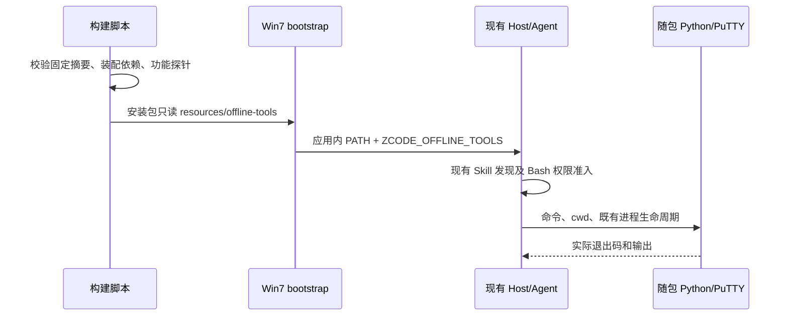

# Win7 内网离线工具包规格

## 产品范围

用户已选择 Win7 SP1 x64、本机 Agent、社区运行时和 GitHub Actions 打包，并要求内网离线部署、Office 编辑、SSH/SFTP、内置 Python 与常用技能。

首版默认连接用户配置的内网模型 API；模型权重不包含在安装包内。Office 首先提供 DOCX/XLSX/PPTX 的创建、读取、内容修改以及现有只读预览；旧二进制 DOC/XLS/PPT、宏执行、复杂版式保真、公式计算、Office→PDF 转换不冒充已支持。是否需要独立办公引擎仍待用户选择。

“离线部署”指安装、首次启动、内置技能和工具依赖不要求公网；模型和 SSH/SFTP 可以访问用户指定的内网地址。并非保证应用所有可选联网功能均无网络请求。公开市场、网页搜索、云登录等需要相应网络服务；自动升级及遥测编译端点在此版本关闭。

## 构建与执行契约

- `scripts/win7/offline-runtime.json` 是工具版本、来源及 SHA-256 的唯一清单，也锁定 Python wheels 的完整传递依赖；构建下载校验，安装端不下载。
- Python 采用 PythonVista 的 3.11 x64 嵌入发行版；Office 使用 python-docx、openpyxl、python-pptx、lxml、Pillow，PDF 使用 pypdf/ReportLab；CSV/JSON/SQLite/ZIP/哈希由标准库处理，附 requests/PyYAML。
- SSH/SFTP 使用官方 PuTTY 便携发行版（Plink/PSFTP/PSCP/PuTTY/Pageant/PuTTYgen），不要求远端安装 ZCode。既有“远程工作区”仍有自己的 Server 资产部署前提，不能以 SSH 客户端通过代替它的验收。
- 资产放在 `resources/offline-tools`。Win7 bootstrap 在导入 Main 前将 Python 和 PuTTY 目录加入**当前应用进程** PATH，提供 `ZCODE_OFFLINE_TOOLS` 指向只读资源目录；Agent/终端通过现有进程环境继承。Windows PATH 大小写键归一到既有键，保留原路径；系统 PATH/HOME/USERPROFILE 不写入。
- Python 的 `._pth` 固定 stdlib、解释器目录、随包 `Lib/site-packages`，不读取用户 site-packages；技能命令使用 `-B -X utf8`，禁止 pip 联网。普通用户不需要向安装目录写缓存。
- 原版 Win7 SP1 可能缺少 Python 需要的 KB2533623/KB3063858 和 UCRT。离线包携带微软 KB3063858 x64 与 VS2019 VC++ x64 原安装器；管理员按说明手动安装并重启，不自动提权/自动改系统。
- Office 插件技能先检查 `ZCODE_OFFLINE_TOOLS`，存在时按随包 Office 指南执行，不运行原来的在线依赖安装脚本；不存在时保持原有指南。插件升级遵守 package/manifest/bootstrap/SEA 同版本契约。
- Win7 专用常用技能随既有 bundled-skills 目录 staging，由原发现器读取；不新增技能缓存、配置 owner 或工具权限通道。
- 修改文档默认另存副本，重读验证；不静默丢失原格式、公式、宏或覆盖源文件。SSH 首连指纹必须从管理员可信来源确认；自动化用 `-batch -hostkey`，错误指纹必须拒绝。密码不写命令行/日志，交互输入或使用用户密钥/Pageant。

无新会话状态。文档事实归工作区文件，远端文件归服务器；权限、owner/lease、任务恢复及 desktop-continuous/mobile-replayable 交付保持既有实现。不会从技能直接绕过执行器。

## 影响扫描

| 项目 | 结论 |
| --- | --- |
| 意图/能力 | 离线部署、Office 编辑、SSH/SFTP、本机 Python |
| 改动层/模式 | 构建资产、运行环境、技能指令；planning→implementation |
| 主要种子 | Win7 build/bootstrap、Office SKILL.md、official-plugin-definitions、bundled-skills、prepare-agent-node-bundle |
| 范围之外 | 新编辑器 UI、模型权重、Linux Server 离线全量资产、全平台 Python 替换 |

### UI Surface Matrix

| 场景/入口 | 共享实现 | 草稿/默认来源 | 校验/提交 | 权威持久化 | 模式隔离 |
| --- | --- | --- | --- | --- | --- |
| 聊天中编辑 Office | 既有 Skill→Bash；既有文档查看器 | 用户提示、插件技能 | 执行权限、随包 Python、另存验证 | 工作区文件 | 查看器不写文件；现代版无工具路径覆盖 |
| 终端/聊天 SSH/SFTP | 既有终端/Bash→PuTTY | 用户提供地址与密钥/指纹 | SSH 主机校验、服务器权限 | 远端文件；PuTTY 用户配置 | 不启动远端 Agent，不修改远端 workspace identity |
| 内网模型设置 | 既有模型配置 UI/服务 | 用户选择 API endpoint | 既有 provider 校验 | 既有设置/凭据 owner | 不要求云账户；不内置凭据 |

### Shared And Divergent Behavior

| 关注项 | 共享 | 差异及理由 |
| --- | --- | --- |
| UI/选项来源 | 原聊天、终端、文档预览、模型设置 | 无新增 UI/写入入口 |
| 默认/校验 | 原权限、文件读写、SSH 验证 | Win7 应用 PATH 优先使用随包工具 |
| 提交/恢复 | 原进程及会话生命周期 | 工具资产随安装升级，不存为会话事实 |

### Feature Relationships / Owners

| 级别/关系 | owner 与写入点 | 证据 |
| --- | --- | --- |
| must-inspect Office→执行依赖 | 构建脚本拥有只读资产；Agent 执行器拥有命令 | document-skills-plugin.md、Office SKILL.md |
| must-inspect 技能发现→缓存升级 | bootstrap 官方 seed；版本是 filesystem 缓存身份 | bundled-plugins.ts:isSeedCurrent |
| must-inspect desktop→进程环境 | Win7 bootstrap 唯一设置应用路径 | win7-environment.mjs；Host 原环境继承 |
| invariant-only 远程工作区 | 原远程连接、LocalEnvironment、workspaceIdentity owner | remoteAssetInstaller.ts；ssh-backend.ts |
| evidence-only 登录/内网 API | 原 provider 可用性 owner | useProviderAvailabilityLoginEntryGuard.ts |

### Must-Preserve Invariants

| 不变量 | 验证 |
| --- | --- |
| 不覆盖系统 Python/HOME/PATH | 工程环境测试 |
| 不安装时下载/不破坏源文档 | 打包后的 Python CRUD/原件摘要验证，pip no-index |
| 不接受错误 SSH 主机 | 回环 SSH 服务 + 错误指纹拒绝 + SFTP 往返 |
| 正式版及缓存升级一致 | 插件版本工程检查；Win7 独立数据目录 |
| Win7 支持不由现代 CI 推断 | PE 静态导入筛查 + 用户 Win7 真机验收 |

### Codegraph Evidence

本会话没有可用 codegraph 工具/索引。使用受控上下文和定向 `rg` 追踪两跳：build→desktop staging→官方插件，bootstrap→环境→Host 继承，Skill→Bash→平台 shell，官方插件→seed marker。未声称完成全图扫描。`architecture:check --changed` 基线 0 违规；desktop/zcode-cli 当前未受完整架构模块治理，检查不能证明运行时正确性。

### Graph Drift / Delta

已确认 Office 能力节点关联本规格；没有新增业务状态 owner/写入关系。图校验发现基线已有两个悬空端点 `persistence.desktop-user-data-root`、`capability.mcp-oauth-authorization`，与 HEAD 比较无新增回归。Office 文档引用存在；没有新增代码种子，可用索引缺席，未声称全图种子验证通过。

### 未决事项

| 问题 | 当前假设/影响 | owner |
| --- | --- | --- |
| Office 是否需要复杂排版/PDF/公式重算 | 首版内容编辑；完整转换需额外兼容办公引擎 | 用户 |
| 模型是否也要 Win7 本机离线运行 | 首版用户配置内网 API，无内置权重 | 用户 |

## 验收目录与交付

| ID | 场景 | 执行方式/期望 |
| --- | --- | --- |
| OFF-01 | 摘要损坏/依赖缺失 | 构建立即失败，不能产出缺件包 |
| OFF-02 | 无系统 Python 的干净目录、中文路径 | 从打包资源启动 Python，导入全部依赖；无联网安装 |
| OFF-03 | DOCX/XLSX/PPTX 创建→改副本→重读 | 内容准确，原件摘要保持，公式文本保留 |
| OFF-04 | PDF/CSV/JSON/ZIP/SQLite | 随包库/标准库运行，PDF 写后可读取 |
| OFF-05 | SSH/SFTP | 本地 fixture 服务真实协议验证 exec、文件往返，错误主机指纹失败 |
| OFF-06 | 内置技能/Office 面板 | Agent 能列出离线技能；Office 技能进入离线分支；预览原产物可用 |
| OFF-07 | 断公网启动及内网模型 | CI 隔离公网的启动检查；用户填内网 API 后对话/工具调用 |
| OFF-08 | Win7 安装和终端 | 用户真机安装、Python/Office、SSH/SFTP；保留诊断与退出码 |

无需新增交互 E2E：复用原 UI；新增工程打包探针在最终产物上运行。覆盖矩阵如上；复杂 Office/本地模型列入决策待办，不作为已完成能力。构建信息、版本/摘要、许可和测试指南一起交付。实际验证结果记录在本节下方，现代 Windows CI 与 Win7 实测分开。
