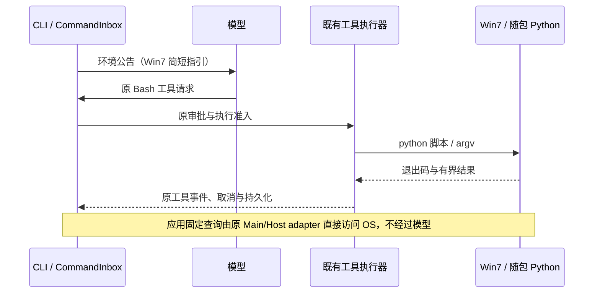

# Win7 Python 优先操作与系统调用兼容

日期：2026-11-12。用户确认同时处理 Agent 指令和应用内部兼容调用，保留 Win7 SP1 x64 / PowerShell 2.0，复用已有随包 Python，不增加模型权重、解释器或第三方依赖。

## Feature Summary

| 项            | 决定                                                                                                               |
| ------------- | ------------------------------------------------------------------------------------------------------------------ |
| 改动层 / 模式 | 执行环境指引、系统查询 / planning → implementation                                                                 |
| 主要种子      | core/context/sections/env-info.ts、offline-toolkit、services/process、file-open-apps、workspace-hook-trust-store   |
| 实现边界      | Agent 对适合 Python 的工作使用 Python；确定性的应用查询继续直接调用 Win7 已有 WMI/.NET/Shell API，不经模型生成脚本 |
| 范围外        | 通用 PowerShell 转译器、新工具协议、UI 重做、终端替换、Python 服务进程、打包瘦身                                   |

## 产品规则与接口

1. 模型环境公告识别 `platform=win32` 且 OS release 为 `6.1.*`，增加一小段 Python 优先说明：先用现有专用工具；复杂文件/结构化数据/Office 任务先确认 `ZCODE_OFFLINE_TOOLS`，使用随包 `python -B -X utf8`。不宣称普通 Win7 用户一定安装了 Python。仍使用真实 shell 字段，不把 Bash 工具或终端错误标为 Python。
2. 说明复用现有环境公告生命周期，新环境块才追加；相同环境不在每轮重复注入。详细配方放入 Win7 独有 offline-toolkit 技能，按需读取；已有历史不重写，无新增持久字段。macOS/Linux/现代 Windows 的公告不变。
3. Agent 先写 `.py` 再调用，避免 PowerShell 3+ 命令、Bash heredoc、CMD/PowerShell 环境变量混用。外部程序使用参数数组、`shell=False`、检查退出码，保持现有审批、取消、目录和输出限制；批量操作输出摘要而非全部内容。下载材料继续遵守既有 `-I` 隔离规则。
4. 应用调用的是 Windows 自带 `powershell.exe`（不是 pwsh）：进程读取使用 PS2/PS5.1 都提供的 Get-WmiObject；WMI CreationDate 转换到 UTC ticks 后交给既有解析器。CPU 两项数值显式相加；查询失败、超时、取消以及 PID 重用保护保持原契约，不以空身份强杀进程。
5. 文件关联仍由现有 Shell COM 接口枚举与启动，保留不透明 ID、重查、图标限制和只读查询；移除 C#4 可选参数、.NET4 IsNullOrWhiteSpace 和 PS3 ConvertTo-Json 依赖，使用 Win7 随系统 .NET3.5 的 JavaScriptSerializer。安装资源查询输出明确字段的 Hashtable 数组，不序列化 WMI/PSObject 包装器。
6. Hook 陈旧锁仍由原 trust-store owner 回收，使用 PS2 可执行的 UTC DateTime 差值计算 Unix 毫秒；无法核实进程身份仍保守不回收。锁内本进程身份必须来自 `process.uptime()`，不能使用 `os.uptime()` 的系统开机时间，否则外部进程会把活锁误判为 PID 已复用；验证真实活 owner 超龄后仍不能被回收。
7. 修正文档中的终端命令：使用 CMD/PowerShell 都能运行的 `python -B -X utf8 -c "import os,runpy; runpy.run_path(os.path.join(os.environ['ZCODE_OFFLINE_TOOLS'],'smoke.py'),run_name='__main__')"`，不要求用户升级 PowerShell。

## UI Surface Matrix / Shared And Divergent Behavior

| 场景 / 入口               | 共享实现 / 草稿               | 校验与提交                           | 权威 owner / 持久化              | 模式与隔离                                                       |
| ------------------------- | ----------------------------- | ------------------------------------ | -------------------------------- | ---------------------------------------------------------------- |
| 聊天、子代理里的脚本操作  | 既有 Environment 公告 / Skill | 原 Bash 执行审批、超时、取消         | 原 CLI CommandInbox / 工作区文件 | 环境取实际执行端；手机连接既有 Host；远端 Linux 不继承 Win7 建议 |
| 资源管理器 / 进程清理     | Host 采样、进程身份解析       | 原 signal/deadline、UTC 创建时间校验 | OS 进程事实；原在途查询缓存      | 无新增 UI 或 Main 采样；不能按裸 PID 清理                        |
| 系统打开方式 / 浏览器发现 | 原 Main native adapter        | 真本机文件、系统关联重查             | Windows Shell/WMI；无新缓存      | 本地能力；远端身份拒绝规则不变                                   |
| Hook 信任恢复             | trust-store                   | owner token、PID + 启动时间          | 原锁与 trust 文件                | 不新增写入路径，不放宽信任                                       |

## Feature Relationships / State Owners And Commit Sinks

| 级别 / 关系                     | 所有者与证据                                                                                              |
| ------------------------------- | --------------------------------------------------------------------------------------------------------- |
| must-inspect 环境→工具执行      | context env-info → runtime/subagent context；真实 shell 仍来自 session-shell-environment                  |
| must-inspect 采样/清理→系统查询 | processResourceSampler、processTreeSnapshot、windowsProcessListAsync；不改变归属判定                      |
| must-inspect 文件入口→关联查询  | file-open-apps/native → windows script → Shell COM；chromeProfileDiscovery 复用 chromeExecutableDiscovery |
| must-inspect 锁恢复→身份查询    | workspace-hook-trust-store 的 removeStaleLock / probeProcessStartTimeDefault                              |
| invariant-only 桌面/手机/远端   | 原 owner/lease、workspaceIdentity、continuous/replayable 不变，无协议或数据库迁移                         |
| evidence-only 现代 Windows CI   | 可重复脚本验证真实 WMI/序列化/进程；不能证明 PS2 或 Win7 真机已运行                                       |

## Must-Preserve Invariants / Codegraph Evidence

未提供 codegraph 索引工具；用定向 rg 核对上述种子的直接调用方与两跳执行边界。已读取 file-open-apps 和 resource-manager 的受控上下文；原其它进程文件不在完整模块治理范围内。所有者、持久化、权限、TLS、SSH 指纹、PID 身份校验和失败关闭行为均不变。无新增工具 schema、env var 或业务状态。

## Graph Drift Candidates / Graph Delta

已有 Office 节点覆盖离线工具，未明确记录本次 Python 优先与 PS2 系统查询边界；增加对应能力节点、code seeds 与本文档引用。已知基线悬空节点不在本次范围。

## Clarification Log / Boundary Decisions

用户已选择“同时处理 Agent 指令和应用内部兼容调用”。Python 用于 Agent 任务；固定的 WMI/Shell 调用通过兼容已有系统接口完成，不为每个查询新增模型交互。没有未决产品问题。

## Dimensions / Candidate Combinations / Pruning Decisions

覆盖 Win7 / 现代 Windows / 非 Windows，首次环境 / 相同环境 / 环境变更，系统查询成功 / 空结果 / 失败，单行 / 多行 / 中文与引号，真实 PID / 已重用 PID。剪枝：无需枚举模型品牌、手机布局、主题，它们不改变这些 adapter 的执行语义；不新增交互入口。

## Accepted Cases / Matrix Backfill / Planning Handoff

| ID      | 设置与操作                                               | 验收                                                                               | 证据                    |
| ------- | -------------------------------------------------------- | ---------------------------------------------------------------------------------- | ----------------------- |
| PY-01   | Win7 环境组装与重复公告                                  | 包含 Python/原审批规则；重复无新公告；非 Win7 无新指引                             | CLI 单测                |
| PY-02   | 随包 Python 运行含中文路径的文件/JSON/哈希/ZIP/argv 配方 | 输出与字节正确；退出码失败被保留；不联网安装                                       | offline smoke           |
| PS-01   | 真实 Windows WMI 采样与身份查询                          | 能找到当前进程，时间/内存/CPU为正确数值；deadline 与身份保护沿用                   | 工程运行时探针          |
| PS-02   | 系统文件关联脚本                                         | JSON 结构正确、空列表与单项保持数组，Unicode/引号/反斜杠往返；原 native 调用可执行 | 工程运行时探针          |
| PS-03   | 安装资源查询 / Hook 锁                                   | 实际进程匹配、启动时间可得、原锁回收回归通过                                       | Windows 探针 + CLI 测试 |
| PS-04   | 缺失/不可访问系统事实                                    | 原调用方报告失败或空事实，不绕过权限/身份                                          | 既有边界与 CLI 回归     |
| ENV-01  | 本地校验与现代 CI                                        | root/CLI typecheck、lint、相关工程及 CLI 测试、架构检查通过并记录告警              | 实际命令日志            |
| WIN7-01 | 真 Win7 SP1 x64 / PS2 / .NET3.5                          | 启动、上述操作、Office 与内网模型任务实际可用                                      | 待真机，不由 CI 推断    |

本文即本次 case catalog / coverage matrix；工程探针先于实现维护，无新增 UI 交互，不新增或恢复 App 业务单测。Windows CI 的 PS5.1 运行与静态旧 API 限制不能替代 Win7/PS2 的最终验收。

## 验证记录（2026-11-12）

实现与验收脚本提交：`78b3613945a39a85019aa3e399b570937b45f39d`。环境指引新增 437 个英文字符，仅通过既有环境公告追加，未增加 Python 运行时、依赖或模型权重。

- Node 24.14.0 / pnpm 10.33.2：root typecheck、CLI typecheck（34/34 tasks）、架构检查通过。root lint 为 0 errors / 538 warnings；CLI lint 为 0 errors / 86 warnings，另有 4 项原样上游行数诊断。本次未修改 React 组件。
- 实际执行 CLI 回归 138 项：环境与 context builder 54、环境公告 68、Hook trust store 与锁归属 16；工程回归 9 项。pre-push 门禁通过，受影响工程测试选择为 0/169，不能称为全量工程测试通过。
- 环境指引测试先失败后通过。锁元数据回归先复现启动时间相差约 16 天：原代码使用系统 uptime；改用进程 uptime 后通过。Windows 探针额外使用真实子进程持锁，验证超龄活锁不被回收，错误启动时间的旧锁可以回收。
- 首轮 CI 的探针依赖尚未生成的 CLI contracts dist；修复为从公开源码入口打包。该失败发生在新探针准备阶段，不表示 Windows 系统查询已经运行。
- [Windows CI 43136043699](https://github.com/skyjt/ZCode_custom/actions/runs/43136043699) 全部通过：新增系统 API/活锁验收、现代与强制 Win7 进程归属、打包 SQLite/WinPTY/双 keyring/中文搜索、Agent 迁移与隔离、原生导入筛查、Python Office/ZIP/中文 argv、SSH/SFTP、离线技能加载、阻断公网后的真实工作区启动。执行系统为 Windows Server 2022，不是真 Win7。

[下载本次离线试验包](https://github.com/skyjt/ZCode_custom/actions/runs/43136043699/artifacts/13907659218)，保留至 2026-11-26。外层 artifact 为 566,729,528 bytes，包含安装器和便携 ZIP，较上一包增加 6,499 bytes；没有新增运行时或依赖。外层 artifact SHA-256：`c952340487c00316a5877b50cff8b0c50820a1c3b0054d2f61e4cf63a9f7dae8`。

产物复核：单个 EXE 为 251,882,591 bytes，便携 ZIP 为 316,693,821 bytes。下载便携 ZIP 并验证 SHA-256 为 `531676dd559784fb9e37ea83e6ac7bc1fa71772464c3e5aea54af534bf075b47`，与 CI 清单一致；直接读取成品 `resources/glm/zcode.cjs` 和离线技能，确认 Python 指引及兼容时间查询已进入成品。EXE 的 CI 清单摘要为 `33222498d1009c73941446798656f4f0c28936742b5f155783800352a9d8e6a5`，本次未重复下载 EXE。大文件检查后已删除本地临时便携包，仅保留验证记录。

API 依据：[Microsoft 的 PS2 WMI 日期转换示例](https://devblogs.microsoft.com/scripting/powertip-get-the-last-boot-time-with-powershell/)、[JavaScriptSerializer 的 .NET Framework 3.5 支持范围](https://learn.microsoft.com/en-us/dotnet/api/system.web.script.serialization.javascriptserializer?view=netframework-4.8)。这些接口依据和现代 Windows 实测均不能替代 Win7 SP1 / PS2 / .NET3.5 真机与内网模型端到端验收。
