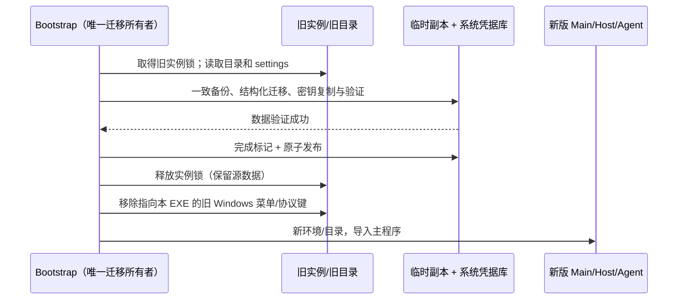

# aibuddy7se 完整品牌与升级迁移

## 产品规则

用户明确要求内部标识改名并迁移旧数据。Win7 发布包使用 aibuddy7se：名称、图标、元数据、IPC/preload、环境变量、协议、资源/插件路径及数据库身份表。仅迁移识别代码可以保留旧标识；法律署名保留原作者 Z.AI。开发仓库路径、上游源码包名和 Git 历史不属于安装产品，现代构建不变。

构建拥有发布身份：复用 base.afterPack 的 sourcemap 清理 staging，仅转换 Win7 的 UTF-8 代码和资源路径，在同一次 ASAR 封装中完成品牌转换；既有原生依赖检查照常执行，extraResources 随后转换并刷新安装清单。禁止修改第三方二进制内容；必须实际启动转换后的 Host/Agent/UI。源码级名称继续供上游工程使用，不能通过另一个 UI 状态副本处理品牌。安装器 GUID 固定为旧版的同一不透明 UUID，确保覆盖升级；新 appId 为 dev.aibuddy7se.app，协议为 aibuddy7se。仅生成离线 EXE，不生成便携 ZIP。

默认业务目录从 ~/.zcode-win7-home/.zcode 迁至 ~/.aibuddy7se-home/.aibuddy7se；Electron userData 从 APPDATA/ZCode Win7 Experimental 迁至 APPDATA/aibuddy7se。自定义 dataBaseDir 下的 .zcode 迁为 .aibuddy7se；用户共享配置 ~/.zcode 复制至 ~/.aibuddy7se。HOME、USERPROFILE、真实工作区路径、workspaceIdentity、用户文档/消息、API 地址和密钥明文不能做品牌替换。已有源目录保留，作为升级前副本。

Bootstrap 是唯一迁移所有者，在导入 Main/Host 前执行。旧实例仍运行时拒绝迁移。每个目标目录使用同级临时副本和完成标记，验证后原子 rename 发布；已有未标记目标拒绝覆盖。重复启动跳过已完成目标；中途失败只清除本次临时副本，不删源/目标。SQLite 使用在线备份 API 取得一致快照，再事务迁移 schema/结构化内部标识；历史迁移 checksum 只接受当前源码生成的旧值，匹配后转换为新值，未知值立即失败。会话 ID、消息正文和 workspace identity 保持。

凭据不能直接移动：OS 密钥项由服务名和凭据文件绝对路径的 SHA-256 共同定位。迁移验证旧密文可解密，将同一随机密钥写到新服务/新路径，读取复核；已有不一致目标密钥拒绝覆盖。v1 使用旧解码器认证后转成 v2，禁止把解密失败当作明文、禁止日志记录凭据。旧识别字符串仅留在独立 migration 模块。

Bootstrap 在数据迁移成功后、加载 Main 前，清理 HKCU 中指向当前可执行文件的旧 Directory/Drive 右键菜单及旧 URL 协议键；Main 沿用现有唯一注册路径创建新名称入口。只接受旧版本实际生成的完整 command（路径比较不区分大小写），其它安装位置、开发入口或用户自定义命令不删。不存在的键视为已完成，删除失败拒绝进入应用；重复启动无副作用。

默认 command 由 Win7 自带 PowerShell 2.0 / .NET Registry API 读取，仅接受 REG_SZ；UTF-8 内容经 Base64 输出，避免系统代码页损坏中文路径。在 JavaScript 中核对完整命令（不区分大小写），不能以 reg query 的过滤结果或退出码判断归属。读取错误拒绝迁移；缺少值/非 REG_SZ/不同命令保留。工程门禁使用隔离的真实 Windows 注册表键验证中文路径、不同安装位置、自定义参数及非字符串值。

## 影响及验收

升级 GUI 验收必须实际从旧 SQLite 和 OS 密文启动。若在 DevTools/窗口出现前失败，Bootstrap 输出不含路径或密钥的阶段日志，Windows CI 保存一次性 runner 的桌面错误窗口截图；不能增加等待时间或改回无旧数据的新装来绕过失败。

Windows 虚构用户 fixture 必须在启动前创建 AppData/Roaming、AppData/Local 并设置 APPDATA/LOCALAPPDATA，不能只覆盖 HOME/USERPROFILE。运行 43401763520 的原生错误截图确认，缺少这些目录会使 Electron 在进入迁移前抛出 `Failed to get 'appData' path`；此证据不能归因为迁移数据库或密钥失败。

验收当前实际挂载的工作区帮助菜单（旧 WindowsCaptionMenuButton 已无调用）：保留关于、资源管理器和导出日志；不提供上游反馈、需求、社区和产品文档入口，也不探测社区。仅更换 URL 中的名称会产生不存在的品牌域名，因此不能以文本替换代替入口清理。

缺少模型时，Win7 错误横幅只引导配置自定义模型，保留设置按钮，移除云套餐升级按钮；其它错误保留复制、详情、重试/重连，不提供云反馈按钮。现代/Web 文案与动作不变。运行 43404254541 的真实 GUI 暴露了该遗漏，并证明旧 SQLite/密文迁移已正常进入工作区；关于窗口标题将产品名与版本放在同一个 h1，验收按完整 heading 校验，不按单独的文本元素查找产品名。

实际依赖以 rg 与受控模块上下文核对（本环境无 Codegraph）。入口：Win7 builder/installer/bootstrap → credential-security、session SQLite → preload/UI、Agent、离线工具。现代/Web 不改变运行语义；Desktop continuous 与远端 replayable 仍由既有 owner 管理。远端独立旧版服务不升级成新版协议，需使用相同品牌版本。

| 场景                             | 必须断言                                      | 证据                                                                      |
| -------------------------------- | --------------------------------------------- | ------------------------------------------------------------------------- |
| 新装、重复启动                   | 新标识/新目录，只有新 preload，启动自测可运行 | 43408181317：工程 + 成包 GUI 通过（新装/系统自测；迁移 fixture 重复运行） |
| 默认/自定义旧数据                | 原文/路径/身份不变，新表/协议/键有效，源不变  | 43408181317：真实 schema 的虚构 SQLite/JSON fixture 通过                  |
| 密文 v1/v2、缺失 OS key          | 可验证读取；缺密钥拒绝且不发布目标            | 43408181317：v1/v2、缺 key 工程回归及成包 Windows OS 密钥迁移通过         |
| 目标已有数据、重复迁移、失败重试 | 无覆盖、无丢失、幂等完成                      | 43408181317：冲突、幂等及失败保留源数据工程回归通过                       |
| 成包资源/安装元数据              | 无活跃旧标识，迁移识别允许；新图标，EXE-only  | 43408181317：28,547 文本扫描 + Server 2022 成包 GUI 通过，EXE-only        |
| Win7 / Office 2013 实机          | 真机安装、旧配置/会话、Office/PDF             | 本地环境不可验证，不以 Server 2022 替代                                   |

## 2026-11-13 云端验收记录

运行时代码为 `4e336a8bbbe1b564c228053987735f887e4e2bf6`，已正常推送到用户 fork 的 `codex/win7-experimental`，未推送上游。[Windows Actions 43408181317](https://github.com/skyjt/ZCode_custom/actions/runs/43408181317) 全部通过（job `131827629878`）。记录提交仅更新文档，不改变该产物对应的运行时代码。

- 修复证据：此前 43406675895 在真实 Windows 的不同 command 负例失败（`true !== false`）。现改为 .NET 读取默认 REG_SZ，经 Base64 传输 Unicode；真实 Windows 原生中文路径、不同安装路径、自定义参数、REG_EXPAND_SZ 拒绝及键不存在检查全部通过。工程回归 25/25 通过，无跳过；安全负例保留。
- 云端 Linux：Node 24.14.0、pnpm 10.33.2；`pnpm typecheck` 通过；`pnpm lint` 538 条既有告警、0 错误，本次工程文件专项扫描 0 告警/错误；架构新增/基线违规均 0；正常 pre-push 门禁通过。Linux 工程回归 24 通过、1 项 Windows 原生检查跳过，另由上述 Windows 运行全部验证。
- 成包检查：Windows 系统 API、现代/legacy 进程归属、Agent stdio/SQLite/Job、WinPTY、真实 Windows Credential Manager 与旧密文迁移、离线 Python/Office 库、SSH 命令/错误 host key 拒绝/SFTP 字节回环、离线技能发现、PE 静态导入全部通过。Firewall 启用后阻断应用出站，旧 SQLite/OS 密文 fixture 实际进入工作区，GUI 检查通过。
- 人工查看 diagnostics 的 `startup.png`、`about.png`、`help-menu.png`：新 Logo/名称正确，关于标题包含版本 3.18.0，帮助菜单无上游反馈/社区/文档，缺模型提示为配置自定义模型且无 Upgrade。`brand-audit.json` 扫描 28,547 个文本文件通过；仅三份迁移识别文件保留旧名称。
- 下载后的外层 artifact ZIP 恰含一个 `aibuddy7se-3.18.0-win7-intranet-x64.exe`（254,572,283 字节），无便携 ZIP。实际 EXE SHA-256 与 runner `SHA256SUMS.txt` 一致：`1c266bf0387b055934b0d3952a0c0e924726612a09b1586d69e8d93010b2768b`。[EXE 下载 artifact](https://github.com/skyjt/ZCode_custom/actions/runs/43408181317/artifacts/14028309752)；[诊断截图与校验记录](https://github.com/skyjt/ZCode_custom/actions/runs/43408181317/artifacts/14028967414)。Artifacts 保留 14 天，外层 ZIP 仅为 GitHub 传输容器。
- 优化实测：继续沿用品牌与 sourcemap 同一次 ASAR 解封装，完整处理耗时 109,846 ms（解包 32,561 ms，重新封装 47,726 ms），原生依赖检查照常执行。安装器构建步骤 11 分 43 秒，整个 job 16 分 05 秒；不能把单阶段优化称为整体耗时固定下降。本次未移除或放宽任何 Actions 门禁。

仍未验收：Win7 SP1 x64 真机/PowerShell 2.0/.NET 3.5、真实 Office 2013 导出、真实模型与内网 SSH、实际旧 NSIS 覆盖升级和完整应用退出后重启升级。Server 2022 的虚构 fixture 与无 Office 的 COM 探针不能替代这些验收；已有原始数据保留规则仍适用。

## 2026-11-13 内存优化后复验

最新交付运行时代码为 `ddd6e31003b6ca4b6e5d4a18fd9110928840254a`，已正常推送到 `skyjt/ZCode_custom` 的 `codex/win7-experimental`，未推送上游。[Windows Actions 43485739797](https://github.com/skyjt/ZCode_custom/actions/runs/43485739797) 全部通过（job `132093688183`）；此版本替代上方历史产物作为当前下载。

- 原有迁移、安全负例与离线能力门禁全部保留并重新通过。Windows 工程回归现为 29/29，无跳过，真实注册表不同 command 负例仍执行；真实旧 SQLite/OS 密文、源数据保留、冲突拒绝、Agent/WinPTY、Office 库、SSH/SFTP、技能、PE 导入及防火墙阻断成包 GUI 均通过。
- 最终本地 Node 24.14.0 / pnpm 10.33.2 类型检查通过，Lint 533 条既有告警、0 错误，架构新增/基线违规 0，正常 pre-push 门禁通过。Linux 工程回归 27 通过、2 项 Windows 原生检查跳过；上述 Windows 运行补齐验证。
- 人工查看最终启动、关于、帮助菜单、浅色/深色代码预览、系统自测、模型设置和首次回复截图；名称/Logo/版本正确，缺模型提示只引导自定义模型，没有云升级或上游社区入口。首次发送真实经过 UI 与共享 Agent 到本机虚构模型并显示回复，只有一个聊天 runtime；不是实际内网模型验收。
- `brand-audit.json` 扫描 28,553 个文本文件通过，仍仅 `legacy-data.cjs`、`legacy-migration.mjs`、`legacy-storage.js` 保留旧识别字符串。新版没有修改原始数据保留及 Windows 自定义入口保护规则。
- [当前 EXE 下载](https://github.com/skyjt/ZCode_custom/actions/runs/43485739797/artifacts/14069470959)外层 artifact ZIP 恰含一个 `aibuddy7se-3.18.0-win7-intranet-x64.exe`，254,611,286 字节，无便携包。下载后实际 SHA-256 与 runner 记录一致：`512861188eb378e6adfe78e2f9e2d027039eea645a1907f601204ff795be08ae`。[当前诊断与截图](https://github.com/skyjt/ZCode_custom/actions/runs/43485739797/artifacts/14068442796)，保留期 14 天。
- 同机对照：启动就绪 90 秒工作集合计由 1166.57 降至 929.41 MiB；配置模型但未发送时由 2480.32 降至 944.85 MiB。启动 30 秒仍约 1372 MiB，打开插件页并首次回复后仍约 2910 MiB；本轮不能声称活动任务或真实浏览器内存已解决。口径、完整数据与取舍见[内存优化 spec](aibuddy7se-memory.md#2026-11-13-最终成包验收)。

上方 Win7 真机、PowerShell 2.0/.NET 3.5、真实 Office 2013、真实模型/内网 SSH、实际旧 NSIS 覆盖安装及完整退出重启升级的未验收范围仍然成立。文档记录提交不改变此已验收 EXE 对应的运行时代码。
