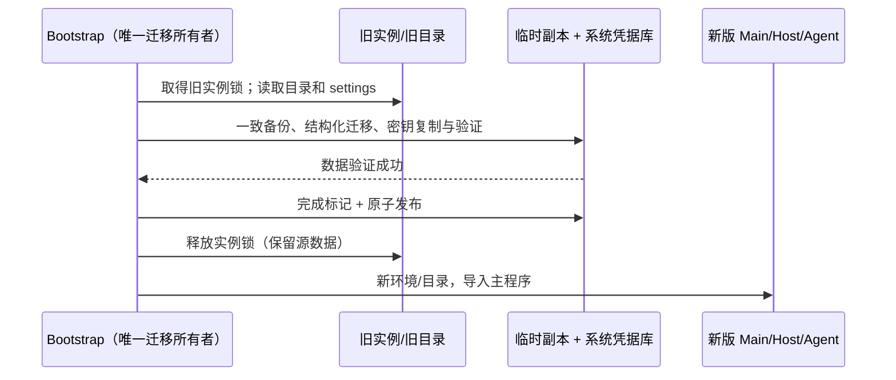

# aibuddy7se 完整品牌与升级迁移

## 产品规则

用户明确要求内部标识改名并迁移旧数据。Win7 发布包使用 aibuddy7se：名称、图标、元数据、IPC/preload、环境变量、协议、资源/插件路径及数据库身份表。仅迁移识别代码可以保留旧标识；法律署名保留原作者 Z.AI。开发仓库路径、上游源码包名和 Git 历史不属于安装产品，现代构建不变。

构建拥有发布身份：复用 base.afterPack 的 sourcemap 清理 staging，仅转换 Win7 的 UTF-8 代码和资源路径，在同一次 ASAR 封装中完成品牌转换；既有原生依赖检查照常执行，extraResources 随后转换并刷新安装清单。禁止修改第三方二进制内容；必须实际启动转换后的 Host/Agent/UI。源码级名称继续供上游工程使用，不能通过另一个 UI 状态副本处理品牌。安装器 GUID 固定为旧版的同一不透明 UUID，确保覆盖升级；新 appId 为 dev.aibuddy7se.app，协议为 aibuddy7se。仅生成离线 EXE，不生成便携 ZIP。

默认业务目录从 ~/.zcode-win7-home/.zcode 迁至 ~/.aibuddy7se-home/.aibuddy7se；Electron userData 从 APPDATA/ZCode Win7 Experimental 迁至 APPDATA/aibuddy7se。自定义 dataBaseDir 下的 .zcode 迁为 .aibuddy7se；用户共享配置 ~/.zcode 复制至 ~/.aibuddy7se。HOME、USERPROFILE、真实工作区路径、workspaceIdentity、用户文档/消息、API 地址和密钥明文不能做品牌替换。已有源目录保留，作为升级前副本。

Bootstrap 是唯一迁移所有者，在导入 Main/Host 前执行。旧实例仍运行时拒绝迁移。每个目标目录使用同级临时副本和完成标记，验证后原子 rename 发布；已有未标记目标拒绝覆盖。重复启动跳过已完成目标；中途失败只清除本次临时副本，不删源/目标。SQLite 使用在线备份 API 取得一致快照，再事务迁移 schema/结构化内部标识；历史迁移 checksum 只接受当前源码生成的旧值，匹配后转换为新值，未知值立即失败。会话 ID、消息正文和 workspace identity 保持。

凭据不能直接移动：OS 密钥项由服务名和凭据文件绝对路径的 SHA-256 共同定位。迁移验证旧密文可解密，将同一随机密钥写到新服务/新路径，读取复核；已有不一致目标密钥拒绝覆盖。v1 使用旧解码器认证后转成 v2，禁止把解密失败当作明文、禁止日志记录凭据。旧识别字符串仅留在独立 migration 模块。

## 影响及验收

升级 GUI 验收必须实际从旧 SQLite 和 OS 密文启动。若在 DevTools/窗口出现前失败，Bootstrap 输出不含路径或密钥的阶段日志，Windows CI 保存一次性 runner 的桌面错误窗口截图；不能增加等待时间或改回无旧数据的新装来绕过失败。

验收当前实际挂载的工作区帮助菜单（旧 WindowsCaptionMenuButton 已无调用）：保留关于、资源管理器和导出日志；不提供上游反馈、需求、社区和产品文档入口，也不探测社区。仅更换 URL 中的名称会产生不存在的品牌域名，因此不能以文本替换代替入口清理。

实际依赖以 rg 与受控模块上下文核对（本环境无 Codegraph）。入口：Win7 builder/installer/bootstrap → credential-security、session SQLite → preload/UI、Agent、离线工具。现代/Web 不改变运行语义；Desktop continuous 与远端 replayable 仍由既有 owner 管理。远端独立旧版服务不升级成新版协议，需使用相同品牌版本。

| 场景                             | 必须断言                                      | 证据                                    |
| -------------------------------- | --------------------------------------------- | --------------------------------------- |
| 新装、重复启动                   | 新标识/新目录，只有新 preload，启动自测可运行 | 工程 + 成包 GUI，待执行                 |
| 默认/自定义旧数据                | 原文/路径/身份不变，新表/协议/键有效，源不变  | 虚构 SQLite/JSON 迁移，待执行           |
| 密文 v1/v2、缺失 OS key          | 可验证读取；缺密钥拒绝且不发布目标            | 注入凭据库回归，待执行                  |
| 目标已有数据、重复迁移、失败重试 | 无覆盖、无丢失、幂等完成                      | 工程回归，待执行                        |
| 成包资源/安装元数据              | 无活跃旧标识，迁移识别允许；新图标，EXE-only  | 扫描 + 实际 Windows 启动，待执行        |
| Win7 / Office 2013 实机          | 真机安装、旧配置/会话、Office/PDF             | 本地环境不可验证，不以 Server 2022 替代 |
