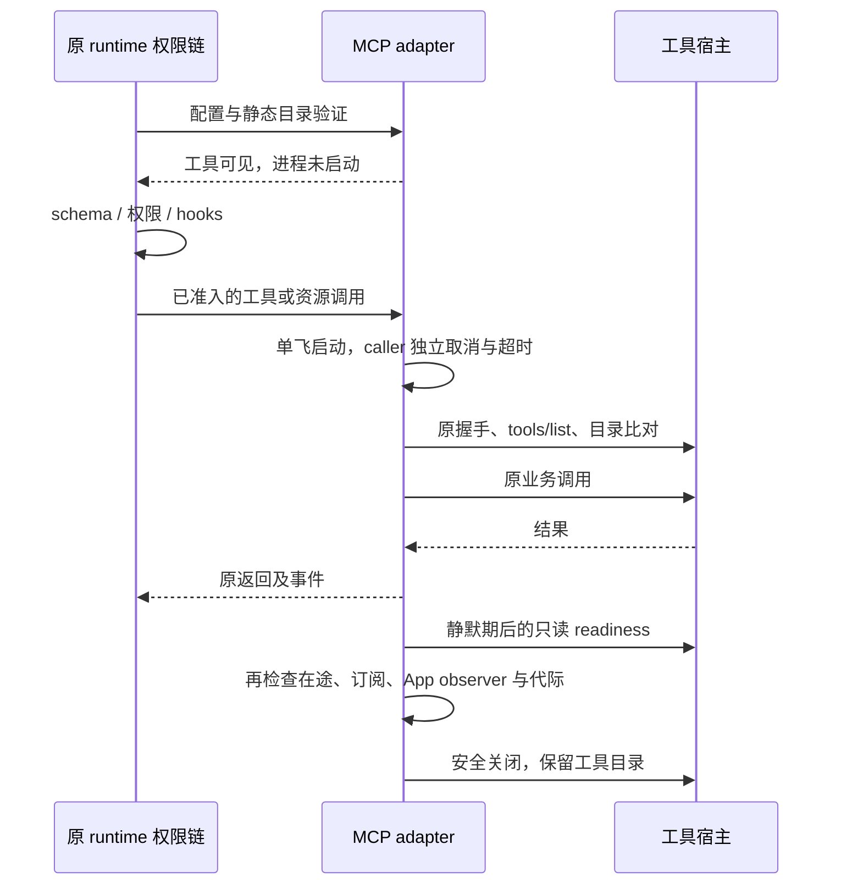

# aibuddy7se 按需宿主重建版本（独立分支，未验收）

本版本从 d50fd51dc35cc34af5cf659a0643495e96d872b5 重建。不是缺失的 7d69ad49 提交，不继承旧原型测试结果；用户已明确授权公开推送独立分支和 Windows 测试；不发布、不部署。

## 合同与所有者

NodeMcpAdapter 唯一拥有 standby / connecting / connected / retiring 状态。连接池保留 lease、工作区和会话隔离。构建从真实随包 tools/list 生成完整目录；bootstrap 仅允许固定内建 Office / node-repl-host 入口，读取 Agent 入口旁的目录，验证目标 manifest、真实路径与运行时代码 SHA-256。目录缺失沿原动态连接；已广告目录而启动时失配必须拒绝执行。

公共 MCP 配置不能打开按需行为。standby 表示 disconnected、无错误、toolCount > 0，不假称进程 connected。子代理 required MCP 判定采用目录可用性，保留 scope/deny 过滤。实际 tools/list 必须与静态规范化 schema 一致；权限、hooks、模式准入与实际 callTool 仍走原路径。

默认空闲 120 秒，随包目录可配置 30–3600 秒，0 禁用。所有工具/资源调用先登记 active 与 revision；回收前后二次检查，检查期间的新请求使结果失效。回收中的新调用等待关闭完成再启动；配置删除、适配器关闭、启动、崩溃与回收均受代际屏障保护。不重放业务写操作。若关闭后原 stdio 子进程仍存活，保留原 transport 并标记清理失败；后续调用只可重试清理，不能并存新宿主。

Office 通过内部资源 zcode://runtime/idle 报告：无在途工具、DocumentOwner 无当前文档/视图/句柄、importer 无未完成导入才可回收。订阅和 App observer 额外固定宿主。已打开文档不自动关闭，不推断已保存。初始 d13 重建的 Node REPL/浏览器只做首次按需启动。当前实验扩展只回收没有调用、Worker、socket 或 CUA runtime 的代理进程；页面、录制和控制 scope 仍由 Agent/Main 持有，详见后文的独立验收。Sites/第三方动态 MCP 保持原发现。

## 本地验收

覆盖零启动目录、首次/重复调用、首次并发单飞、取消 waiter、运行时/真实目录失配、禁用/第三方、空闲回收及重启、长调用/文档/订阅/App observer 保留、检查与新调用竞争、适配器关闭与配置删除不复活、崩溃后显式调用恢复。Office 覆盖 current/views/handles/imports。根及 CLI typecheck/lint、受影响调用方/权限回归及架构检查需实际执行并记录。

d13 本地验收时，Windows 全进程树与 PID 映射、四对 AB/BA 独立冷启动、首次/复用延迟、纯聊天/Word/浏览器场景均未执行；原结果不沿用。真实 Win7、Office 2013、内网项目、用户低内存 VM、定时任务真实唤醒也未验收。不得报告新的 RAM 节省或 500 MB 达标。

## 重建版实测记录

本地 Linux / Node 24.14.0 / pnpm 10.33.2，详细数据见同目录 aibuddy7se-demand-rebuild-evidence.json。实际执行适配器 + 本地构建的 Word MCP 子进程，目录由 smoke 脚本预先真实 tools/list 获取再注入，不能冒充 Windows 成包 bootstrap 验证。

最终实验：15 个工具目录可见时没有子进程；首次读报告启动 PID 64（474.09 ms），重复读同 PID（2.98 ms）；实验用 30 秒 idle 后 PID 64 确认退出；重用启动 PID 90（431.46 ms）；打开文档后继续等待 31 秒，PID 90 被保留；整体 close 后两个 PID 均不存在。产品默认仍 120 秒。单次时延仅是功能实验观测，不是稳定性能结论，不包含整体 RAM 测量。

新增生命周期 13/13；完整 MCP 文件 56 通过/9 OAuth 失败/2 未处理拒绝；未改基线临时副本 43 通过/同样 9 失败/2 未处理拒绝，失败原因未确定。调用方及权限 55/55（7 文件）；Office 87/87；品牌工程 12 通过/1 Windows 专属跳过。根 typecheck 首次与 CLI 并发时 exit 137，串行重跑 exit 0。根 lint 526 警告/0 错误，CLI lint 86 警告/0 错误。临时基线副本曾触发 lint max-lines，清理后重跑通过；没有增加例外。架构 baseline 0/new 0；未受管 CLI 模块不因此自动获得运行时正确性证明。

初始 d13 本地验收时，浏览器自动回收、Windows 四对完整应用对照、整机进程树/PID 映射、内存实际回落、Office GUI 保存/关闭以及定时任务唤醒尚未完成，且当时未修改 Actions/推送。后续进展另记；本地实验不能代替 Windows 验收。

最终 CLI typecheck 34/34 通过。完整 MCP 的 9 个失败名称与未改基线逐项相等，记录于 evidence JSON；没有把失败用例排除出完整测试。

## Windows 验收扩展（四对结果待完成）

独立分支 codex/win7-demand-rebuild-20261116；首次公开提交 ee9748d9 与本地 d13efd59 的源码树 a5a53888 完全相同。复用 provider candidate 工作流全部安全/功能断言，基线采用已通过的 43859527521 安装包及固定 SHA-256。四对同机 AB/BA 独立进程和临时用户目录，保留原启动/90秒空闲/文字后三快照口径。每轮依次 Word 首次/复用/130秒回收/重启/130秒回收，再浏览器首次/复用/130秒等待/重用/关闭测试页/130秒等待，最后打开 Word 并等待130秒验证有状态文档保留。工具阶段不是额外独立冷启动。浏览器实验要求页面保留时及关闭后均回收工具代理；实际证据尚未取得，不能预先判定通过。

进程采样仅读取 PID、父 PID、创建时刻、白名单入口/插件身份及工作集/私有提交量，不记录完整命令行、用户路径或环境。创建时间排除已复用父 PID 的旧孤儿。静态目录存在的候选必须证明纯聊天没有 Office/Node REPL 宿主，Word 仅启动 documents，首次与复用同 PID，静默后 PID 消失、重启为新 PID，已打开文档后保持；任何不满足均失败并保留原始证据。测试只访问合成 Word 文件和 loopback HTML，权限走原 GUI 调用链，不关闭安全门禁。

测试夹具遵循真实工具发现协议：名称公告后通过 LocalToolSearch/ToolSearch 获取 schema，按模式使用 DeferredToolCall；不把未加载目录冒充可直接调用。浏览器 js 带必需用户标题。若产品弹出权限选项，仅当前已下发的合成探针可经 UI 选择 allowOnce，记录审批次数；不切换模式、不设置永久授权。

## 首轮 Windows 证据与路径修复

43984513584 成包与原有离线 GUI/Office 检查通过，13 项 rebuilt demand 生命周期通过；官方 manifest 用例因 Windows 混合分隔符的字符串比较失败，故比较 job 被门禁跳过。运行时重写保留 `${PLUGIN_ROOT}/dist/server.mjs` 的正斜杠；按需目录 resolver 原先以平台 sep 做后缀匹配，漏掉这个合法 Windows 入口。修复只对已通过绝对路径/官方命令前缀检查的入口做平台 resolve 归一化，再进行原 manifest/hash/realpath 防护。测试继续严格检查目标路径和额外 argv，而不是要求相同斜杠拼写；追加混合分隔符静态目录与篡改拒绝回归。首轮内存不是优化验收，不计算节省比例。

首轮脱敏采样只匹配 packages 目录，实际宿主从 cache/aibuddy7se-plugins-official/<name>/<version>/dist 启动，因此 5 个宿主未能辨识；不能将 unknown 算作不存在。采样补充固定官方缓存路径模式，候选场景遇到未映射 plugin-host 必须失败。Main PID 直接来自启动句柄，Host 可由原日志中的带 PID host 前缀核实，不猜未知进程身份。

## 浏览器代理进程回收扩展（实验，尚未验收）

源码复核确认 BrowserConnection/controlScopeId 在 Agent 的 protocol server context，页面/录制在 Main；node-repl-host 只拥有每次调用的 Worker、调用队列、账本与 socket 代理。不得调用 releaseScope/closeSession 来换取空闲。新增只读 readiness 只授权退出这个代理进程：无排队/执行调用、所有 Worker 实际终止、所有代理入站 socket 已关闭、没有 CUA runtime 才报告 true。代理连接计数由 broker 自己持有，Worker 存活集合由 MCP runtime 持有，adapter 继续做 active/revision/订阅/observer/代际复核；任何不确定状态均保留宿主。退出不关闭 Main 页面，不停止录制、下载或定时 Agent。

重启继续用同一个 Agent broker/权限身份；新 Worker 与新代理凭据仍由可信账本创建，原权限链不变。CUA runtime 存在时保守禁止回收。进程内非持久的 no-progress 提醒计数会随退出重置（它只产生提示，不是权限门禁）；这项性能/行为权衡需记录，不能宣称所有进程内状态无变化。

Windows 场景增加：页面填写合成未提交文本，等默认空闲期后确认代理 PID 消失、页面 renderer 保留，再次调用使用新 PID 并读到同一页面文本；关闭测试页后再次等待，代理再次消失。旧包保持原行为。长调用、排队、socket、CUA 与真实 Worker 终止加入回归；页面状态保存、真实录制/下载及真实 CUA 未充分验证时不能宣称这些场景已通过。

截至浏览器扩展提交前，路径修复版本 3d45710e 的 Windows 2022 构建 job（43987788598）全部门禁通过，四对比较正在执行；其浏览器尚不回收。浏览器扩展本地 CLI/root typecheck、lint 与架构检查通过；Node host 四文件 43 通过、13 失败，失败涉及当前 Linux 环境拒绝 Unix socket listen（EPERM），包括已有 12 项和新增 1 项；bundle/真实 Worker 退出与 no-progress 回归通过。完整四文件继续作为 Windows 必须通过的断言，不删除受阻用例。

第三轮构建诊断保留一个未映射 plugin-host。源码 manifest 的实际 Sites 名称为 zcode-site，成包品牌替换后为 aibuddy7se-site，并非旧采样的 sites。采样增加这两个固定官方缓存/包目录名称，统一输出 sites-plugin；保留未知宿主阻断，不按剩余数量猜测 PID。Windows 工程回归直接执行采样 PowerShell，覆盖五种工具、Sites 两种品牌路径及未知路径，并验证输出没有完整命令行。最终进程身份仍以新运行实际采样为准。

43987788598 的首对旧包在 BROWSER_FIRST 的第二次 allowOnce click 超时，原日志表明首击已经放行且 loopback 页面发生 GET。原因是按钮 focus 会先更新选中状态，首击可能已提交；脚本再根据短暂可见状态追加点击，追逐消失的弹窗。夹具改为 focus 指定 allowOnce、等待其 aria-selected、只按一次 Enter 并等原弹窗消失；不直接调用内部权限服务，不修改模式或永久授权。失败数据完整保留，不构成四对结果。
