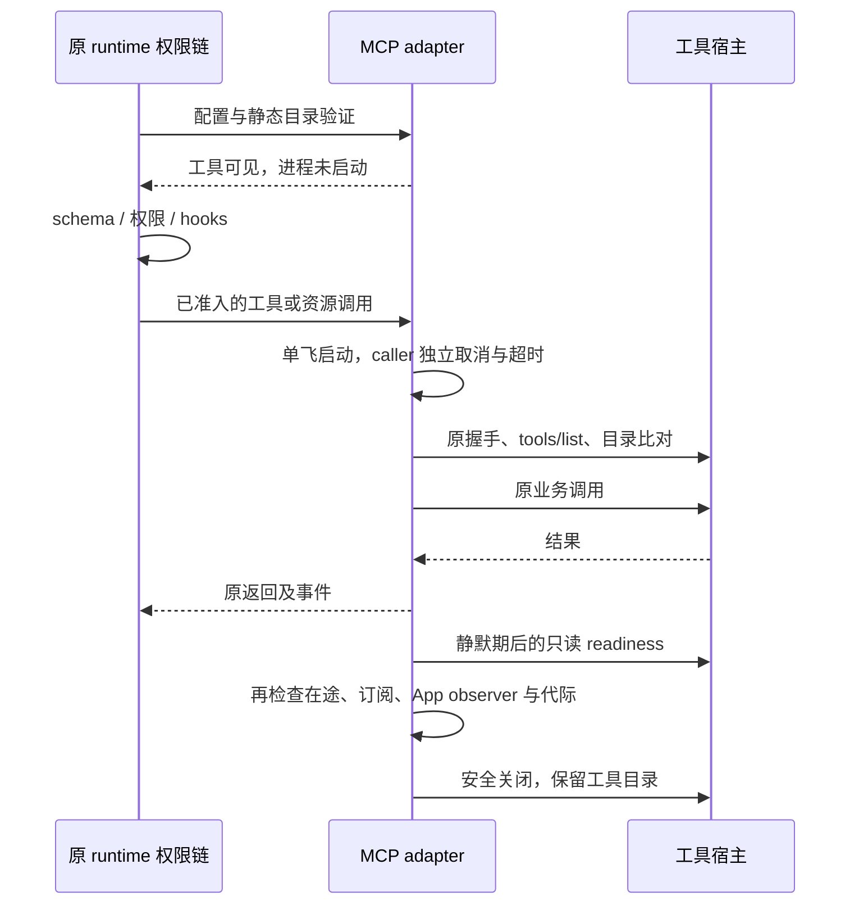

# aibuddy7se 按需宿主重建版本（独立分支，未验收）

本版本从 d50fd51dc35cc34af5cf659a0643495e96d872b5 重建。不是缺失的 7d69ad49 提交，不继承旧原型测试结果；用户已明确授权公开推送独立分支和 Windows 测试；不发布、不部署。

## 合同与所有者

NodeMcpAdapter 唯一拥有 standby / connecting / connected / retiring 状态。连接池保留 lease、工作区和会话隔离。构建从真实随包 tools/list 生成完整目录；bootstrap 仅允许固定内建 Office / node-repl-host 入口，读取 Agent 入口旁的目录，验证目标 manifest、真实路径与运行时代码 SHA-256。目录缺失沿原动态连接；已广告目录而启动时失配必须拒绝执行。

公共 MCP 配置不能打开按需行为。standby 表示 disconnected、无错误、toolCount > 0，不假称进程 connected。子代理 required MCP 判定采用目录可用性，保留 scope/deny 过滤。实际 tools/list 必须与静态规范化 schema 一致；权限、hooks、模式准入与实际 callTool 仍走原路径。

默认空闲 120 秒，随包目录可配置 30–3600 秒，0 禁用。所有工具/资源调用先登记 active 与 revision；回收前后二次检查，检查期间的新请求使结果失效。回收中的新调用等待关闭完成再启动；配置删除、适配器关闭、启动、崩溃与回收均受代际屏障保护。不重放业务写操作。若关闭后原 stdio 子进程仍存活，保留原 transport 并标记清理失败；后续调用只可重试清理，不能并存新宿主。

Office 通过内部资源 zcode://runtime/idle 报告：无在途工具、DocumentOwner 无当前文档/视图/句柄、importer 无未完成导入才可回收。订阅和 App observer 额外固定宿主。已打开文档不自动关闭，不推断已保存。Node REPL/浏览器仅重建首次按需启动；页面、录制和控制 scope 在 Main，CUA 合同无 readiness，不能因 worker 完成就推断可回收；使用后的回收保守禁用，列为未完成。Sites/第三方动态 MCP 保持原发现。

## 本地验收

覆盖零启动目录、首次/重复调用、首次并发单飞、取消 waiter、运行时/真实目录失配、禁用/第三方、空闲回收及重启、长调用/文档/订阅/App observer 保留、检查与新调用竞争、适配器关闭与配置删除不复活、崩溃后显式调用恢复。Office 覆盖 current/views/handles/imports。根及 CLI typecheck/lint、受影响调用方/权限回归及架构检查需实际执行并记录。

Windows 全进程树与 PID 映射、四对 AB/BA 独立冷启动、首次/复用延迟、纯聊天/Word/浏览器场景均未执行；原结果不沿用。真实 Win7、Office 2013、内网项目、用户低内存 VM、定时任务真实唤醒也未验收。不得报告新的 RAM 节省或 500 MB 达标。

## 重建版实测记录

本地 Linux / Node 24.14.0 / pnpm 10.33.2，详细数据见同目录 aibuddy7se-demand-rebuild-evidence.json。实际执行适配器 + 本地构建的 Word MCP 子进程，目录由 smoke 脚本预先真实 tools/list 获取再注入，不能冒充 Windows 成包 bootstrap 验证。

最终实验：15 个工具目录可见时没有子进程；首次读报告启动 PID 64（474.09 ms），重复读同 PID（2.98 ms）；实验用 30 秒 idle 后 PID 64 确认退出；重用启动 PID 90（431.46 ms）；打开文档后继续等待 31 秒，PID 90 被保留；整体 close 后两个 PID 均不存在。产品默认仍 120 秒。单次时延仅是功能实验观测，不是稳定性能结论，不包含整体 RAM 测量。

新增生命周期 13/13；完整 MCP 文件 56 通过/9 OAuth 失败/2 未处理拒绝；未改基线临时副本 43 通过/同样 9 失败/2 未处理拒绝，失败原因未确定。调用方及权限 55/55（7 文件）；Office 87/87；品牌工程 12 通过/1 Windows 专属跳过。根 typecheck 首次与 CLI 并发时 exit 137，串行重跑 exit 0。根 lint 526 警告/0 错误，CLI lint 86 警告/0 错误。临时基线副本曾触发 lint max-lines，清理后重跑通过；没有增加例外。架构 baseline 0/new 0；未受管 CLI 模块不因此自动获得运行时正确性证明。

浏览器自动回收、Windows 四对完整应用对照、整机进程树/PID 映射、内存实际回落、Office GUI 保存/关闭以及定时任务唤醒仍未完成。未修改 GitHub Actions，未推送；本地实验不能代替这些验收。

最终 CLI typecheck 34/34 通过。完整 MCP 的 9 个失败名称与未改基线逐项相等，记录于 evidence JSON；没有把失败用例排除出完整测试。

## Windows 验收扩展（计划，结果待运行）

独立分支 codex/win7-demand-rebuild-20261116；首次公开提交 ee9748d9 与本地 d13efd59 的源码树 a5a53888 完全相同。复用 provider candidate 工作流全部安全/功能断言，基线采用已通过的 43859527521 安装包及固定 SHA-256。四对同机 AB/BA 独立进程和临时用户目录，保留原启动/90秒空闲/文字后三快照口径。每轮依次 Word 首次/复用/130秒回收/重启/130秒回收，再浏览器首次/复用/关闭测试页/130秒等待，最后打开 Word 并等待130秒验证有状态文档保留。工具阶段不是额外独立冷启动。浏览器回收当前未实现，只如实记录关闭后进程和内存；不能判定浏览器已回收。

进程采样仅读取 PID、父 PID、创建时刻、白名单入口/插件身份及工作集/私有提交量，不记录完整命令行、用户路径或环境。创建时间排除已复用父 PID 的旧孤儿。静态目录存在的候选必须证明纯聊天没有 Office/Node REPL 宿主，Word 仅启动 documents，首次与复用同 PID，静默后 PID 消失、重启为新 PID，已打开文档后保持；任何不满足均失败并保留原始证据。测试只访问合成 Word 文件和 loopback HTML，权限走原 GUI 调用链，不关闭安全门禁。

测试夹具遵循真实工具发现协议：名称公告后通过 LocalToolSearch/ToolSearch 获取 schema，按模式使用 DeferredToolCall；不把未加载目录冒充可直接调用。浏览器 js 带必需用户标题。若产品弹出权限选项，仅当前已下发的合成探针可经 UI 选择 allowOnce，记录审批次数；不切换模式、不设置永久授权。

## 首轮 Windows 证据与路径修复

43984513584 成包与原有离线 GUI/Office 检查通过，13 项 rebuilt demand 生命周期通过；官方 manifest 用例因 Windows 混合分隔符的字符串比较失败，故比较 job 被门禁跳过。运行时重写保留 `${PLUGIN_ROOT}/dist/server.mjs` 的正斜杠；按需目录 resolver 原先以平台 sep 做后缀匹配，漏掉这个合法 Windows 入口。修复只对已通过绝对路径/官方命令前缀检查的入口做平台 resolve 归一化，再进行原 manifest/hash/realpath 防护。测试继续严格检查目标路径和额外 argv，而不是要求相同斜杠拼写；追加混合分隔符静态目录与篡改拒绝回归。首轮内存不是优化验收，不计算节省比例。

首轮脱敏采样只匹配 packages 目录，实际宿主从 cache/aibuddy7se-plugins-official/<name>/<version>/dist 启动，因此 5 个宿主未能辨识；不能将 unknown 算作不存在。采样补充固定官方缓存路径模式，候选场景遇到未映射 plugin-host 必须失败。Main PID 直接来自启动句柄，Host 可由原日志中的带 PID host 前缀核实，不猜未知进程身份。
