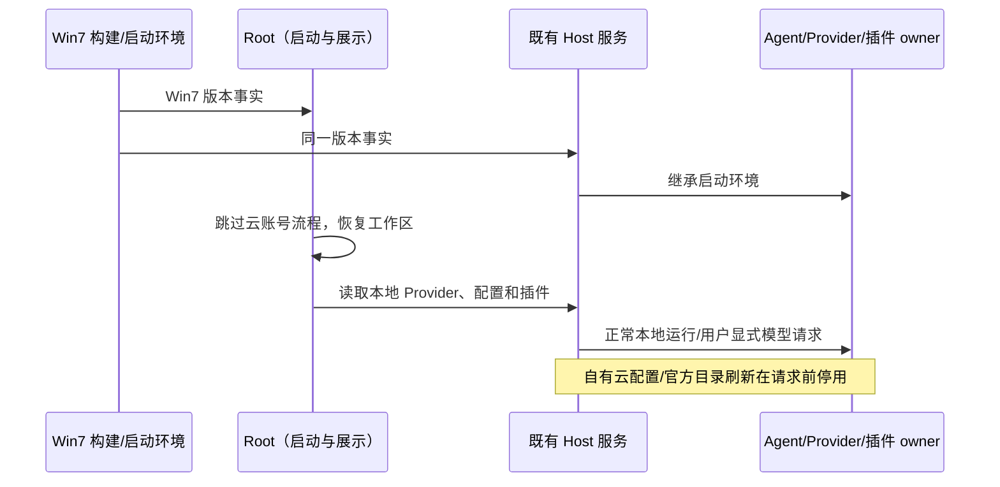

# aibuddy7se 内网精简

## Feature Summary / 已确认边界

用户确认「清理一下，这些没用，我内网」。只对 Win7 特别版生效；改动层为 presentation、validation、option-source、commit-effect，沿用 `ZCODE_WIN7_EDITION`，Agent 通过启动环境继承同一版本事实。现代 Desktop/Web 保持原功能。不是全网防火墙：自定义模型、MCP、内网 SSH、用户主动配置的源及浏览器操作仍按原权限工作。

- 启动直接进入本地工作区，不展示登录/职业营销引导，不恢复云账号，不注册登录轮询或账号过期弹窗。没有模型时从既有模型设置添加自定义 API。
- 移除登录/退出、账号头像、套餐/用量/升级/奖励/高速权益、营销投放、在线反馈/推广、云端手机连接/推送、云端分享等入口；本地主题/语言/缩放/设置与诊断仍保留。
- 模型设置保留已保存的普通 API Provider 和自定义 Provider/模型编辑、连通性检查；隐藏账号套餐产品。保留旧会话、凭据与配置文件，不删除用户数据，不重置模型选择。
- 停止产品自有云配置、内置模型目录下载、营销/账号刷新、官方插件目录后台刷新和不必要的统计采样。内置离线插件及本地插件管理、手动配置的源继续工作。
- 不卸载现有运行依赖、不改变 Agent/Host、workspaceIdentity、owner/lease、队列、取消、权限及历史恢复语义。

## UI Surface Matrix / owners

| 场景            | 入口/共享实现                                                     | owner / 默认来源                     | Win7 gating 与提交落点                                         | 隔离边界                               |
| --------------- | ----------------------------------------------------------------- | ------------------------------------ | -------------------------------------------------------------- | -------------------------------------- |
| 启动/旧账号升级 | Root、OAuth effects、provider availability guard                  | 原 Store 与 Root 启动协调            | 不执行云账号恢复，正常恢复 workspace；本地 Provider owner 不变 | 不删除凭据和历史，不绕过文件/工具权限  |
| 侧栏/设置底栏   | WorkspaceSidebarFooter                                            | 原主题/语言 store                    | 偏好菜单保留；账号/套餐/奖励/手机入口不挂载                    | 两处共享 UI 一起处理                   |
| 模型设置        | ModelProviderSection、navigation、既有 Provider facade            | 原 Provider Config/Registry          | 过滤账号产品，保留普通 API 编辑和选择                          | 不覆盖已有 API URL/Key/模型            |
| 插件            | 插件管理、CLI discovery/marketplace                               | CLI installed state/本地 marketplace | 使用内置目录；不自动拉公网官方目录                             | 内置离线技能仍就绪，手动本地源仍可安装 |
| 公网功能        | client config、builtin download、Main rollout/telemetry、营销服务 | 各既有网络 owner                     | 在发起请求前停用；UI 无无效入口                                | 不通过重试或吞网络错误伪装离线支持     |

## Shared And Divergent Behavior / 关系

必须检查：Root → OAuth/模型恢复，Footer → 使用量 hooks，设置 → Provider 导航，Main → 云配置/监控，Provider runtime → builtin downloader，插件 UI → CLI discovery。共享按钮只负责展示，底层请求 owner 也停用。应检查：帮助/分享、侧栏营销、高速卡、旧持久化导航意图。仅保持不变量：会话连续流、手机 replayable 协议实现、SSH/本地文件、凭据保护。现代构建仅校验默认分支，不删除现代版模块。

## Codegraph Evidence / 图谱与待确认项

当前未提供 Codegraph 工具；使用精确 rg 调用点、现有 spec 与架构 context，展开两层。seeds 为 Root/useRootOAuthEffects、WorkspaceSidebarFooter、ModelProviderSection/useModelProviderNavigation、createClientConfigService、downloadZCodeBuiltinRelease、plugin-discovery-port、Desktop Main。原 aibuddy7se 节点只声明品牌/自测，补充本次内网边界；无状态 owner 迁移。UI/desktop/services 根是未管理旧模块，现有文件原地修改，不宣称架构检查覆盖所有运行语义。

无阻塞问题：保留用户主动配置的网络能力是内网模型/SSH 可用的必要条件。无需追加功能或让用户重确认范围。真实内网 API 和 Win7 硬件仍由用户环境验收。

## Case Planning / 验收矩阵

| ID    | 设置 → 动作 → 断言                                                                                         | 状态                                            |
| ----- | ---------------------------------------------------------------------------------------------------------- | ----------------------------------------------- |
| IN-01 | 全新离线包 → 启动 → 无登录/跳过按钮、无职业引导，进入工作区                                                | planned：成包 UI                                |
| IN-02 | 工作区/设置 → 偏好菜单 → 主题/语言可用，无账号/奖励/云手机入口                                             | planned：成包 UI                                |
| IN-03 | 模型设置 → 添加自定义 API → 可编辑地址、模型，重新加载后保留；无套餐推广                                   | planned：成包 UI（虚构 API 配置，不发模型请求） |
| IN-04 | 打开插件管理 → 内置离线技能仍列出，无官方目录自动联网                                                      | planned：CLI 回归/成包                          |
| IN-05 | 启动/设置/空闲 → 云配置与目录读取 → 本地缺省结果，官方目录回归的请求计数为 0，断网启动无原公网配置失败日志 | planned：CLI 请求计数/成包启动日志              |
| IN-06 | 已保存普通 Provider/会话 → 升级启动 → 配置与历史不删除                                                     | planned：配置路径断言与回归                     |
| IN-07 | 现代构建 → 默认行为 → 原账号功能分支保留，类型/架构通过                                                    | planned：默认构建                               |
| IN-08 | 内网版 → 自测 → 12 项结果正常，Python/Office/终端/SSH 工具可加载                                           | planned：既有成包检查                           |

维度只覆盖新安装/既有配置、Win7/现代、工作区/设置、产品后台请求/显式用户网络。剪枝：公网账号登录/购买/奖励成功流在内网版不可达；不创建账号替身、不伪造模型成功。E2E 沿用 Win7 app-smoke，先改断言再实现；CLI 改动补所属包回归。无模型真实凭据；需要模型验收时使用本机虚构响应。未执行的验收保持 planned，不把静态检查当真机通过。

## 本地验证记录（2026-11-12）

- `pnpm typecheck` 通过；`pnpm lint` 为 0 错误、538 条存量告警；架构检查 0 违规；改动文件格式检查通过。
- Win7 工程回归 6/6，CLI discovery 5/5、官方 marketplace 8/8。真实本机 HTTP fixture 确认 Win7 同时跳过两个官方源，显式个人源仍可请求；默认版本原更新用例继续通过。
- 修改 UI 文件的无忽略 Hooks 专项扫描 22 条，与 HEAD 对照无新增、无调用顺序诊断。scope token 的依赖承担身份失效语义；现有对象/成员和日志依赖告警未扩大修改。营销、账号、套餐和 onboarding 的旧回调在 Win7 不挂载或不执行；保留默认版原逻辑，不为本次清理改写异步 owner。
- 成包 UI 验收沿用固定虚构 API 地址/Key/模型，只编辑和重新加载，不调用真实模型。完整应用升级和重启保持路径的行为仍需用户环境验证。
