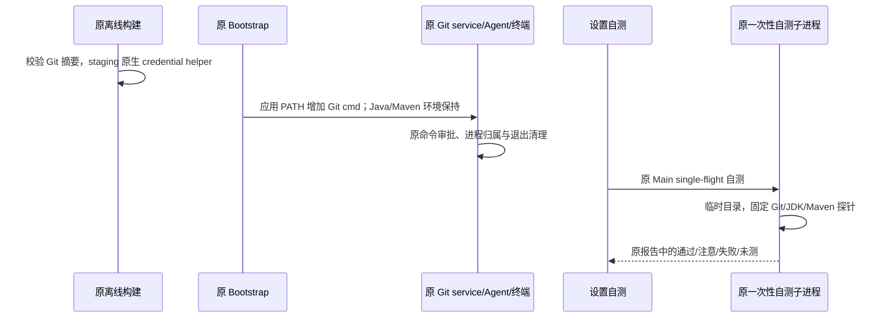

# aibuddy7se Java 8 / Maven 开发环境

## 用户选择与本轮范围

用户需要客户端具备实际开发工具，不增加 AI 可临时生成的报表/文件处理模板。内网项目以 Java 8 + Maven 为主，目标电脑通常已经安装两者，优先复用。第一批只补齐随包 Git 及现有系统自测中的开发环境诊断；不新增 JDK/Maven 发行版、语言服务、常驻 JVM 或新的构建任务管理器。

- Win7 x64 随包 Git for Windows 2.46.2（官方最后支持 Win7 的系列）。使用面向应用集成的官方 MinGit 标准发行版，包含 Git 所需 sh、SSH/HTTPS 和原生凭据组件，复用现有 Git 界面。固定来源、版本及官方 SHA-256，沿用唯一离线资产清单和 staging；只交付一个离线 EXE。MinGit 不提供交互式 Git Bash，原终端仍优先使用已有 Git Bash，否则 CMD；不改变用户的 shell 选择。
- Bootstrap 仅在本应用 PATH 中加入 `offline-tools/git/cmd`。不把整套 Unix 工具加入 Windows PATH，不修改系统 PATH、HOME、USERPROFILE、JAVA_HOME、MAVEN_HOME、M2_HOME 或任何用户 Git/Maven/SSH 文件。显式 Git executable override 仍由原 Git 服务优先处理。
- 随包 Git 的默认 credential helper 使用原生 `wincred`，避免默认 GCM 要求 Win7 基线未必具备的 .NET 4.7.2；只修改构建 staging 的系统级 Git 配置，并移除 MinGit 中指向其他 Git 安装目录的两个默认 system include，保证随包 helper 与路径独立。原用户/仓库配置仍按 Git 自身优先级生效；若企业证书仅配置在另一个 Git 的 system 配置中，需要显式配置该 Git 或用户/仓库设置。保留证书验证、主机指纹验证和许可文件；不预置账户、密钥、内网地址或凭据。Git LFS 不随 MinGit 提供，已有 LFS filter 不删除，不能把 pointer 当作实际文件。
- Java/Maven 继续使用继承的本机环境和项目原配置，不自动扫描整个磁盘，不升级工具、不改 settings.xml、不自动下载依赖。项目 Wrapper 仍属于项目；安装 Maven 不代表项目依赖已离线齐备。

## 开发环境自测

复用设置 → 常规 → 系统能力自测、Main 的在途合并及现有一次性子进程。只有用户主动自测才启动短生命周期工具，不在启动路径探测 Java/Maven。

- Git 是新版随包能力：检查固定随包 Git 版本；损坏或缺件报失败。正常功能仍通过原 Git service/Agent/终端执行。
- JDK：显示 JAVA_HOME、PATH 的 java/javac 候选与版本；缺失、非 Java 8、JAVA_HOME/PATH 不一致时明确注意，不静默切换。完整 JDK 8 在私有临时目录编译并运行固定 UTF-8 Java 样本，结束后删除临时文件。
- Maven：检查 PATH 中的 mvn.cmd，显示版本和其报告的 Java 版本，以及默认用户/安装 settings.xml 是否存在。仅执行固定 `--version`，不运行真实项目，不读取或输出 settings.xml 凭据。报告默认路径不等于解析了项目 `-s`、Wrapper 或有效仓库配置。
- 版本探针屏蔽仅对子进程生效的 Java/Maven 注入参数，并跳过 Maven rc；避免自测因 JAVA_TOOL_OPTIONS/MAVEN_ARGS 等执行额外操作或回显秘密。原应用环境不变。路径不拼进 CMD 程序文本，使用固定命令和独立环境字段，兼容中文、空格、百分号、感叹号、& 与括号路径。
- JDK/Maven 是可选开发依赖：缺失或版本不匹配为注意项，不阻断聊天/Office。明确未验证真实项目构建、内网仓库、企业证书/认证、真实 Win7；不把版本输出当成项目构建成功。

## 所有者与边界

构建脚本拥有只读 Git 资产；Bootstrap 拥有本应用环境增量；现有 Git service/Agent/终端拥有原命令入口；本机 JDK/Maven 和用户配置仍归用户。自测没有持久化配置或新的任务状态，沿用 SystemSelfTestReport schema，不增加协议。

现代版、Web、手机远控及 workspace identity/owner/lease/accepted queue 均不变。仅自测增加结果行和中英文标题。

## 验收

1. 工程回归先验证 PATH 幂等和原 Java/Maven/HOME 不变、坏资产拒绝；版本/缺失诊断不暴露环境参数或 settings.xml 秘密。
2. Windows 成包使用固定随包 Git：中文/空格目录初始化、提交、分支、差异、bare clone/push、worktree、bundle 回环和 sh hook；真实回环 SSH/HTTPS 及错误信任拒绝按实际完成情况记录。原生 wincred 用唯一虚构 target 写入/读取/删除。
3. Windows CI 使用 JDK 8 和 Maven 的现有/测试安装：编译运行固定样本、mvn --version，覆盖有/无环境、版本冲突和特殊路径；保留所有原门禁和 PE 导入检查，新增 Git 二进制检查。
4. 成包 GUI 自测出现 Git、JDK 8、Maven 三行，中英文及深浅主题显示正常；依旧从旧 SQLite/OS 密文迁移进入工作区。检查没有启动常驻 JVM，保留既有内存采样与首次发送验证。
5. 类型检查、Lint、架构与正常 pre-push，通过完整最新 Windows Actions 后核对品牌扫描、截图和唯一 EXE SHA-256。

当前为待实现规格，未执行场景不标为通过。Win7 真机、真实 Java 项目/内网 Git/Maven 仓库仍需实测。

首轮 Actions 43798670712 的 Windows 工程回归为 31/32：特殊路径 Maven 探针和原注册表安全负例通过，JDK fixture 清理发生 EBUSY。原版本探针并行使用 Promise.all，任意命令失败后可能在另一个进程尚持有 cwd 时清理；改为等待所有版本命令结束并报告具体失败阶段，保留特殊路径与版本冲突断言。该轮没有生成新 EXE。

43799134307 补充诊断确认，runner JDK 8 通过中文目录 junction 启动时，两条原生命令均直接退出 2（`could not find java.dll` / `Could not find Java SE Runtime Environment`）。自测报告注意符合实际，不能强行宣称该 launcher 路径可用。正例改用本机真实 JDK 安装，源码和 cwd 继续包含中文、空格、百分号及其他 shell 字符；固定编译文件名/类路径相对于 cwd 传递，避免旧 JDK 参数编码限制。另用真实本机失败进程验证两条版本命令均退出后能立即清理，无 mock 或增加等待。

来源：[Git Windows 版本边界](https://gitforwindows.org/requirements.html)、[2.46.2 发行资产与摘要](https://github.com/git-for-windows/git/releases/tag/v2.46.2.windows.1)、[Maven 仓库与离线依赖](https://maven.apache.org/guides/introduction/introduction-to-repositories)。
