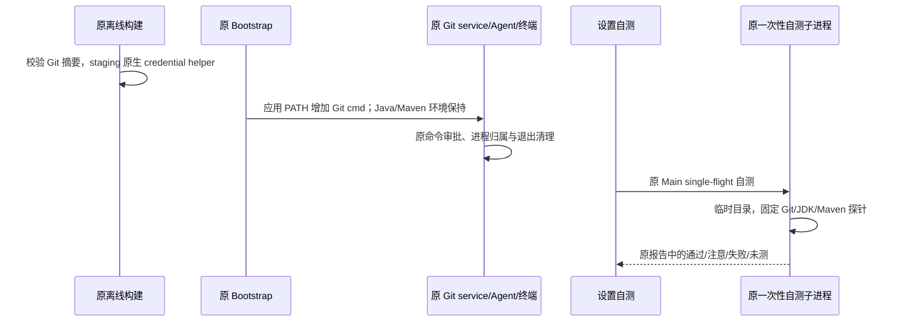

# aibuddy7se Java 8 / Maven 开发环境

## 用户选择与本轮范围

用户需要客户端具备实际开发工具，不增加 AI 可临时生成的报表/文件处理模板。内网项目以 Java 8 + Maven 为主，目标电脑通常已经安装两者，优先复用。第一批只补齐随包 Git 及现有系统自测中的开发环境诊断；不新增 JDK/Maven 发行版、语言服务、常驻 JVM 或新的构建任务管理器。

- Win7 x64 随包 Git for Windows 2.46.2（官方最后支持 Win7 的系列）。使用面向应用集成的官方 MinGit 标准发行版，包含 Git 所需 sh、SSH/HTTPS 和原生凭据组件，复用现有 Git 界面。固定来源、版本及官方 SHA-256，沿用唯一离线资产清单和 staging；只交付一个离线 EXE。MinGit 不提供交互式 Git Bash，原终端仍优先使用已有 Git Bash，否则 CMD；不改变用户的 shell 选择。
- Bootstrap 仅在本应用 PATH 中加入 `offline-tools/git/cmd`。不把整套 Unix 工具加入 Windows PATH，不修改系统 PATH、HOME、USERPROFILE、JAVA_HOME、MAVEN_HOME、M2_HOME 或任何用户 Git/Maven/SSH 文件。显式 Git executable override 仍由原 Git 服务优先处理。
- 随包 Git 的默认 credential helper 使用原生 `wincred`，避免默认 GCM 要求 Win7 基线未必具备的 .NET 4.7.2；只修改构建 staging 的系统级 Git 配置，并移除 MinGit 中指向其他 Git 安装目录的两个默认 system include，保证随包 helper 与路径独立。原用户/仓库配置仍按 Git 自身优先级生效；若企业证书仅配置在另一个 Git 的 system 配置中，需要显式配置该 Git 或用户/仓库设置。保留证书验证、主机指纹验证和许可文件；不预置账户、密钥、内网地址或凭据。Git LFS 不随 MinGit 提供，已有 LFS filter 不删除，不能把 pointer 当作实际文件。
- Java/Maven 继续使用继承的本机环境和项目原配置，不自动扫描整个磁盘，不升级工具、不改 settings.xml、不自动下载依赖。项目 Wrapper 仍属于项目；安装 Maven 不代表项目依赖已离线齐备。

## 开发环境自测

复用设置 → 常规 → 系统能力自测、Main 的在途合并及现有一次性子进程。只有用户主动自测才启动短生命周期工具，不在启动路径探测 Java/Maven。

- Git 是新版随包能力：检查固定随包 Git 版本；损坏或缺件报失败。正常功能仍通过原 Git service/Agent/终端执行。
- JDK：显示 JAVA_HOME、PATH 的 java/javac 候选与版本；缺失、非 Java 8、JAVA_HOME/PATH 不一致时明确注意，不静默切换。完整 JDK 8 在私有临时目录编译并运行固定 UTF-8 Java 样本，结束后删除临时文件。
- Maven：检查 PATH 中的 mvn.cmd，显示版本和其报告的 Java 版本，以及默认用户/安装 settings.xml 是否存在。仅执行固定 `--version`，不运行真实项目，不读取或输出 settings.xml 凭据。报告默认路径不等于解析了项目 `-s`、Wrapper 或有效仓库配置。
- 版本探针屏蔽仅对子进程生效的 Java/Maven 注入参数，并跳过 Maven rc；避免自测因 JAVA_TOOL_OPTIONS/MAVEN_ARGS 等执行额外操作或回显秘密。原应用环境不变。路径不拼进 CMD 程序文本，使用固定命令和独立环境字段，兼容中文、空格、百分号、感叹号、& 与括号路径。
- JDK/Maven 是可选开发依赖：缺失或版本不匹配为注意项，不阻断聊天/Office。明确未验证真实项目构建、内网仓库、企业证书/认证、真实 Win7；不把版本输出当成项目构建成功。

## 所有者与边界

构建脚本拥有只读 Git 资产；Bootstrap 拥有本应用环境增量；现有 Git service/Agent/终端拥有原命令入口；本机 JDK/Maven 和用户配置仍归用户。自测没有持久化配置或新的任务状态，沿用 SystemSelfTestReport schema，不增加协议。



现代版、Web、手机远控及 workspace identity/owner/lease/accepted queue 均不变。仅自测增加结果行和中英文标题。

## 验收

1. 工程回归先验证 PATH 幂等和原 Java/Maven/HOME 不变、坏资产拒绝；版本/缺失诊断不暴露环境参数或 settings.xml 秘密。
2. Windows 成包使用固定随包 Git：中文/空格目录初始化、提交、分支、差异、bare clone/push、worktree、bundle 回环和 sh hook；真实回环 SSH/HTTPS 新提交推送后核对远端 ref，错误信任必须拒绝。原生 wincred 用唯一虚构 target 写入、读取并核对原值、删除后确认不存在。
3. Windows CI 使用 JDK 8 和 Maven 的现有/测试安装：编译运行固定样本、mvn --version，覆盖有/无环境、版本冲突和特殊路径；保留所有原门禁和 PE 导入检查，新增 Git 二进制检查。
4. 成包 GUI 自测出现 Git、JDK 8、Maven 三行，中英文及深浅主题显示正常；依旧从旧 SQLite/OS 密文迁移进入工作区。检查没有启动常驻 JVM，保留既有内存采样与首次发送验证。
5. 类型检查、Lint、架构与正常 pre-push，通过完整最新 Windows Actions 后核对品牌扫描、截图和唯一 EXE SHA-256。

本轮已完成并通过 Windows Server 2022 成包验收，最终产物及证据见下方 2026-11-16 记录。Win7 真机、真实 Java 项目/内网 Git/Maven 仓库仍需实测；以下失败记录保留用于说明修复依据。

首轮 Actions 43798670712 的 Windows 工程回归为 31/32：特殊路径 Maven 探针和原注册表安全负例通过，JDK fixture 清理发生 EBUSY。原版本探针并行使用 Promise.all，任意命令失败后可能在另一个进程尚持有 cwd 时清理；改为等待所有版本命令结束并报告具体失败阶段，保留特殊路径与版本冲突断言。该轮没有生成新 EXE。

43799134307 补充诊断确认，runner JDK 8 通过中文目录 junction 启动时，两条原生命令均直接退出 2（`could not find java.dll` / `Could not find Java SE Runtime Environment`）。自测报告注意符合实际，不能强行宣称该 launcher 路径可用。正例改用本机真实 JDK 安装，源码和 cwd 继续包含中文、空格、百分号及其他 shell 字符；固定编译文件名/类路径相对于 cwd 传递，避免旧 JDK 参数编码限制。另用真实本机失败进程验证两条版本命令均退出后能立即清理，无 mock 或增加等待。

来源：[Git Windows 版本边界](https://gitforwindows.org/requirements.html)、[2.46.2 发行资产与摘要](https://github.com/git-for-windows/git/releases/tag/v2.46.2.windows.1)、[Maven 仓库与离线依赖](https://maven.apache.org/guides/introduction/introduction-to-repositories)。

43799659769 的回归为 32/33：失败进程退出清理正例通过，真实 javac 版本命令约 15 秒后被终止。下一轮记录超时/信号与有限的 CI 固定版本命令诊断，对照 ASCII/中文工作目录和完整/精简 PATH；不延长超时或降低 JDK 成功条件。产品报告只显示失败阶段和退出原因，不回显工具原始错误输出。

回环 SSH fixture 的本机 OpenSSH 实测：仅在 shell 层引用含空格的 UserKnownHostsFile 仍会被 SSH 配置解析器拆成多个文件，正确密钥也得到 `Host key verification failed`；在选项值内部再引用路径后成功。fixture 同时改用 ssh2 服务端连接实际提供的 `end()`，避免清理时的 TypeError 遮蔽原验收结果。严格主机验证和错误密钥负例保持。

Actions 43800362165 已通过 33/33 工程回归、原成包门禁与完整 GUI，Java 超时未再复现，原因仍未确认；唯一失败为上述 Git SSH 正例的 `Host key verification failed`，故不交付该包。补充 Linux 的真实回环协议验证通过 SSH/HTTPS clone、新提交 push 与远端 ref 核对、未知主机/不受信任 TLS 拒绝；其中使用 Linux Git/临时 credential-store，仅用于验证 fixture，不能代替 Windows MinGit、wincred 或 JDK/Maven 成包验收。

### 原生 wincred 修复与提前验收

43802405334 的原门禁及中英文 GUI 通过，但真实 `git-credential-wincred.exe erase` 以 `3221226356`（`0xC0000374`）崩溃。2.46.2 的 helper 将字节长度误作 WCHAR 容量，且遗漏 NUL 空间；上游 [936eb757](https://github.com/git/git/commit/936eb75730b6e25248fcf0537811f867311d1341) 说明与本次退出状态一致。原 `get` 和 OAuth `store` 也有对应越界，不能通过不带 password 的 erase 或取消删除断言来绕过。

- 保留 Git 2.46.2；仅将 wincred 从固定上游源码提交 `f635ab9ab496ad710fec16f3d854e064110d158f` 重新编译（已包含 get/erase/OAuth store 及 target 长度修复）。源码通过原离线资产清单锁定 SHA-256，随包保留源码、CMake 构建说明和 Git GPL 许可。构建使用 x64 MSVC、静态 CRT、`WINVER/_WIN32_WINNT=0x0601`，仍通过成包 PE 导入门禁；这不代替真实 Win7 验收。
- 延续标准 Git wincred 格式和 Windows Credential Manager，不设计新凭据存储、降级明文 helper 或读取真实企业账户。原生场景核对 Unicode 凭据、错误 password 不删除、正确 password 删除后不存在、OAuth 字段往返和过长 target 明确拒绝。
- 原 `prepareOfflineTools` 继续唯一拥有资产下载/摘要/配置/编译。在打包前复用同一准备函数和 Git 验收，输出单独的 `developer-tools-preflight.json`；成包后依旧执行全部原门禁和相同 Git 场景，输出 `developer-tools.json`。预检不能冒充安装器验收。
- 下载缓存允许恢复相同 runner 架构的旧清单缓存，每个实际使用的资产仍重新按当前清单核对 SHA-256；错误摘要必须失败。

43805188701 在约 25 秒的预检中完成 MSVC helper 构建、SSH 新提交推送和原生凭据断言后，暴露 HTTPS fixture 的后端假设错误：该 MinGit 只支持 Schannel，不能要求 OpenSSL。回环客户端改用实际 Schannel，并仅在受信任正例显式设置 `http.schannelUseSSLCAInfo=true` 和临时 CA 文件；产品仍使用 Windows 原生证书信任。负例必须报告证书/信任错误，不能把“不支持的 SSL backend”当成成功拒绝；不关闭 TLS 验证或全局导入证书。

## 2026-11-16 最终成包验收

运行时代码 `121ad70a55273e1327175f3867b1d19743035234` 已正常推送到用户 fork `skyjt/ZCode_custom` 的 `codex/win7-experimental`，未推送上游。[Windows Actions 43805639768](https://github.com/skyjt/ZCode_custom/actions/runs/43805639768) 全部通过（job `133095663892`）。本节文档提交不改变已验收安装器对应的运行时代码。

- Windows 工程回归 33/33 通过，无失败或跳过；真实注册表中文路径、不同 command/安装位置和自定义入口的安全负例保持。JDK 失败子进程全部退出后清理、真实 JDK 编译、特殊路径 Maven、环境注入隔离和版本冲突检查均通过。
- 打包前预检与成包后 Git 验收分别通过，报告明确区分 `developer-tools-preflight.json` 和 `developer-tools.json`。成包 Git 为 `2.46.2.windows.1`，覆盖初始化/提交/分支/差异、bare clone/push、worktree、bundle、中文路径、sh hook，以及原 GitCommandProvider 实际选中随包 Git。
- SSH 和 Schannel HTTPS 均实际 clone、创建新提交、push 并核对服务端 ref；错误主机密钥和不受信任证书必须失败。SSH fixture 使用虚构用户的 anonymous/none 认证，不代表真实私钥或企业认证通过。HTTPS 正例仅显式信任临时 CA，没有关闭 TLS 校验或改变系统证书库。
- 固定上游源码重编译的原生 wincred 在 Windows Credential Manager 中验证虚构凭据的读写原值、Unicode/OAuth/expiry 字段、错误 password 不删除、正确 password 删除后为空和超长 target 拒绝。凭据与临时资源清理成功后才写入 PASS；保留全部删除安全断言。
- CI 复用实际安装的 Temurin JDK `1.8.0_512` 与 Maven `3.9.16`，UTF-8 Java 样本编译/运行成功，Maven 版本报告的 Java 为 `1.8.0_512`。没有向安装器加入 JDK/Maven，没有运行真实项目或下载项目依赖；仅检查默认 settings.xml 是否存在，不读取其内容。
- 原有缓存/懒草稿浏览器验收、Office 文件安全与 COM 注册探针、Windows API、现代/legacy 进程归属、Agent/SQLite/WinPTY、真实旧 OS 密文迁移、离线 Python/Office 库、SSH/SFTP、离线技能、全部原生 PE 导入及防火墙阻断 GUI 门禁均重新通过。Git 二进制纳入同一 PE 导入检查，未移除验收门禁。
- Node `24.14.0` / pnpm `10.33.2`：类型检查通过；正常 pre-push 的 Lint 为 533 条既有告警、0 错误，本次新增工程脚本专项扫描 0 告警/错误；schema、受影响工程检查和架构检查通过，架构新增/基线违规均 0。架构工具未治理的 UI/services/desktop 模块不能据此宣称已获得边界证明。
- 下载后逐一查看中英文开发工具自测、启动、关于、帮助菜单、深浅代码预览/设置、模型配置和首次回复截图。名称/Logo/版本 `3.18.0` 正确，Git/Java/Maven 标题和结果可见；缺模型提示只引导自定义模型，无云升级/上游社区入口。成包自测为 12 通过、1 注意、0 失败、1 未测：注意项为 runner 不是 Win7，未测项为真实模型/SSH/GPU。首次 UI 回复仅使用回环虚构模型，`runtimeStarts: 1`。
- 品牌扫描覆盖 28,562 个文本文件，仅 `legacy-data.cjs`、`legacy-migration.mjs`、`legacy-storage.js` 允许旧识别字符串；原始数据保留、冲突拒绝和其它安装位置/自定义 Windows 入口保护规则不变。

### 内存边界

保留此前内存优化。本轮未运行可选旧包对照，不能将不同 runner 的采样差异称为进一步下降或回退。以下为同一次 Server 2022 虚构迁移工作区采样，单位 MiB；工作集合计包含共享页，Private bytes 为提交量，均不等于去重后的实际物理 RAM。

| 采样阶段 | 工作集合计 | Private bytes | 进程数 |
| --- | ---: | ---: | ---: |
| 工作区就绪 30 秒 | 1374.40 | 1026.16 | 10 |
| 工作区就绪 90 秒 | 963.14 | 756.24 | 7 |
| 浅色代码预览 | 1041.12 | 832.06 | 7 |
| 深色代码预览 | 1067.10 | 859.93 | 7 |
| 配置模型、关闭设置 30 秒，尚未发送 | 959.16 | 851.89 | 7 |
| 打开插件页并首次回复后 30 秒 | 2916.21 | 2366.18 | 24 |

上述采样的应用进程树均没有 java/javac；开发探针仅在手动自测时运行，不新增启动常驻 JVM。启动 30 秒与插件/任务阶段仍高，不能声称已解决所有高内存场景，也未验证真实网页/内网任务的内存。

### 交付

[下载离线 EXE](https://github.com/skyjt/ZCode_custom/actions/runs/43805639768/artifacts/14198479433)；[诊断、截图、内存采样和校验记录](https://github.com/skyjt/ZCode_custom/actions/runs/43805639768/artifacts/14198972317)。Artifacts 保留至 **2026-11-30 04:58 UTC**。下载外层 ZIP 仅为 GitHub 传输容器，已核对恰含一个 `aibuddy7se-3.18.0-win7-intranet-x64.exe`，**291,404,424 字节**，无便携 ZIP。

下载后的 EXE SHA-256 与 runner 的 `SHA256SUMS.txt` 一致：

```text
29b5a141c608a79d7ae330d77ac224d33fb001441683288a1f4e9b3a75b86ae4
```

仍未验收：Win7 SP1 x64 真机/PowerShell 2.0/.NET 3.5、真实 Office 2013 导出、真实 Java 项目构建与内网 Git/Maven 仓库/企业认证、真实模型/内网 SSH、实际旧 NSIS 覆盖安装及完整退出后的真实升级重启。Git LFS 和交互式 Git Bash 不随此 MinGit 分发。Server 2022 的虚构 fixture、版本检查和无 Office 的探针不能替代这些验收。
