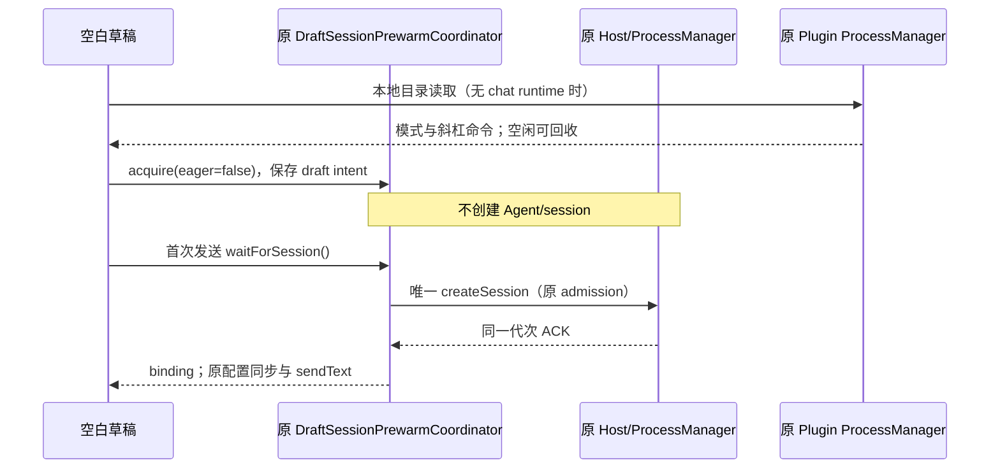
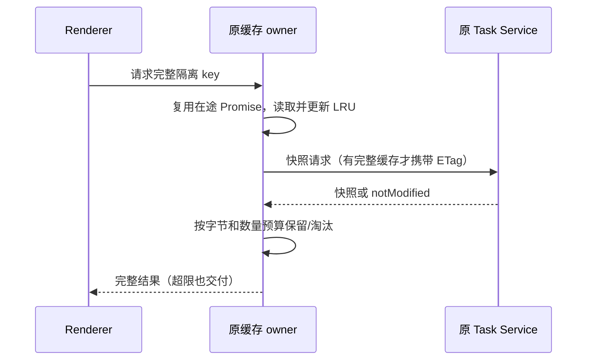

# aibuddy7se 内存优化

## 范围与规则

用户反馈刚启动以及执行任务、浏览网页时总 RAM 超过 1 GB。本轮先减少可确认的启动分配和无界缓存，不承诺未经测量的降幅。

- Win7 renderer 的代码/Diff Worker 池固定为 1 个，沿用 WASM 高亮引擎、任务队列、主题同步和主线程降级；文件与 Diff AST 缓存分别最多 16 项。其他版本沿用原策略。不能通过禁用代码高亮或丢弃待处理任务省内存。
- 设置页的两个入口均按首次打开加载本地 chunk，加载时沿用应用加载反馈；工作区组件保持挂载，草稿、终端和任务不中断。首次加载和再次打开都可编辑设置，离线可用。
- Shiki token 缓存按最近使用淘汰，最多 100 项、估算保留体积 4 MiB；超限单项照常返回但不缓存。计量是缓存预算，不等同于 V8 实际堆大小。完整代码参与 key，避免同长度同首尾的不同代码误命中。
- task snapshot 内存缓存每个 service 最多 20 项、UTF-8 JSON 预算 8 MiB，单项最多 2 MiB。超限或淘汰只移除缓存引用，不删除原会话、SQLite、磁盘数据或活动 UI。仍复用同 key 在途请求；缓存缺失时从同一 service 重取，Desktop continuous 和手机 replayable 等所有现有 key 隔离维持不变。
- 不按空闲时间回收聊天 Agent、Cron、扩展 Host 或浏览器活动页面；不关闭 GPU、不缩小 V8 堆上限、不强制 GC、不关闭安全隔离。已有离线 Office/Python/SSH/技能保持可用。

## 成包测量后的启动调整

第一次对照（Actions 43472414375，源码 06d2851b）发现：90 秒工作集合计仅由 1158.89 MiB 变为 1141.92 MiB；配置虚构模型后、未发送消息时已有 20 个进程，共 2439.36 MiB。10 个新增进程来自共享任务 Agent 的进程树，而 renderer JS heap 只有约 43.5 MiB。源码调用链为 Host initializeWorkspace 预热与空白草稿 createSession，两者提前初始化 Agent。不能据此把内存大幅增长归因于 Electron renderer 缓存。

- Win7 Host 不主动 initializeWorkspace 预热；真实打开历史、发送、自动化和显式能力请求仍走原服务 admission。现代 Desktop 保持预热。
- Win7 新草稿订阅原 DraftSessionPrewarmCoordinator，但不在订阅时创建会话。首次 `waitForSession` 在同一 owner 启动 createSession，并发发送等待同一个 Promise；模型/权限/思考档位仍由原 draft config owner 提供。会话创建期间切 workspace/transport/代次，旧等待失败，迟到结果按原规则删除，不能错误提交到新草稿。现代/Web 默认仍 eager。
- 这项取舍将首次会话准备时间移到首次发送；不把 `enabled=false` 当作懒启动，不另建发送专用会话路径，也不修改 accepted queue、owner/lease、desktop/mobile delivery kind。
- Win7 插件管理 lane 在没有在途操作且数据库准备完成后连续空闲 30 秒回收整棵树；下一次插件/技能管理请求透明重新启动。复用原 ProcessManager 的 idle 回收与 cleanup barrier，不建立第二个计时器或管理器。聊天 lane 不启用该策略，插件安装/配置/迁移请求未结束时不得回收。getClient 的明确使用重置空闲期限，避免刚交付 client 就被旧计时器回收。
- Actions 43481461286 的真实 GUI 揭示第三条启动路径：`useDraftConfigControl` 水合斜杠命令目录调用 `readWorkspacePresentation`，原本通过只读 chat client 创建常驻共享 Agent。Win7 本地、聊天 runtime 尚未存在时，目录读取改用原插件管理 lane；已有聊天 runtime、现代/Web 与远程目录保持原路径。继续准备实际 workspace，传递完整 workspace identity/remote session 字段，走原协议和动态工作流策略同步队列，不把管理进程登记为聊天会话 owner。管理面每次读目录同步当前策略（不能假定其上次状态），不禁用水合或删减技能/命令。GUI 必须看到非空目录，并仍断言首次发送前无共享聊天 Agent。

追加验收：真实浏览器验证懒订阅/并发首次请求/清理/现代 eager；成包在配置模型并 reload 后仍没有共享任务 Agent，首次向本机虚构模型发送成功且只创建一个共享 runtime；插件管理空闲回收后再次读取离线技能成功。原始模型与内网服务仍未实测。

## 所有者与事件

原 DiffsWorkerPoolProvider 仍拥有唯一 Worker 池。React.lazy 拥有本地模块加载 Promise；原设置服务仍拥有配置。原 Shiki 模块与 task service proxy 分别拥有各自的可丢弃缓存，不另建任务状态。

在途请求持有本次缓存引用，其他请求的淘汰不会使 notModified 丢失正文；回收不改变 service 的 owner/lease、事件顺序或远程恢复协议。

## 验收

1. 类型检查、Lint/Hooks、架构检查和正常 pre-push；保留全部 Win7 Windows Actions 门禁，包括真实注册表安全负例。
2. 成包 GUI 首次/再次打开设置，修改语言、主题、自定义模型并 reload；系统自测与品牌截图保持通过。
3. 成包设置页代码预览验证 Worker 可完成高亮、主题切换与再次打开；浏览器缓存场景包含中文代码。确认 Win7 Worker 数为 1，构建入口未静态包含设置页 chunk。
4. 同一 Windows runner、同一虚构用户数据及运行时，对旧包/新包分别在工作区就绪后 30 秒和 90 秒取样，报告进程树的 working set 与 private bytes、renderer JS heap、Worker 数。新包还在虚构模型首次回复后 30 秒采样，明确区分尚未启用 Agent 与任务后的占用，不能把延迟分配当成活动任务阶段的内存降幅。采样不强制 GC，不打开资源管理器窗口；数值不代表真实 Win7 或用户真实任务/网站。
5. Windows 成包通过后只交付校验 SHA-256 的单个离线 EXE；记录实测差异及未验收范围。

Windows 成包验收已通过，实测与未覆盖范围见下方最终记录；不能把空闲阶段的改善外推到活动任务或真实网站。

### 构建环境兼容回归

Actions 43479173611 在安装器准备 ugrep 时失败：`powershell.exe` 从继承的 PSModulePath 加载了 PowerShell 7 的 Archive 模块，调用当前 .NET 不具备的 ExtractToDirectory 重载。预编译 ZIP 解压仍由原脚本负责，但 Windows 必须显式导入当前 PowerShell 自带的 Archive 模块；任何解压错误必须非零退出，不能继续到“找不到二进制”才报错。保留 -Force 覆盖构建临时目录的语义、SHA-256 校验和产物验证；不涉及用户数据。Windows 工程回归使用中文/单引号路径、污染的模块目录、重复解压和损坏 ZIP 验证，不依赖网络。

## 本地验证

- Node 24.14.0 / pnpm 10.33.2：两轮类型检查均通过，架构 0 新/基线违规；第一轮 Lint 536 项既有告警、0 错误，第二轮为 533 项、0 错误。Root 原有两个未使用导入现在用于 lazy/Suspense；draft hook 明确代次字段与已提交的配置函数，消除了相关依赖诊断。Root 的既有 appSettings 字段依赖、task hook 的既有条件调用未在本轮修改；draft 的 retainers Set 快照保留，避免删除时修改迭代集合。
- `node scripts/win7/renderer-memory-smoke.mjs /usr/bin/chromium`：真实 Chromium 挂载 service hook、虚构 RPC 快照，验证并发去重、在途 notModified 被淘汰仍完整返回、淘汰后重取、大快照不截断、不复用不同 identity/clientMode、token 中间修改不误命中、数量/字节双限额。结果通过；结束时快照 15 项 / JSON 7,864,959 bytes，token 7 项 / 估算 3,611,954 bytes。这是隔离缓存场景，不是真实模型任务验收。
- Win7 renderer 生产构建通过，SettingsPage 为独立本地 chunk（约 454 kB 未压缩传输体积，不能等同于节省 RAM）。新 Windows 门禁复跑同一缓存浏览器验收。
- 单行数万字符的 JavaScript 高亮压力样本耗时过长，本轮不宣称解决超长单行的 tokenizer CPU 问题；预算压力验收使用多行中文代码并保持相同预算断言。
- 第二轮真实 Chromium 验收追加通过：懒订阅不创建、并发首次请求共用 binding、未发送草稿清理、切换工作区使旧请求失败并清理迟到结果、promote 后不删除任务、默认现代 eager 行为保持。最终工程检查 29 项，本机 27 通过、2 项 Windows 原生检查按平台跳过；最终 Windows 29 项全部执行通过。ZIP 解压修复的正常 pre-push 另选中 3 个工程 Vitest 文件，22 项通过。

## 2026-11-13 最终成包验收

运行时代码 `ddd6e31003b6ca4b6e5d4a18fd9110928840254a` 已正常推送到用户 fork 的 `codex/win7-experimental`。[Windows Actions 43485739797](https://github.com/skyjt/ZCode_custom/actions/runs/43485739797) 全部通过（job `132093688183`）。最终本地类型检查通过，Lint 533 条既有告警、0 错误，架构新增/基线违规均 0，正常 pre-push 通过。架构工具对当前 UI/services/desktop 未纳入治理的模块不提供边界证明；仍按受控上下文及调用链复核。

### 同机旧包与新包测量

同一 Windows Server 2022 runner、同一虚构迁移数据、同一防火墙策略，顺序运行旧包 `4e336a8b`（Actions 43408181317）与新包。单位为 MiB；工作集合计包括共享页，private bytes 为进程提交量，两者都不能直接等同于不重复计算的物理 RAM。没有强制 GC；以下是单次对照采样，不代表 Win7 真机或所有负载。

| 采样阶段                                    | 工作集合计：旧 → 新 | Private bytes：旧 → 新 | Renderer JS heap：旧 → 新 | 进程数：旧 → 新 |
| ------------------------------------------- | ------------------- | ---------------------- | ------------------------- | --------------- |
| 工作区就绪 30 秒                            | 1380.12 → 1371.61   | 1065.90 → 1026.79      | 36.34 → 36.24             | 10 → 10         |
| 工作区就绪 90 秒                            | 1166.57 → 929.41    | 950.06 → 759.72        | 36.34 → 36.26             | 10 → 7          |
| 浅色代码预览                                | 1266.39 → 1011.94   | 1032.12 → 833.26       | 45.15 → 46.18             | 10 → 7          |
| 深色代码预览                                | 1274.55 → 1026.48   | 1039.85 → 851.48       | 45.02 → 53.99             | 10 → 7          |
| 配置模型并 reload，关闭设置 30 秒，尚未发送 | 2480.32 → 944.85    | 2020.77 → 856.41       | 43.33 → 43.17             | 20 → 7          |
| 新包打开插件页并完成首次回复，回复后 30 秒  | 未测 → 2910.22      | 未测 → 2369.97         | 未测 → 58.82              | 未测 → 24       |

90 秒空闲工作集合计下降 20.33%，配置模型但未发送时下降 61.91%；对应 private bytes 下降 20.03% 和 57.62%。初始 30 秒仅下降 0.62%，仍约 1372 MiB，不能声称刚启动即低于 1 GB。代码预览仍正常高亮，Worker 在该 runner 上由 2 个减至 1 个；新包设置页未在启动入口预加载。

首次回复后的 2910.22 MiB 仍然偏高。该采样前还打开过插件页，进程树同时包括聊天 Agent/MCP 与插件页触发的 MCP 状态检查；旧包没有同阶段采样，因此不能据此计算活动任务阶段的改善或回退。日志显示插件管理进程已按空闲策略回收，活动聊天未被结束；任务和 MCP 后台进程仍有后续优化空间。本轮没有真实浏览网页的 RAM 对照，也没有解决超长单行 tokenizer CPU 问题。

### 功能、门禁与交付

- 29/29 Windows 工程回归无跳过，包含真实注册表中文路径、不同安装位置/自定义 command 的安全负例，以及污染 PSModulePath 下的原生 ZIP 解压。未删除或放宽原门禁。
- 成包原有系统 API、现代/legacy 进程归属、Agent stdio/SQLite/Job/WinPTY、真实 OS 凭据和旧密文迁移、离线 Python/Office 库、SSH/SFTP、离线技能、PE 导入检查与防火墙阻断 GUI 全部通过。
- 缓存浏览器验收及懒草稿生命周期场景通过。GUI 在发送前看到非空斜杠命令目录且无共享聊天 runtime；插件管理空闲回收后可再次读取；真实 UI 向本机虚构 OpenAI 接口首次发送并收到回复，只启动一个共享聊天 runtime。`first-send.json` 为 PASS、`runtimeStarts: 1`；该结果不代表真实模型可用性。
- 逐一查看最终 `startup.png`、`about.png`、`help-menu.png`、浅色/深色代码预览、自测、模型配置及 `first-send.png`：名称/Logo/关于版本正确，无云升级或上游社区入口，代码高亮及回复正文可见。自测为 10 通过、0 失败、1 注意、1 未测；注意项是 runner 不是 Win7，未测项为真实模型/SSH 服务和 GPU/驱动交互。Office 库通过不代表真实 Office 2013 导出已验收。品牌扫描 28,553 个文本文件，仅三份迁移识别文件允许旧名称。
- [EXE 下载](https://github.com/skyjt/ZCode_custom/actions/runs/43485739797/artifacts/14069470959)外层 ZIP 恰含一个 `aibuddy7se-3.18.0-win7-intranet-x64.exe`，254,611,286 字节，无便携包。下载后实际 SHA-256 与 runner 的 `SHA256SUMS.txt` 一致：`512861188eb378e6adfe78e2f9e2d027039eea645a1907f601204ff795be08ae`。[诊断、截图与完整内存采样](https://github.com/skyjt/ZCode_custom/actions/runs/43485739797/artifacts/14068442796)和安装器 artifact 保留 14 天。

仍未验收：Win7 SP1 x64 真机/PowerShell 2.0/.NET 3.5、真实 Office 2013、真实模型/内网 SSH、实际旧 NSIS 覆盖安装、完整退出后的真实升级重启，以及用户实际浏览器/任务负载的内存。离线 Office/Python/SSH/技能和原始数据保留规则维持；首次发送会承担延迟到此时的 Agent 初始化开销。
