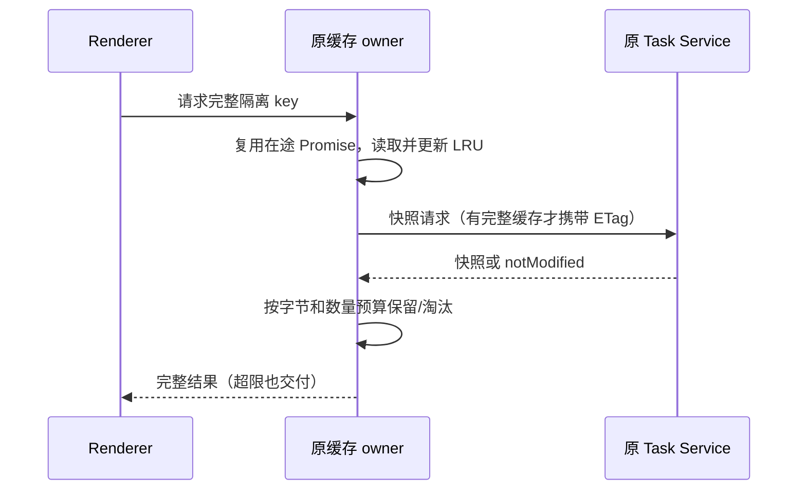

# aibuddy7se 内存优化（第一轮）

## 范围与规则

用户反馈刚启动以及执行任务、浏览网页时总 RAM 超过 1 GB。本轮先减少可确认的启动分配和无界缓存，不承诺未经测量的降幅。

- Win7 renderer 的代码/Diff Worker 池固定为 1 个，沿用 WASM 高亮引擎、任务队列、主题同步和主线程降级；文件与 Diff AST 缓存分别最多 16 项。其他版本沿用原策略。不能通过禁用代码高亮或丢弃待处理任务省内存。
- 设置页的两个入口均按首次打开加载本地 chunk，加载时沿用应用加载反馈；工作区组件保持挂载，草稿、终端和任务不中断。首次加载和再次打开都可编辑设置，离线可用。
- Shiki token 缓存按最近使用淘汰，最多 100 项、估算保留体积 4 MiB；超限单项照常返回但不缓存。计量是缓存预算，不等同于 V8 实际堆大小。完整代码参与 key，避免同长度同首尾的不同代码误命中。
- task snapshot 内存缓存每个 service 最多 20 项、UTF-8 JSON 预算 8 MiB，单项最多 2 MiB。超限或淘汰只移除缓存引用，不删除原会话、SQLite、磁盘数据或活动 UI。仍复用同 key 在途请求；缓存缺失时从同一 service 重取，Desktop continuous 和手机 replayable 等所有现有 key 隔离维持不变。
- 本轮不改变 Agent、Cron、扩展 Host 和浏览器活动页面的调度，不关闭 GPU、不缩小 V8 堆上限、不强制 GC、不关闭安全隔离。已有离线 Office/Python/SSH/技能保持可用。

## 所有者与事件

原 DiffsWorkerPoolProvider 仍拥有唯一 Worker 池。React.lazy 拥有本地模块加载 Promise；原设置服务仍拥有配置。原 Shiki 模块与 task service proxy 分别拥有各自的可丢弃缓存，不另建任务状态。

在途请求持有本次缓存引用，其他请求的淘汰不会使 notModified 丢失正文；回收不改变 service 的 owner/lease、事件顺序或远程恢复协议。

## 验收

1. 类型检查、Lint/Hooks、架构检查和正常 pre-push；保留全部 Win7 Windows Actions 门禁，包括真实注册表安全负例。
2. 成包 GUI 首次/再次打开设置，修改语言、主题、自定义模型并 reload；系统自测与品牌截图保持通过。
3. 成包设置页代码预览验证 Worker 可完成高亮、主题切换与再次打开；浏览器缓存场景包含中文代码。确认 Win7 Worker 数为 1，构建入口未静态包含设置页 chunk。
4. 同一 Windows runner、同一虚构用户数据及运行时，对旧包/新包分别在工作区就绪后 30 秒和 90 秒取样，报告进程树的 working set 与 private bytes、renderer JS heap、Worker 数。采样不强制 GC，不打开资源管理器窗口；数值不代表真实 Win7 或用户真实任务/网站。
5. Windows 成包通过后只交付校验 SHA-256 的单个离线 EXE；记录实测差异及未验收范围。

验收结果待填，未测项目不得标为通过。

## 本地验证

- Node 24.14.0 / pnpm 10.33.2：类型检查通过，架构 0 新/基线违规；Lint 536 项既有告警、0 错误（Root 原有两个未使用导入现在用于 lazy/Suspense）。改动文件 Hooks 检查未新增诊断；Root 的既有 appSettings 字段依赖、task hook 的既有条件调用未在本轮修改。
- `node scripts/win7/renderer-memory-smoke.mjs /usr/bin/chromium`：真实 Chromium 挂载 service hook、虚构 RPC 快照，验证并发去重、在途 notModified 被淘汰仍完整返回、淘汰后重取、大快照不截断、不复用不同 identity/clientMode、token 中间修改不误命中、数量/字节双限额。结果通过；结束时快照 15 项 / JSON 7,864,959 bytes，token 7 项 / 估算 3,611,954 bytes。这是隔离缓存场景，不是真实模型任务验收。
- Win7 renderer 生产构建通过，SettingsPage 为独立本地 chunk（约 454 kB 未压缩传输体积，不能等同于节省 RAM）。新 Windows 门禁复跑同一缓存浏览器验收。
- 单行数万字符的 JavaScript 高亮压力样本耗时过长，本轮不宣称解决超长单行的 tokenizer CPU 问题；预算压力验收使用多行中文代码并保持相同预算断言。
