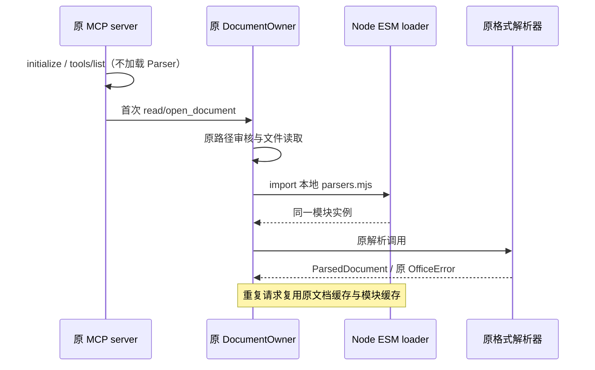
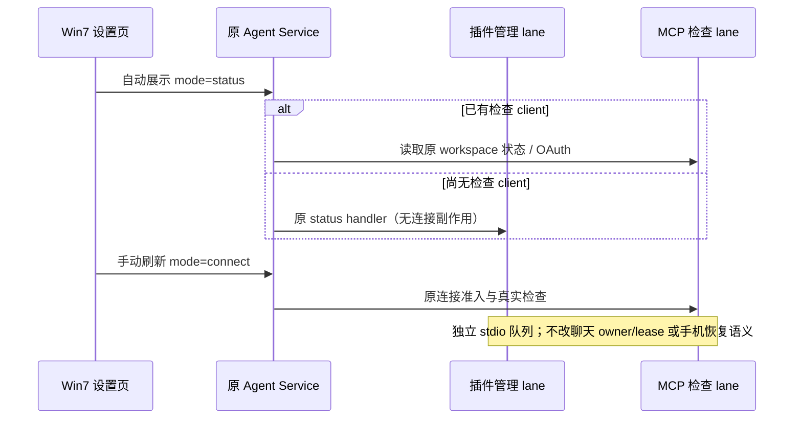
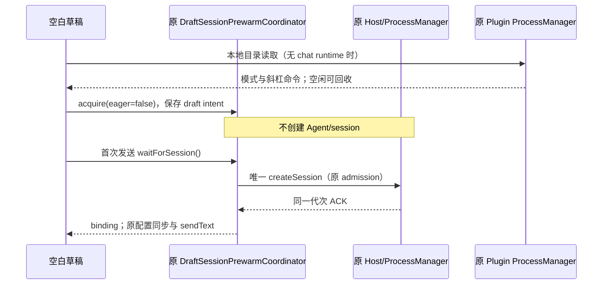
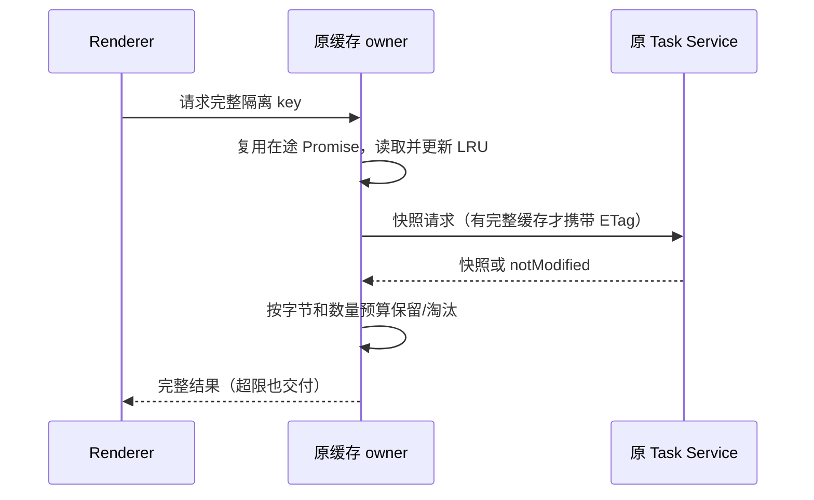

# aibuddy7se 内存优化

## 继续开发：Word 样式解析的临时分配

从干净且与 fork 同步的 `0164fdd0` 接续；成包对照基线为 43829709499（`3fce87dd`）。
本阶段先调查 Main/Window Host 导入图和 Word CPU/分配，再选择已有直接运行时证据的
Word 热点。Main/Host 的 bundle 中包含 RUM、证书校验、协议 schema 与服务装配；体积
不是 RAM，没有据此删除功能或修改它们的初始化/权限路径。

现有 `report.docx` 正文 XML 3,750 字节，样式 XML 349,458 字节、164 个样式。32 次解析
保留最后 6 个结果的 Linux Node 诊断中，主要分配在 XML 属性/节点构造，GC 后堆明显回落，
支持“重复临时分配压力”的判断，尚不能断言是文档缓存泄漏。诊断用的 CPU/分配采样和堆
快照（会触发 GC）只用于定位，不能混入无强制 GC 的成包验收数据。

方案：仅 Word 文本解析的 styles.xml 使用同一 fast-xml-parser 的 stopNodes，跳过不会
参与标题/继承判断的 docDefaults、latentStyles、rPr、tblStylePr、tblPr、trPr、tcPr 子树
展开；保留样式 id/name/basedOn、pPr/outlineLvl、顺序和原安全选项。正文 XML 和查看面板
继续读取原文件，所有格式仍可显示；不删数据、不新增缓存、不改变 DocumentOwner 的
会话/6 项文档缓存/文件句柄所有权、工具 schema 或工作区权限。

验收先覆盖丰富格式与精简格式产生相同文本/标题/表格/搜索/锚点，样式继承、直接覆盖、
循环引用、中文与实体处理；再执行四类 Office 原回归及新旧成包同机同流程。保留启动、
文字、五轮真实命令及四类 Office 的首次延迟、轮换/空闲内存、安全负例和原文哈希。
Word 在原第 20 次之外追加第 60 次采样，记录每次轮换延迟；其它格式保持 20 次。
收益只按实测阶段报告，不把 Word 活跃解析改善说成启动或整体 RAM 已解决。

本地证据：新增复杂样式语义用例在修改前后均通过，Office 84 项及四类完整 MCP smoke、
新增文件/轮换流程通过。三组独立 Node 进程交替按旧→新、新→旧、旧→新执行 60 次解析，
不强制 GC，输出摘要哈希一致；旧平均 30.79–38.31 ms，新 10.75–12.24 ms，结束 RSS
旧 258–270 MiB、新 112–132 MiB。另有采样分配诊断约 752 → 259 MiB（32 次累计分配，
不是常驻 RAM）。根/CLI 类型检查通过，根 Lint 526 既有告警/0 错误，CLI 86 既有告警/0
错误，架构新增/基线违规 0。Linux 工程 31 通过/5 项原生 Windows 跳过；Windows 成包待验收。

## 2026-11-16 调度器与 Office 成包对照验收

代码 `3fce87dd116956f0c20253b5e2172edcdd5907fd`，包含调度器有限导入 `497d00ac`、
Office 延迟加载 `621f239b` 及测试流程 `c847e269` / `3fce87dd`。
[Windows Actions 43829709499](https://github.com/skyjt/ZCode_custom/actions/runs/43829709499)
（job `133171871338`）全部通过。**功能/安全门禁通过，但本轮没有证明整体 RAM 明显下降，
启动及纯文本内存目标仍未达到。** 不将此前约 42% 的结果重复算作本轮收益。

旧包为成功构建 43812974790、代码 `a44a27aa`，新旧包在本次同一 Windows Server 2022 runner
顺序运行相同隔离数据、迁移、设置、文字回复与五轮真实只读 Bash 命令。没有强制 GC、压缩
工作集或关闭必要进程。下表单位 MiB；working set 合计可能重复计算共享页，private bytes
是私有提交量，不是私有物理驻留 RAM。三次回复快照来自一次运行，不是三次独立启动。

| 阶段 | 旧 working set | 新 working set | 旧 private bytes | 新 private bytes |
| --- | ---: | ---: | ---: | ---: |
| 工作区就绪 30 秒 | 1354.14 | 1377.60 | 1045.03 | 1032.02 |
| 工作区就绪 90 秒 | 956.38 | 955.58 | 747.04 | 755.39 |
| 设置关闭 30 秒、未发送 | 948.11 | 949.63 | 836.24 | 884.52 |
| 文字回复后三次平均 | 1593.90 | 1663.63 | 1448.67 | 1437.09 |
| 首次真实命令完成 | 1590.93 | 1654.00 | 1468.99 | 1455.51 |
| 第五次真实命令完成 | 1641.11 | 1696.67 | 1530.10 | 1507.94 |
| 命令结束空闲 15 秒 | 1521.53 | 1564.71 | 1471.82 | 1456.86 |

启动 90 秒总体基本持平，文字回复后三次平均 working set **上升 4.37%**，private bytes
仅下降 0.80%。本次调度器对应 utility 节点从 147.08/129.36 降为 135.20/118.98 MiB
（working set/private bytes），但这一局部收益没有转化为整棵进程树明显下降。其它 Host、
renderer 和 Agent 的变化不能仅凭这一次顺序采样归因于本轮代码。启动 90 秒仍为 7 个进程，
聊天及命令阶段仍为 16 个；不是通过关掉功能取得数字。

五轮命令均核对真实 stdout，且新旧包各只有一个原 shared runtime。首次从 UI 发送到完成
为 1446.8 → 1479.2 ms，随后四轮平均为 1061.4 → 995.8 ms；首次工具下发到结果为
903.9 → 714.3 ms，后续单次约 286–388 ms。五轮间 working set 增长 50.18 → 42.66 MiB，
private bytes 增长 61.11 → 52.43 MiB；空闲后回到首轮附近。这只是短回合样本，不能据此
声称长会话、真实模型、浏览器或 Maven 构建无持续增长/无延迟回归。

四个 Office 插件分别以随包 Electron + 轻量宿主运行真实 MCP；每个使用同一中文文件、
8 份副本轮换读取 20 次（超过原 6 项缓存），同时验证损坏文件拒绝、越界拒绝和原文件哈希
不变。下表每格均为“旧 → 新”，四个插件是分别运行，不能把分项之和冒充同时运行的总 RAM。

| 插件 | 目录就绪 working set MiB | 目录就绪 private bytes MiB | 20 次轮换后 working set MiB | 20 次轮换后 private bytes MiB |
| --- | ---: | ---: | ---: | ---: |
| Word | 51.80 → 53.71 | 66.43 → 70.04 | 124.07 → 140.44 | 134.78 → 155.71 |
| Excel | 58.47 → 52.87 | 74.61 → 70.24 | 70.66 → 68.90 | 86.19 → 87.63 |
| PowerPoint | 51.83 → 50.11 | 66.48 → 64.61 | 62.97 → 63.44 | 75.51 → 76.21 |
| PDF | 59.88 → 50.20 | 77.06 → 64.61 | 132.80 → 125.21 | 148.67 → 137.28 |

| 插件 | 首次 open_document ms，旧 → 新 | 随后首次 read_document ms，旧 → 新 |
| --- | ---: | ---: |
| Word | 355.5 → 500.5 | 5.4 → 55.2 |
| Excel | 249.1 → 275.9 | 3.6 → 4.1 |
| PowerPoint | 176.2 → 209.8 | 5.7 → 6.8 |
| PDF | 770.0 → 837.4 | 2.1 → 3.1 |

重复读取约 1–8 ms。PDF/Excel 的未用解析器占用有局部下降，但 Word 目录和轮换后的占用
反而更高，首次打开四类文件均更慢；首次读完四类文件的分项合计也没有下降。延迟加载
不能当成活动 Office 内存已经优化成功，后续应复测 Word 的解析分配及文档释放。当前保留
加载边界与原缓存所有者，不根据单次快照缩小缓存、强制 GC 或回收在用进程。

验证与故障记录：

- Windows 工程 36/36、零跳过，真实注册表不同 command/中文路径负例保留；旧 SQLite/OS
  密文迁移、源数据与冲突保护、完整/轻量 Agent 执行边界、WinPTY、进程归属、离线
  Python/Office/SSH/SFTP/Git、现有 JDK 8/Maven、技能、PE、防火墙 GUI 全部通过。
- 新旧包各四个 Office MCP 文件流程全部通过。自动 MCP 查询 0 个检查进程、手动 1 个，
  再次进入复用同一进程。原调度器启动、单 Diff Worker、代码预览与设置重开继续通过。
- 最终 13 张截图逐一核对，名称/Logo、关于/帮助、中英文自测、深浅设置与代码、模型配置、
  首次文字回复、五轮命令及手动 MCP 检查正常。品牌扫描 28,572 个文本文件，仅原三份迁移
  识别模块允许旧标识；自测 12 通过、1 注意、0 失败、1 未测。
- 本地根/CLI 类型检查通过；Office 83 项、四类完整 MCP smoke、四类新增 Node 文件流程、
  SEA 42 项、相关 bootstrap 98 项通过，远端资产 2 项及测试模型 5 项通过。Linux 工程
  31 通过/5 项原生 Windows 跳过，已由本次 Windows 36/36 补齐。正常 pre-push 通过，
  根 Lint 526 既有告警/0 错误，CLI Lint 86 既有告警/0 错误；架构新增/基线违规 0。
  App/CLI 部分目录尚未纳入受管模块，不能把架构检查当作完整边界证明。
- 本地 Office 探针曾把真实错误码 `path_outside_workspace` 写为 `outside_workspace`，
  PDF fixture 正文应为 `Research Paper`，纠正测试预期后四类均通过，没有放宽负例。
  首轮 Windows 43825818453 在旧包真实命令后的回复等待失败，尚未运行 Office 内存探针；
  原因是测试模型把工具结果后的 user-role 系统提醒误作原用户探针。真实 Agent 本地复现后
  修复探针定位，仍严格匹配实际 stdout，五轮真实调用及本次成包通过，未改产品权限。

[本轮验证版单个离线 EXE](https://github.com/skyjt/ZCode_custom/actions/runs/43829709499/artifacts/14209257226)：
`aibuddy7se-3.18.0-win7-intranet-x64.exe`，291,424,932 字节。实际下载 SHA-256 与 runner 一致：
`5004501678705a84b17d89eaff96fe92a6caceac278961a2a29c7952f2edd17c`。
外层 ZIP 仅为 Actions 传输容器，恰含一个 EXE，没有便携包。
[原始数据与截图](https://github.com/skyjt/ZCode_custom/actions/runs/43829709499/artifacts/14209486465)
包含新旧 `memory*.json`、`office-memory.json`、`model-fixture.json`；保留至 2026-11-30
08:38 UTC（北京时间 16:38）。构建步骤 10 分 43 秒，完整 job 23 分 54 秒（含 9 分 05 秒
双版本 GUI/Office 对照）；未削减原验收门禁。只推送用户 fork，没有部署或发布 Release。

下一步优先测 Main/Window Host 的装配依赖和 Word 实际解析分配，再做多次独立启动、长会话
与真实浏览任务对照。没有实现原生 UI 重写；renderer 只是整棵树的一部分，不能假定重写 UI
即可消除 Agent/工具占用。真实 Win7/Office 2013、内网模型/SSH/Git/Maven 项目及企业认证、
实际旧 NSIS 覆盖安装和完整退出重启升级仍未验收。Server 2022 的样本不替代这些验收。

## 本轮实现：调度器依赖与 Office 解析器延迟加载

本轮从干净且与 fork 同步的 `8ea01b48` 开始，运行时对照使用成功构建 43812974790（`a44a27aa`）。开始时没有未提交修改、活动协作代理或正在运行的构建；保持现有执行环境和模型，不部署或发布 Release。最终对照见上方验收记录。

- 调度器只通过 services 的有限公开子路径读取原 `AutomationRepo`、`OffPeakTaskRepo` 与 cron 函数，避免加载整个 Host 服务装配入口。公开导出直接指向原文件，没有第二个 Repo/状态机；常驻进程、轮询周期、唤醒、事务认领、恢复、退出和 Main 路由不变。构建回归禁止 scheduler 闭包重新包含 services/node。
- 四个 Office 查看插件的 MCP 握手/工具目录不加载解析器；首次真正解析文件时通过本地 ESM 动态导入加载。esbuild 同次构建 `server.mjs`、`parsers.mjs` 和共享 chunk，保持 `OfficeError` 等对象身份；所有资产随包离线提供，种子/桌面/SEA 清单把解析入口列为必需资产。模块缓存由 Node loader 拥有，原 DocumentOwner 继续拥有会话、6 项文档缓存与文件句柄；不增加状态副本、不清理正在使用的文档或工具进程。
- 延迟加载只转移解析器首次加载成本，必须单独报告首次与重复工具延迟。工具 schema/权限/工作区文件边界不变，损坏文件和越界访问继续返回原错误。

验收：同 runner 对旧包和新包执行相同启动/空闲/设置/文字会话流程；追加真实无害 Bash 工具的首次和五轮重复调用、前后及空闲后进程采样。另对四个随包 Office MCP 执行工具目录、首次读取、重复读取和错误边界，核对原文件哈希、延迟与内存。所有采样不强制 GC/压缩工作集。保留原 Windows 安全/迁移/离线功能门禁，并检查调度器正常启动；Windows Server 数据不得声称为真实 Win7、Office 2013 或内网模型/服务验收。

首次成包运行 43825818453 在旧包的工具回复等待处失败，Office 内存流程尚未执行，未交付安装器。真实 Agent + OpenAI-compatible 适配器的本地复现确认：命令结果后附加的 user-role 系统提醒使测试模型漏掉原探针、回复普通文本。测试模型改为定位最近的合成探针正文，继续要求匹配真实工具输出（拒绝仅在错误中复述命令），并保留无正文/凭据的角色、工具名与探针编号诊断。流式/非流式回归包含前后 reminder，不更改产品权限或放宽成功条件。

## 2026-11-16 设置查询与轻量宿主成包验收

代码 `a44a27aa3a97c18425c95a745447aefcd4832d6d`，包含实现 `8331fc6f` 及对照流程修正。
[Windows Actions 43812974790](https://github.com/skyjt/ZCode_custom/actions/runs/43812974790)
（job `133118609641`）全部通过。旧包来自成功构建 43805639768、代码 `121ad70a`。
在同一 Windows Server 2022 runner，使用相同内容的隔离用户数据、旧 SQLite/OS 密文迁移、
中英文自测、主题/模型配置、插件页及本机虚构模型纯文本回复；无强制 GC 或工作集压缩。

| 阶段                   | 旧包 working set MiB | 新包 working set MiB | 旧包 private bytes MiB | 新包 private bytes MiB |
| ---------------------- | -------------------: | -------------------: | ---------------------: | ---------------------: |
| 工作区就绪 30 秒       |              1382.32 |              1376.00 |                1037.60 |                1031.02 |
| 工作区就绪 90 秒       |               967.05 |               950.22 |                 766.20 |                 765.96 |
| 设置关闭 30 秒、未发送 |               981.99 |              1001.81 |                 873.13 |                 911.13 |
| 首次回复后 30 秒       |              2906.88 |              1716.08 |                2368.91 |                1458.32 |
| 首次回复后第二次采样   |              2871.78 |              1664.46 |                2363.20 |                1458.33 |
| 首次回复后第三次采样   |              2828.77 |              1610.22 |                2358.32 |                1459.12 |
| 回复后三次平均         |              2869.14 |              1663.59 |                2363.48 |                1458.59 |

三次为同一运行的连续快照，不是三次独立启动。回复后 working set 合计下降 **42.02%**
（1205.55 MiB），private bytes 下降 **38.29%**（904.89 MiB），进程数均由 24 变为 16。
新包此时只剩基础 7 个进程及聊天树 9 个进程，已无额外设置检查树；首次快照的 6 个工具
子进程 private bytes 各约 65–70 MiB。working set 可能重复计共享页，private bytes 是提交量，
不能当作私有物理驻留 RAM。真实浏览任务、重型 Office/Maven 构建的峰值未由此覆盖。

启动 90 秒只下降约 1.7%，private bytes 几乎不变；设置关闭后的数值还有上升。**基础常驻占用
仍高，不能宣称启动高占用已解决或达到 600 MiB/纯文本 1 GiB 目标。** 本次未重写原生 UI、
未更改调度器/扩展 Host/有状态浏览器及 REPL 生命周期；后续应继续按实际进程分解做启动加载
和工具执行优化，不把本轮效果外推到这些未实现的阶段。

验证证据：

- Windows 工程 33/33，包括真实注册表不同 command/中文路径安全负例，零跳过；完整/轻量
  CLI 的四组执行边界全部通过。实际成包轻量宿主在 main 返回后仍处理 stdio，中文路径/argv、
  环境清洗和 Job 清理通过；完整 Agent、SQLite、凭据迁移、WinPTY/原生 API 门禁保持通过。
- `mcp-passive-status.json`：自动插件页检查进程 0 个、手动检查 1 个、再次进入仍为同一个。
  手动 MCP 截图显示真实连接结果；首次聊天只创建一个原 shared runtime，命令目录非空。
- 离线 Office/Python、SSH/SFTP、Git/系统凭据、现有 JDK 8 编译运行/Maven 版本、技能与 PE
  检查通过；防火墙开启的成包 GUI 全程通过。所有内存采样均无常驻 java/javac。
- 最终 12 张启动、关于、帮助、中英文自测、深浅主题/代码预览、模型配置、MCP 手动检查和
  首次回复截图逐一核对。品牌扫描 28,563 个文本文件，仅三份迁移识别模块允许旧标识。
- 本地根类型检查通过，正常 pre-push 全门禁通过，Lint 526 既有告警/0 错误；MCP 设置页专项
  0 告警/0 错误。CLI/bootstrap 类型及相关回归通过。Linux 空插件三轮 RSS 完整入口约 186 MiB、
  轻量入口约 62 MiB，仅作为同源入口的辅助证据，不替代以上 Electron 成包数据。

[离线 EXE](https://github.com/skyjt/ZCode_custom/actions/runs/43812974790/artifacts/14201458321)
附件内只有 `aibuddy7se-3.18.0-win7-intranet-x64.exe`，**291,499,677 字节**；外层 ZIP 是 Actions
传输封装，没有便携包。已下载并确认 SHA-256 与 runner 一致：
`45942d5603520c8fb3b36aea9144f7ef43d0bc1e2d63b9ca7b5fe8123e2a3110`。
[诊断和截图](https://github.com/skyjt/ZCode_custom/actions/runs/43812974790/artifacts/14201612658)
保留至 2026-11-30 06:09 UTC（北京时间 14:09）。没有写入离线电脑 Downloads。

真实 Win7/Office 2013、真实模型/内网 SSH/Git/Maven 项目及企业认证、实际旧 NSIS 覆盖安装
仍未验收。以上记录对应代码 `a44a27aa`；随后仅更新验收文档，不改变该安装器代码。

## 2026-11-16 分阶段优化：设置查询与工具宿主

基线为 Actions 43805639768 的运行时代码 121ad70a。打开插件页再向虚构模型发送一次纯文本请求后，24 个进程的 working set 合计 2916.21 MiB、private bytes 2366.18 MiB；其中设置 MCP 检查树 8 个进程、968.95/680.86 MiB，聊天树 9 个进程、1137.55/798.93 MiB。working set 会重复计共享页，private bytes 是提交量，不等于实际私有物理 RAM。不能用 renderer JS heap（52.81 MiB）解释整个进程树。

第一步只改变 Win7 的被动设置查询：

- 自动打开/配置投影变化使用已有 `mcp/list mode=status`，只展示配置及已有检查状态；未检查不能显示连接成功。手动刷新、启用与实际工具调用继续执行真实连接。
- 若原 `mcp-status` manager 已有 client，status 请求继续在该 client 读取，以保留 OAuth、当前 workspace 的状态及原 lease。否则复用可空闲回收的插件管理 lane；不得因只读查询创建第二个 MCP 检查树。
- connect 请求仍独占原 `mcp-status` lane，不能阻塞插件安装/卸载。保留五分钟空闲策略和在途请求保护，不提前关闭授权窗口，不回收聊天、REPL 或浏览器。
- 原 CLI handler、Host 工作区登记、UI epoch 和刷新队列继续拥有状态；不增设状态缓存或第二个 owner。旧 Agent 不支持 status 时仍明确失败，禁止降级 connect。现代 Desktop/Web 行为不变。
- 进程启动日志增加已有 lane 字段，便于区分同 cwd 的管理与检查进程，不记录参数、凭据或新用户数据。

验收先覆盖真实成包：插件页自动查询完成、无 mcp-status spawn；首次纯文本回复后采样；再点击手动 MCP 刷新，确认真实检查 lane 启动及请求完成，再次进入页面复用原 lane。对照包也必须执行插件页及首次发送，不能拿旧包启动内存与新包任务后内存比较。原安全负例、功能门禁及品牌截图全部保留。后续宿主/前端优化逐步追加实测，不预先承诺目标 RAM。

## 范围与规则

第二步减少每个自有工具宿主的重复加载：从同一 CLI main 源码构建 `plugin-host.cjs`，构建期排除普通 Agent/provider/run 分支。入口仍执行原环境清洗、进程名称、stderr/error 边界和官方 CUA 凭据校验；成功启动 MCP 后不能按一次性 CLI 回收。轻量入口收到非 plugin-host 命令必须明确失败，不能隐式加载 Agent。

完整 `zcode.cjs` 保持自包含（Node/SEA/SSH 兼容）。桌面打包同时暂存轻量入口，缺失时报错，不能静默交付旧的重宿主。官方插件配置优先使用当前 CLI 旁的轻量入口；无伴随文件的独立 CLI/SEA/旧远端保持原路径。不新建 tool schema、连接池、权限路径或环境变量，不回收有状态工具；同一原插件 server.js 接收原 argv/env 并持有原 stdio。

CLI 回归分别执行完整/轻量入口的普通插件、授权 CUA、拒绝非法 CUA、未知命令；构建 metafile 证明轻量包没有 Agent 模块。真实成包补轻量宿主 stdio 请求/响应与参数、环境清洗，并保留 Office/SSH/REPL 全部门禁。RAM 降幅以同 runner 成包采样为准，包体积不是 RAM。

这两步本地验证：根类型检查通过，Lint 526 告警/0 错误（修复本次 MCP 状态页相关的不稳定空数组/对象依赖，专项 0 告警/0 错误）；CLI/bootstrap 类型检查与 Lint 通过（bootstrap 既有告警保留）。完整/轻量入口四组执行边界全部通过，官方启动路径 4/4、MCP 状态/工作区切换/官方授权 20/20 通过；构建与 Win7 工程场景 41 通过、5 项 Windows 原生场景在 Linux 跳过，必须等待 Windows 门禁。架构新/基线违规均 0，但目标 App/CLI 多数目录未纳入受管模块，不能把此项当作完整边界证明。

压缩入口构建约 15.6 MB → 0.50 MB，只能证明避免重复加载的代码体积；实际 RAM 待同一 Windows runner 对照，首次回复后连续三次采样（无强制 GC/工作集压缩）。

用户反馈刚启动以及执行任务、浏览网页时总 RAM 超过 1 GB。本轮先减少可确认的启动分配和无界缓存，不承诺未经测量的降幅。

- Win7 renderer 的代码/Diff Worker 池固定为 1 个，沿用 WASM 高亮引擎、任务队列、主题同步和主线程降级；文件与 Diff AST 缓存分别最多 16 项。其他版本沿用原策略。不能通过禁用代码高亮或丢弃待处理任务省内存。
- 设置页的两个入口均按首次打开加载本地 chunk，加载时沿用应用加载反馈；工作区组件保持挂载，草稿、终端和任务不中断。首次加载和再次打开都可编辑设置，离线可用。
- Shiki token 缓存按最近使用淘汰，最多 100 项、估算保留体积 4 MiB；超限单项照常返回但不缓存。计量是缓存预算，不等同于 V8 实际堆大小。完整代码参与 key，避免同长度同首尾的不同代码误命中。
- task snapshot 内存缓存每个 service 最多 20 项、UTF-8 JSON 预算 8 MiB，单项最多 2 MiB。超限或淘汰只移除缓存引用，不删除原会话、SQLite、磁盘数据或活动 UI。仍复用同 key 在途请求；缓存缺失时从同一 service 重取，Desktop continuous 和手机 replayable 等所有现有 key 隔离维持不变。
- 不按空闲时间回收聊天 Agent、Cron、扩展 Host 或浏览器活动页面；不关闭 GPU、不缩小 V8 堆上限、不强制 GC、不关闭安全隔离。已有离线 Office/Python/SSH/技能保持可用。

## 成包测量后的启动调整

第一次对照（Actions 43472414375，源码 06d2851b）发现：90 秒工作集合计仅由 1158.89 MiB 变为 1141.92 MiB；配置虚构模型后、未发送消息时已有 20 个进程，共 2439.36 MiB。10 个新增进程来自共享任务 Agent 的进程树，而 renderer JS heap 只有约 43.5 MiB。源码调用链为 Host initializeWorkspace 预热与空白草稿 createSession，两者提前初始化 Agent。不能据此把内存大幅增长归因于 Electron renderer 缓存。

- Win7 Host 不主动 initializeWorkspace 预热；真实打开历史、发送、自动化和显式能力请求仍走原服务 admission。现代 Desktop 保持预热。
- Win7 新草稿订阅原 DraftSessionPrewarmCoordinator，但不在订阅时创建会话。首次 `waitForSession` 在同一 owner 启动 createSession，并发发送等待同一个 Promise；模型/权限/思考档位仍由原 draft config owner 提供。会话创建期间切 workspace/transport/代次，旧等待失败，迟到结果按原规则删除，不能错误提交到新草稿。现代/Web 默认仍 eager。
- 这项取舍将首次会话准备时间移到首次发送；不把 `enabled=false` 当作懒启动，不另建发送专用会话路径，也不修改 accepted queue、owner/lease、desktop/mobile delivery kind。
- Win7 插件管理 lane 在没有在途操作且数据库准备完成后连续空闲 30 秒回收整棵树；下一次插件/技能管理请求透明重新启动。复用原 ProcessManager 的 idle 回收与 cleanup barrier，不建立第二个计时器或管理器。聊天 lane 不启用该策略，插件安装/配置/迁移请求未结束时不得回收。getClient 的明确使用重置空闲期限，避免刚交付 client 就被旧计时器回收。
- Actions 43481461286 的真实 GUI 揭示第三条启动路径：`useDraftConfigControl` 水合斜杠命令目录调用 `readWorkspacePresentation`，原本通过只读 chat client 创建常驻共享 Agent。Win7 本地、聊天 runtime 尚未存在时，目录读取改用原插件管理 lane；已有聊天 runtime、现代/Web 与远程目录保持原路径。继续准备实际 workspace，传递完整 workspace identity/remote session 字段，走原协议和动态工作流策略同步队列，不把管理进程登记为聊天会话 owner。管理面每次读目录同步当前策略（不能假定其上次状态），不禁用水合或删减技能/命令。GUI 必须看到非空目录，并仍断言首次发送前无共享聊天 Agent。

追加验收：真实浏览器验证懒订阅/并发首次请求/清理/现代 eager；成包在配置模型并 reload 后仍没有共享任务 Agent，首次向本机虚构模型发送成功且只创建一个共享 runtime；插件管理空闲回收后再次读取离线技能成功。原始模型与内网服务仍未实测。

## 所有者与事件

原 DiffsWorkerPoolProvider 仍拥有唯一 Worker 池。React.lazy 拥有本地模块加载 Promise；原设置服务仍拥有配置。原 Shiki 模块与 task service proxy 分别拥有各自的可丢弃缓存，不另建任务状态。

在途请求持有本次缓存引用，其他请求的淘汰不会使 notModified 丢失正文；回收不改变 service 的 owner/lease、事件顺序或远程恢复协议。

## 验收

1. 类型检查、Lint/Hooks、架构检查和正常 pre-push；保留全部 Win7 Windows Actions 门禁，包括真实注册表安全负例。
2. 成包 GUI 首次/再次打开设置，修改语言、主题、自定义模型并 reload；系统自测与品牌截图保持通过。
3. 成包设置页代码预览验证 Worker 可完成高亮、主题切换与再次打开；浏览器缓存场景包含中文代码。确认 Win7 Worker 数为 1，构建入口未静态包含设置页 chunk。
4. 同一 Windows runner、同一虚构用户数据及运行时，对旧包/新包分别在工作区就绪后 30 秒和 90 秒取样，报告进程树的 working set 与 private bytes、renderer JS heap、Worker 数。新包还在虚构模型首次回复后 30 秒采样，明确区分尚未启用 Agent 与任务后的占用，不能把延迟分配当成活动任务阶段的内存降幅。采样不强制 GC，不打开资源管理器窗口；数值不代表真实 Win7 或用户真实任务/网站。
5. Windows 成包通过后只交付校验 SHA-256 的单个离线 EXE；记录实测差异及未验收范围。

Windows 成包验收已通过，实测与未覆盖范围见下方最终记录；不能把空闲阶段的改善外推到活动任务或真实网站。

### 构建环境兼容回归

Actions 43479173611 在安装器准备 ugrep 时失败：`powershell.exe` 从继承的 PSModulePath 加载了 PowerShell 7 的 Archive 模块，调用当前 .NET 不具备的 ExtractToDirectory 重载。预编译 ZIP 解压仍由原脚本负责，但 Windows 必须显式导入当前 PowerShell 自带的 Archive 模块；任何解压错误必须非零退出，不能继续到“找不到二进制”才报错。保留 -Force 覆盖构建临时目录的语义、SHA-256 校验和产物验证；不涉及用户数据。Windows 工程回归使用中文/单引号路径、污染的模块目录、重复解压和损坏 ZIP 验证，不依赖网络。

## 本地验证

- Node 24.14.0 / pnpm 10.33.2：两轮类型检查均通过，架构 0 新/基线违规；第一轮 Lint 536 项既有告警、0 错误，第二轮为 533 项、0 错误。Root 原有两个未使用导入现在用于 lazy/Suspense；draft hook 明确代次字段与已提交的配置函数，消除了相关依赖诊断。Root 的既有 appSettings 字段依赖、task hook 的既有条件调用未在本轮修改；draft 的 retainers Set 快照保留，避免删除时修改迭代集合。
- `node scripts/win7/renderer-memory-smoke.mjs /usr/bin/chromium`：真实 Chromium 挂载 service hook、虚构 RPC 快照，验证并发去重、在途 notModified 被淘汰仍完整返回、淘汰后重取、大快照不截断、不复用不同 identity/clientMode、token 中间修改不误命中、数量/字节双限额。结果通过；结束时快照 15 项 / JSON 7,864,959 bytes，token 7 项 / 估算 3,611,954 bytes。这是隔离缓存场景，不是真实模型任务验收。
- Win7 renderer 生产构建通过，SettingsPage 为独立本地 chunk（约 454 kB 未压缩传输体积，不能等同于节省 RAM）。新 Windows 门禁复跑同一缓存浏览器验收。
- 单行数万字符的 JavaScript 高亮压力样本耗时过长，本轮不宣称解决超长单行的 tokenizer CPU 问题；预算压力验收使用多行中文代码并保持相同预算断言。
- 第二轮真实 Chromium 验收追加通过：懒订阅不创建、并发首次请求共用 binding、未发送草稿清理、切换工作区使旧请求失败并清理迟到结果、promote 后不删除任务、默认现代 eager 行为保持。最终工程检查 29 项，本机 27 通过、2 项 Windows 原生检查按平台跳过；最终 Windows 29 项全部执行通过。ZIP 解压修复的正常 pre-push 另选中 3 个工程 Vitest 文件，22 项通过。

## 2026-11-13 最终成包验收

运行时代码 `ddd6e31003b6ca4b6e5d4a18fd9110928840254a` 已正常推送到用户 fork 的 `codex/win7-experimental`。[Windows Actions 43485739797](https://github.com/skyjt/ZCode_custom/actions/runs/43485739797) 全部通过（job `132093688183`）。最终本地类型检查通过，Lint 533 条既有告警、0 错误，架构新增/基线违规均 0，正常 pre-push 通过。架构工具对当前 UI/services/desktop 未纳入治理的模块不提供边界证明；仍按受控上下文及调用链复核。

### 同机旧包与新包测量

同一 Windows Server 2022 runner、同一虚构迁移数据、同一防火墙策略，顺序运行旧包 `4e336a8b`（Actions 43408181317）与新包。单位为 MiB；工作集合计包括共享页，private bytes 为进程提交量，两者都不能直接等同于不重复计算的物理 RAM。没有强制 GC；以下是单次对照采样，不代表 Win7 真机或所有负载。

| 采样阶段                                    | 工作集合计：旧 → 新 | Private bytes：旧 → 新 | Renderer JS heap：旧 → 新 | 进程数：旧 → 新 |
| ------------------------------------------- | ------------------- | ---------------------- | ------------------------- | --------------- |
| 工作区就绪 30 秒                            | 1380.12 → 1371.61   | 1065.90 → 1026.79      | 36.34 → 36.24             | 10 → 10         |
| 工作区就绪 90 秒                            | 1166.57 → 929.41    | 950.06 → 759.72        | 36.34 → 36.26             | 10 → 7          |
| 浅色代码预览                                | 1266.39 → 1011.94   | 1032.12 → 833.26       | 45.15 → 46.18             | 10 → 7          |
| 深色代码预览                                | 1274.55 → 1026.48   | 1039.85 → 851.48       | 45.02 → 53.99             | 10 → 7          |
| 配置模型并 reload，关闭设置 30 秒，尚未发送 | 2480.32 → 944.85    | 2020.77 → 856.41       | 43.33 → 43.17             | 20 → 7          |
| 新包打开插件页并完成首次回复，回复后 30 秒  | 未测 → 2910.22      | 未测 → 2369.97         | 未测 → 58.82              | 未测 → 24       |

90 秒空闲工作集合计下降 20.33%，配置模型但未发送时下降 61.91%；对应 private bytes 下降 20.03% 和 57.62%。初始 30 秒仅下降 0.62%，仍约 1372 MiB，不能声称刚启动即低于 1 GB。代码预览仍正常高亮，Worker 在该 runner 上由 2 个减至 1 个；新包设置页未在启动入口预加载。

首次回复后的 2910.22 MiB 仍然偏高。该采样前还打开过插件页，进程树同时包括聊天 Agent/MCP 与插件页触发的 MCP 状态检查；旧包没有同阶段采样，因此不能据此计算活动任务阶段的改善或回退。日志显示插件管理进程已按空闲策略回收，活动聊天未被结束；任务和 MCP 后台进程仍有后续优化空间。本轮没有真实浏览网页的 RAM 对照，也没有解决超长单行 tokenizer CPU 问题。

### 功能、门禁与交付

- 29/29 Windows 工程回归无跳过，包含真实注册表中文路径、不同安装位置/自定义 command 的安全负例，以及污染 PSModulePath 下的原生 ZIP 解压。未删除或放宽原门禁。
- 成包原有系统 API、现代/legacy 进程归属、Agent stdio/SQLite/Job/WinPTY、真实 OS 凭据和旧密文迁移、离线 Python/Office 库、SSH/SFTP、离线技能、PE 导入检查与防火墙阻断 GUI 全部通过。
- 缓存浏览器验收及懒草稿生命周期场景通过。GUI 在发送前看到非空斜杠命令目录且无共享聊天 runtime；插件管理空闲回收后可再次读取；真实 UI 向本机虚构 OpenAI 接口首次发送并收到回复，只启动一个共享聊天 runtime。`first-send.json` 为 PASS、`runtimeStarts: 1`；该结果不代表真实模型可用性。
- 逐一查看最终 `startup.png`、`about.png`、`help-menu.png`、浅色/深色代码预览、自测、模型配置及 `first-send.png`：名称/Logo/关于版本正确，无云升级或上游社区入口，代码高亮及回复正文可见。自测为 10 通过、0 失败、1 注意、1 未测；注意项是 runner 不是 Win7，未测项为真实模型/SSH 服务和 GPU/驱动交互。Office 库通过不代表真实 Office 2013 导出已验收。品牌扫描 28,553 个文本文件，仅三份迁移识别文件允许旧名称。
- [EXE 下载](https://github.com/skyjt/ZCode_custom/actions/runs/43485739797/artifacts/14069470959)外层 ZIP 恰含一个 `aibuddy7se-3.18.0-win7-intranet-x64.exe`，254,611,286 字节，无便携包。下载后实际 SHA-256 与 runner 的 `SHA256SUMS.txt` 一致：`512861188eb378e6adfe78e2f9e2d027039eea645a1907f601204ff795be08ae`。[诊断、截图与完整内存采样](https://github.com/skyjt/ZCode_custom/actions/runs/43485739797/artifacts/14068442796)和安装器 artifact 保留 14 天。

仍未验收：Win7 SP1 x64 真机/PowerShell 2.0/.NET 3.5、真实 Office 2013、真实模型/内网 SSH、实际旧 NSIS 覆盖安装、完整退出后的真实升级重启，以及用户实际浏览器/任务负载的内存。离线 Office/Python/SSH/技能和原始数据保留规则维持；首次发送会承担延迟到此时的 Agent 初始化开销。

## 2026-11-16 开发工具增量复验

加入随包 Git 和现有 JDK 8/Maven 按需自测后，运行时代码 `121ad70a55273e1327175f3867b1d19743035234` 的 [Windows Actions 43805639768](https://github.com/skyjt/ZCode_custom/actions/runs/43805639768) 全部通过。保留上述优化与缓存/懒草稿/首次发送门禁；本轮没有旧包同机对照，不重新计算节省比例。完整采样与最新 EXE 见 [Java 开发环境验收](aibuddy7se-java-development.md#2026-11-16-最终成包验收)。

Server 2022 单次采样：启动就绪 30 秒工作集合计 1374.40 MiB，90 秒 963.14 MiB，模型已配置但未发送 959.16 MiB，打开插件页并首次回复后 2916.21 MiB；对应 Private bytes 为 1026.16、756.24、851.89、2366.18 MiB。所有采样的应用进程树均没有 java/javac；开发探针没有加入启动路径或引入常驻 JVM。初始启动、任务/插件与真实浏览器的高占用问题仍不能宣称解决。
