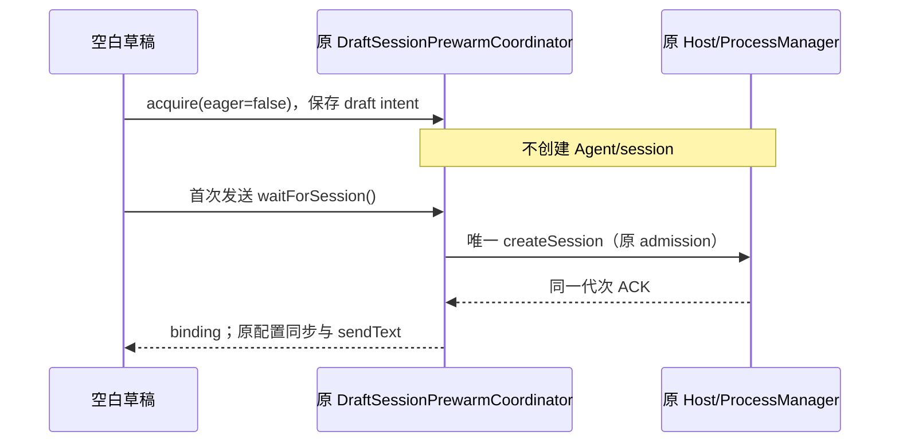
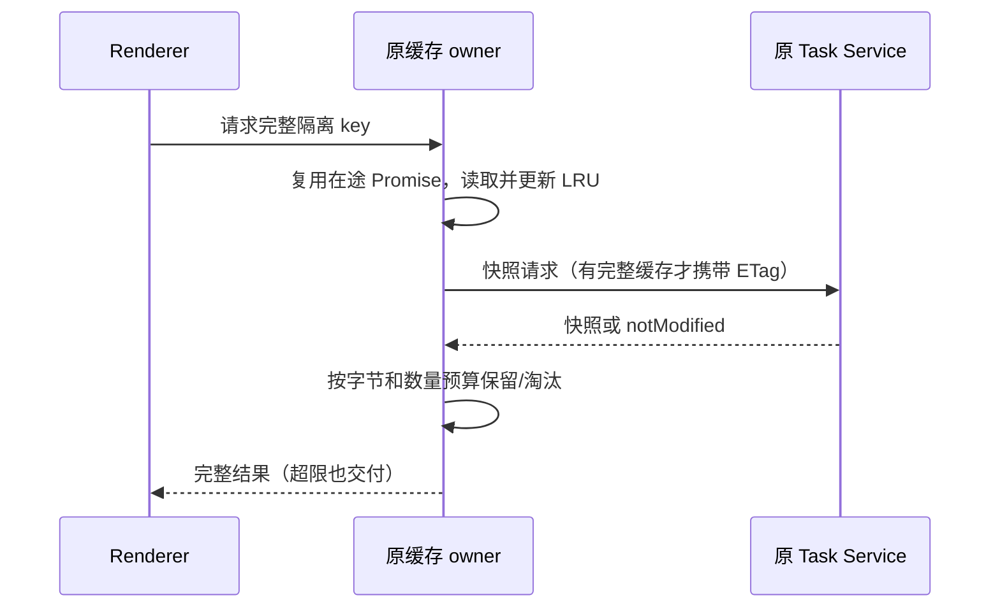

# aibuddy7se 内存优化

## 范围与规则

用户反馈刚启动以及执行任务、浏览网页时总 RAM 超过 1 GB。本轮先减少可确认的启动分配和无界缓存，不承诺未经测量的降幅。

- Win7 renderer 的代码/Diff Worker 池固定为 1 个，沿用 WASM 高亮引擎、任务队列、主题同步和主线程降级；文件与 Diff AST 缓存分别最多 16 项。其他版本沿用原策略。不能通过禁用代码高亮或丢弃待处理任务省内存。
- 设置页的两个入口均按首次打开加载本地 chunk，加载时沿用应用加载反馈；工作区组件保持挂载，草稿、终端和任务不中断。首次加载和再次打开都可编辑设置，离线可用。
- Shiki token 缓存按最近使用淘汰，最多 100 项、估算保留体积 4 MiB；超限单项照常返回但不缓存。计量是缓存预算，不等同于 V8 实际堆大小。完整代码参与 key，避免同长度同首尾的不同代码误命中。
- task snapshot 内存缓存每个 service 最多 20 项、UTF-8 JSON 预算 8 MiB，单项最多 2 MiB。超限或淘汰只移除缓存引用，不删除原会话、SQLite、磁盘数据或活动 UI。仍复用同 key 在途请求；缓存缺失时从同一 service 重取，Desktop continuous 和手机 replayable 等所有现有 key 隔离维持不变。
- 不按空闲时间回收聊天 Agent、Cron、扩展 Host 或浏览器活动页面；不关闭 GPU、不缩小 V8 堆上限、不强制 GC、不关闭安全隔离。已有离线 Office/Python/SSH/技能保持可用。

## 成包测量后的启动调整

第一次对照（Actions 43472414375，源码 06d2851b）发现：90 秒工作集合计仅由 1158.89 MiB 变为 1141.92 MiB；配置虚构模型后、未发送消息时已有 20 个进程，共 2439.36 MiB。10 个新增进程来自共享任务 Agent 的进程树，而 renderer JS heap 只有约 43.5 MiB。源码调用链为 Host initializeWorkspace 预热与空白草稿 createSession，两者提前初始化 Agent。不能据此把内存大幅增长归因于 Electron renderer 缓存。

- Win7 Host 不主动 initializeWorkspace 预热；真实打开历史、发送、自动化和显式能力请求仍走原服务 admission。现代 Desktop 保持预热。
- Win7 新草稿订阅原 DraftSessionPrewarmCoordinator，但不在订阅时创建会话。首次 `waitForSession` 在同一 owner 启动 createSession，并发发送等待同一个 Promise；模型/权限/思考档位仍由原 draft config owner 提供。会话创建期间切 workspace/transport/代次，旧等待失败，迟到结果按原规则删除，不能错误提交到新草稿。现代/Web 默认仍 eager。
- 这项取舍将首次会话准备时间移到首次发送；不把 `enabled=false` 当作懒启动，不另建发送专用会话路径，也不修改 accepted queue、owner/lease、desktop/mobile delivery kind。
- Win7 插件管理 lane 在没有在途操作且数据库准备完成后连续空闲 30 秒回收整棵树；下一次插件/技能管理请求透明重新启动。复用原 ProcessManager 的 idle 回收与 cleanup barrier，不建立第二个计时器或管理器。聊天 lane 不启用该策略，插件安装/配置/迁移请求未结束时不得回收。getClient 的明确使用重置空闲期限，避免刚交付 client 就被旧计时器回收。

追加验收：真实浏览器验证懒订阅/并发首次请求/清理/现代 eager；成包在配置模型并 reload 后仍没有共享任务 Agent，首次向本机虚构模型发送成功且只创建一个共享 runtime；插件管理空闲回收后再次读取离线技能成功。原始模型与内网服务仍未实测。

## 所有者与事件

原 DiffsWorkerPoolProvider 仍拥有唯一 Worker 池。React.lazy 拥有本地模块加载 Promise；原设置服务仍拥有配置。原 Shiki 模块与 task service proxy 分别拥有各自的可丢弃缓存，不另建任务状态。

在途请求持有本次缓存引用，其他请求的淘汰不会使 notModified 丢失正文；回收不改变 service 的 owner/lease、事件顺序或远程恢复协议。

## 验收

1. 类型检查、Lint/Hooks、架构检查和正常 pre-push；保留全部 Win7 Windows Actions 门禁，包括真实注册表安全负例。
2. 成包 GUI 首次/再次打开设置，修改语言、主题、自定义模型并 reload；系统自测与品牌截图保持通过。
3. 成包设置页代码预览验证 Worker 可完成高亮、主题切换与再次打开；浏览器缓存场景包含中文代码。确认 Win7 Worker 数为 1，构建入口未静态包含设置页 chunk。
4. 同一 Windows runner、同一虚构用户数据及运行时，对旧包/新包分别在工作区就绪后 30 秒和 90 秒取样，报告进程树的 working set 与 private bytes、renderer JS heap、Worker 数。采样不强制 GC，不打开资源管理器窗口；数值不代表真实 Win7 或用户真实任务/网站。
5. Windows 成包通过后只交付校验 SHA-256 的单个离线 EXE；记录实测差异及未验收范围。

验收结果待填，未测项目不得标为通过。

## 本地验证

- Node 24.14.0 / pnpm 10.33.2：两轮类型检查均通过，架构 0 新/基线违规；第一轮 Lint 536 项既有告警、0 错误，第二轮为 533 项、0 错误。Root 原有两个未使用导入现在用于 lazy/Suspense；draft hook 明确代次字段与已提交的配置函数，消除了相关依赖诊断。Root 的既有 appSettings 字段依赖、task hook 的既有条件调用未在本轮修改；draft 的 retainers Set 快照保留，避免删除时修改迭代集合。
- `node scripts/win7/renderer-memory-smoke.mjs /usr/bin/chromium`：真实 Chromium 挂载 service hook、虚构 RPC 快照，验证并发去重、在途 notModified 被淘汰仍完整返回、淘汰后重取、大快照不截断、不复用不同 identity/clientMode、token 中间修改不误命中、数量/字节双限额。结果通过；结束时快照 15 项 / JSON 7,864,959 bytes，token 7 项 / 估算 3,611,954 bytes。这是隔离缓存场景，不是真实模型任务验收。
- Win7 renderer 生产构建通过，SettingsPage 为独立本地 chunk（约 454 kB 未压缩传输体积，不能等同于节省 RAM）。新 Windows 门禁复跑同一缓存浏览器验收。
- 单行数万字符的 JavaScript 高亮压力样本耗时过长，本轮不宣称解决超长单行的 tokenizer CPU 问题；预算压力验收使用多行中文代码并保持相同预算断言。
- 第二轮真实 Chromium 验收追加通过：懒订阅不创建、并发首次请求共用 binding、未发送草稿清理、切换工作区使旧请求失败并清理迟到结果、promote 后不删除任务、默认现代 eager 行为保持。工程检查 28 项，本机 27 通过、1 项 Windows 原生注册表检查按平台跳过；Windows 必须全部执行。
