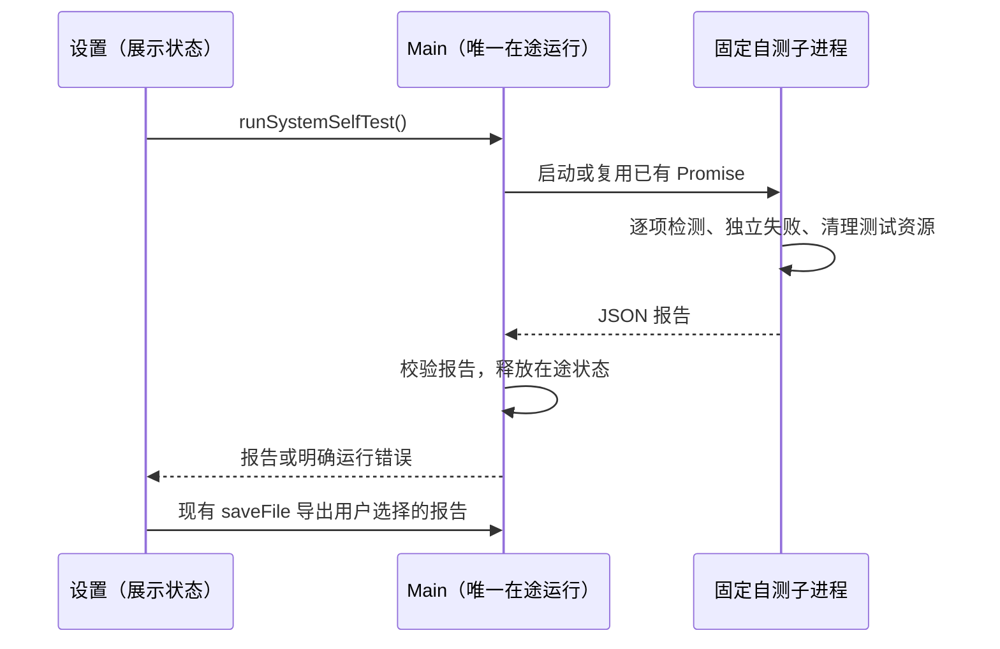

# aibuddy7se · Win7 特别版

## 产品规则与范围

- Win7 构建显示名、可执行文件、安装包、菜单及自身图标统一为 `aibuddy7se`，界面标注「Win7 特别版」。复用 `skyjt/ZCode_custom` 主分支 `eddafa6ec4517ccd71f2d5dbe0e917e855da8332` 的 AIbuddy 图标；保留上游署名和供应商图标。
- 本次是现有 Win7 包的升级：保留安装 appId、`.zcode-win7-home`、Electron `ZCode Win7 Experimental` userData、凭据键和内部协议，避免改名造成会话/配置丢失。现代 Desktop、Web、手机不切换产品身份。
- 设置 → 常规提供手动「系统能力自测」，不在启动或后台周期运行，不请求模型、不访问外网。一次运行逐项检查，单项失败后继续；明确通过、失败、警告、未测试，支持导出 JSON。
- 检查本机 OS/架构、Unicode 文件读写、SQLite、WinPTY、两套凭据组件、搜索工具、随包 Python/Office、PuTTY、WMI/PowerShell 2.0/.NET 调用。Git 缺失是可选能力警告；真实模型、SSH 服务器和 Win7 视觉/驱动兼容不能由本地自测宣称通过。
- 自测只操作独立临时目录与随机生成的测试凭据，结束清理；不读取会话、模型密钥或用户文件。报告仅含版本和检查结果，异常消息清除用户目录。
- Win7 默认减少动效；不挂载引导 WebGL 背景和装饰粒子/扩散 Canvas，启动图标静态化。保留必要的忙碌、错误、焦点提示，视觉结束回调涉及的业务动作仍立即交付；不禁用 GPU。

## 所有者、接口与事件顺序

构建标记拥有版本差异；Main 拥有唯一在途自测进程；隔离子进程拥有临时资源；UI 经 IPlatformService 发起并展示返回结果，不保存第二份系统事实。IPC 不接受脚本、命令或路径参数，Main 仅启动随包固定脚本，校验结构并限制总超时与输出。

不改变 Host、Agent、workspaceIdentity、owner/lease、Desktop continuous 或手机 replayable 的状态与顺序。多窗口请求复用同一次运行；重复点击禁用；组件关闭不改变已接受运行的所有权。

## 影响简表

| 场景/入口             | 共享实现与所有者                             | 差异与隔离                       | 验收                                  |
| --------------------- | -------------------------------------------- | -------------------------------- | ------------------------------------- |
| 安装/启动/关于/标题栏 | Win7 build/bootstrap、现有品牌组件           | 只切换 Win7 显示身份；存储键不变 | 图标、名称、旧数据路径断言            |
| 常规设置自测          | IPlatformService → preload → Main → 固定脚本 | Web/手机无入口；不访问远端 Host  | 实际点击、忙碌、逐项结果、导出        |
| 引导/高速视觉         | 原组件与模型选择 owner                       | 不挂载装饰 Canvas，仍交付回调    | reduced-motion、Canvas 缺席、业务回调 |

代码搜索使用精确 rg/调用点检查（当前无 Codegraph 服务）。已检查调用点包含 Win7 CI、三套冒烟、构建身份、renderer 启动壳、共享 logo/i18n、设置、平台 IPC 和高速视觉交接。新增 UI 放在现有受控模块；不增加依赖，不迁移旧 AIbuddy 主分支内部命名。

## 验收目录与覆盖矩阵

| ID  | 设置 → 动作 → 断言                                                                        | 状态/证据                                                      |
| --- | ----------------------------------------------------------------------------------------- | -------------------------------------------------------------- |
| B1  | Win7 构建 → 打包/启动 → exe/窗口/自身图标为 aibuddy7se，原 appId/数据库/userData 路径不变 | 工程断言、成包启动通过；Win7 覆盖升级未实测                    |
| B2  | 现代构建 → 启动 → 名称和 UI 不受影响                                                      | 默认 renderer 构建及原标题/SVG、类型检查通过；现代桌面启动未测 |
| S1  | 离线包进入设置 → 点击自测 → 按项结果、无模型请求；报告可导出                              | 防火墙阻断下结果、JSON 报告及导出按钮通过；原生保存对话框未测  |
| S2  | 某项探针失败 → 继续执行 → 失败可见且后续项有结果，临时文件清理                            | 工程回归及缺失安装资源探针通过，12 项结果返回并清理临时目录    |
| S3  | 连续点击/多窗口 → 同一 Main → 一次运行，无并行压力                                        | 成包两次并发 IPC 返回同一运行报告通过；实际多窗口点击未测      |
| M1  | 引导/工作区 → 查看 → reduced-motion 生效，无引导 Canvas，所选持续装饰动画静止             | 成包实际媒体偏好为 true、Canvas 缺席通过；样式检查通过         |
| M2  | 高速卡激活 → 视觉精简 → 呈现交接立即执行                                                  | 调用链确认仍交付既有呈现回调；高速权益运行场景未测             |

只检查已定义语义；无需模型回放 fixture（自测不调用模型），沿用现有 Win7 成包 UI 冒烟。用户已反馈旧包 Win7 安装和简单问答通过，这不代表新版自测或其他功能已在 Win7 验证。真实 Win7 SP1、驱动及内网 API 由用户机器的报告继续确认。

## 本地实现验证

- 工程回归 10 项通过；根类型检查通过；Lint 为 0 错误、538 项既有警告；架构 0 违规。
- 本次 React 文件额外无忽略 Hooks 扫描：仅发现既有 App useMemo 多余依赖、设置终端选项每次 render 重建；均与此次 logo/自测路径无关，新回调依赖无诊断。
- Win7 标记下 renderer 生产构建通过，HTML 标题与静态 AIbuddy 图标已检查。未新增外部依赖。
- 特性图新增种子文件/符号有效；无新悬空边，保留原有两个缺失端点。pre-push 门禁通过；其 affected engineering 因既有全选策略跳过 169 项，不计作测试通过；上面的 10 项已独立实际执行。

## 成包验收中的测试环境修正

第一次成包（024e654f，Actions 43147442412）运行时、Agent、PE、Python Office 和 SSH/SFTP 全部通过，UI 在 reduced-motion 断言处停止，后续自测界面未覆盖。确认 Playwright 的 page.emulatedMedia() 默认返回 no-preference 并经 CDP 覆盖原浏览器设置；本机带 force-prefers-reduced-motion 启动 Chrome 复现 false，emulateMedia({reducedMotion:null}) 恢复 true。验收连接后清除模拟，只读取产品真实值，不把模拟设为 reduce 来制造通过。补充同一次自测中的并发 IPC 请求一致性与 JSON 报告留存。

Actions 43150016981 第二次运行已通过自测 UI、12 项报告和并发请求一致性；主题切换脚本因主界面/设置页各有 login-trigger 触发严格定位失败。修正为 settings-page 内的触发按钮，保留现有双入口，不改产品 UI。第一次运行的旧进程采样空结果在同一提交复跑后通过，原因尚未确认，不改采样超时。

## 2026-11-12 成包交付

提交 `a0e2becdad84ba134f88ab598280b438db669d65` 的 [Actions 43153086647](https://github.com/skyjt/ZCode_custom/actions/runs/43153086647) 全部通过：工程回归、旧系统 API、现代/Win7 路径进程归属、成包 SQLite/WinPTY/凭据/搜索、Agent、PE 导入、离线 Python Office、SSH/SFTP、断网 GUI。实际 reduced-motion 为 true，深浅主题及中英文界面验收通过，已人工复查截图。

自测在 Windows Server 2022 返回 12 项：通过 10、失败 0、警告 1（系统不是 Win7）、未测试 1（真实外部连接/驱动），耗时 3183 ms。CI 的 PowerShell 是 5.1，不能据此宣称 Win7 PowerShell 2.0 实测通过。新版本的 Win7 真机、原生报告保存对话框、真实模型/SSH 和高速权益交互仍未验收。

- [安装包产物](https://github.com/skyjt/ZCode_custom/actions/runs/43153086647/artifacts/13915911361)：包含 EXE、便携 ZIP、指南、版本和摘要；保留至 2026-11-26。
- EXE：`aibuddy7se-3.18.0-win7-x64.exe`，253,228,038 bytes（约 253 MB / 241.5 MiB）。只交付此 EXE 即可安装，无需同时携带便携 ZIP。
- EXE SHA-256：`34d5c22b9c599c90359aaa3d792c40eff5d82d3dc8bc92f6c0efff5b6727b0f4`。
- [诊断产物](https://github.com/skyjt/ZCode_custom/actions/runs/43153086647/artifacts/13915741624)：自测 JSON、界面结果、中英文/主题截图、启动与 PE 记录。后续仅补充此验证记录，不改变以上安装包提交。
